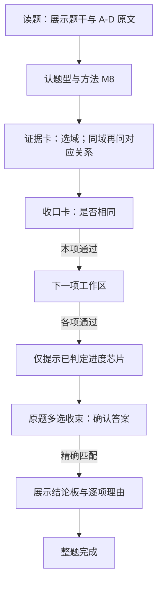

# T1 判断是否为相同函数：题型开发设计

更新：2026-10-28。状态：**Q19、Q20 均已加入“函数的概念”专题。Q19 真实拍题识别、求解 ABC、学生完整两层交互、刷新恢复与独立 AI 回放通过；独立冻结的 6 对函数及 2 道完整多选结构留出首轮通过。** Q19 静态专题 AI 回放 15/15、模式隔离及日常后台重启确认也已通过，实际验证范围见 [Q19 验收记录](function-equality-q19-acceptance.md)与本文 §9.2。独立新题的真实照片尚未取得，T1 整型仍未完成。两题均复用 M8「同一函数判定法」，四项清单选域，同域时在同一证据卡逐问完成对应关系，再用单独一张卡收口「是否相同」；**15 个内部评分决策需要 15 次确认，归并展示为 12 张卡**。M1 完整取证但不投影逐步卡。T2 未完成目标与 Q22 真实照片缺口继续保留，Q20 历史证据见[验收记录](function-equality-q20-acceptance.md)。

遵循[专题与拍题学开发流程](topic-and-photo-learning-development-workflow.md)（含 [§5.3.1 子方法交互密度](topic-and-photo-learning-development-workflow.md#531-子方法交互密度)），归属[函数的概念专题计划](function-concepts-topic-and-photo-learning-plan.md)。题面依据[3.1 知识图谱设计 §5.2](function-concepts-and-representation-knowledge-graph-discussion.md)；Q19、Q20 的原页与题目裁片均已回收、核对并归档。本文保留原设计要求与开工基线；题源归档、代码通过、真实拍题与浏览器验收分别记状态，后续门槛不自动算作通过。

## 1. 为什么下一型选 T1

既定顺序是 T2 具体定义域 → **T1 同一函数** → T3 抽象定义域 → T4 函数值 → T5 完整值域。T1 紧接定义域有三个收益：

1. 复用 M1「列条件求交集法」和 S3「提取表达式有意义的条件」，让已有能力成为新方法中的子任务。
2. 将“定义域与对应关系共同确定函数”落实为可验证的判断：相同须证明全域一致，不同须说明定义域差异或给出有效反例。
3. 建立原题多选的逐项数学判定、答案汇总和学习记录闭环，后续题型可复用这项能力。

### 1.1 上一题型的收尾与启动条件

Q20 开工前，专题有 Q15、Q01、Q22、Q04、Q12、Q23b 六题，不能写成 T2 全题集已完成。Q20 收录后专题为七题，以下 T2 状态继续保留：

| T2 范围 | 当前应记录的状态 |
| --- | --- |
| Q15、Q01、Q04、Q12、Q23b | 已有各批验收记录；证据范围以各文档为准 |
| Q22 | 已有规范候选和课包链路；真实照片及完整双入口证据仍待补齐 |
| Q9 定义域、Q14、Q21 两问、Q23(1) | 尚未完成对应题目的验收；底层结构部分可用不等于整题已通过 |
| Q24 建模及关联最值问 | M11 与前后问依赖待建设，需核对必要原图 |

**排期调整已记录：用户指定按已讨论的两层交互设计先实现 Q20，现已完成本轮代表题。** T2 剩余目标继续按上表保留在后续批次，不删除待办、不将未验收题标为通过，也不要求借此一次完成任意定义域问题。

## 2. 题型、方法与批次范围

| 项目 | 设计 |
| --- | --- |
| 题型 | T1「判断是否为相同函数」，沿用 `type-function-equality`；Q20 首批受限范围已激活 |
| 任务 | 比较一对函数；逐组选出相同函数；从若干候选中选出与给定函数相同的函数 |
| 入口方法 | M8「同一函数判定法」；已登记全局 ID `method-function-equality` |
| 核心路线 | 确定各自定义域 → 比较定义域 → 在共同定义域比较对应关系 → 汇总结论 |
| 子方法 | M1 `method-domain-intersection`；保留原函数、题设限制及来源 |
| 首批代表题 | Q20，四组选项全部贯通后才算代表题完成 |
| 后续完整题集 | Q19；两题均属于开发／回归集，不作为留出新题 |
| 专题安排 | Q20、Q19 已纳入，Q19 使用本轮真实执行证据生成课程并已发布到隔离与日常本地实例；静态专题浏览器与后台重启验证见 §9.2 |

### 2.1 第一批：Q20 的结构范围

限实数、一个自变量、固定有理数系数、非空定义域。可比较下列受限形式：至多二次多项式、仿射式的绝对值、仿射式平方的算术平方根、仿射根式的平方；允许自变量改名及明确给定的有理端点区间，**包括显式单点域**。这里“仿射式”包括常量及正、负、零系数分支。

**`abs` 是 Q20 的阻断前置，不能推迟到 Q19。** C 组的 `abs(x)`、`sqrt(x^2)`，以及与 A 组 `(sqrt(x))^2` 的对照，要求原图提取、记法编译、原式显示、定义域条件、恒等化简与独立验证全部贯通。S0 逐项探测，S2 冻结表示，S4 完成数学能力；只接收 `abs` 语法或只通过某个化简测试，均不能开放 Q20。Q19 后补的是绝对值内部的二次式判号及四次被开方数的平方结构，不是首次接入绝对值。

显式给定的 `[a,a]` 与 `{a}` 在第一批 IR 中均受支持：保留原文及其声明归属，数学层规范为单点集合，按该点比较原式。`[a,a)` 等退化空区间不得被规范成单点；空域按无效函数声明处理。该表示须经 S2 编译夹具验证，不能仅在 §8 写一条求解器单测后假定提取已支持。

这些是按表达式结构定义的输入族，不是 Q20 的数字白名单。原式的自然定义域与显式输入限制分别保存。题面若明确声称某定义域、原式却在其中无意义，应报告条件冲突，不能悄悄删去非法点后判为相同函数。

输入范围内的常规分支一次覆盖：定义域相同／不同，正负零输入，区间端点，完全相同／恒等化简／仅部分点相同，以及变量改名。有限试值不能作为肯定证明；能力未知不能转成“不相同”。

### 2.2 第二批：Q19 的结构扩展

**2026-10-28 已冻结并实现的结构契约：** 限一个实自变量、固定有理系数，原式与各自题设范围始终保留。沿用 §2.1 已有输入族，并新增以下结构：

| 结构 | 准入与证明边界 |
| --- | --- |
| `abs(Q)` | `Q` 是至多二次多项式；无实根、重根、两个有理实根、退化为一次／常量及恒零全部支持。存在实零点时须全部有理；含无理零点的二次式本批不开放 |
| `sqrt(Q^2)` | 原始 AST 必须明确为平方的平方根；`Q` 满足上一行。先用 `sqrt(Q^2)=abs(Q)`，再按全部零点分区判号；一般四次根式即使可事后配成平方，也不属于这一结构 |
| `P + abs(Q)` | 原式顶层为加法，一侧为至多二次多项式 `P`，另一侧为 `abs(Q)`；两侧可换序。`Q` 满足有理临界点边界；不扩成任意多层绝对值运算 |
| `(Q*L)/L` | 原分子须为显式两因子乘积，因子可换序；`Q` 至多二次，`L` 为非恒零仿射式，分母与被约因子的有理系数一致。常量非零 `L`、零多项式 `Q` 等退化情况也覆盖；原分母禁取点始终保留，不开放任意展开有理式的自动因式分解约分 |
| 显式去点域 | 从全体实数、有理端点区间或单点域中，一次去掉不超过 **16** 个有理点。受控表示为 `D setminus {a,b}`，编译为 `set_difference`；不把算术减号当集合差，不开放嵌套差或任意集合并。去点后的空域、声明域包含原式非法点仍分别报告无效／冲突 |

沿用统一 AST 256 节点、深度 24、有理系数分子／分母各 128 bit 等结构预算；去点数量也在准入、执行和验证中共用。以上是结构族边界，不按 Q19 的题号或系数开白名单。

Q19 的 `sqrt((2*x^2+1)^2)` 展开后是四次被开方数。本批 M1 已识别原式平方结构，保留原根式条件及 AST 位置，以平方非负依据归一；独立验证仍从原树求值和检查临界点。比较层按全部有理零点及定义域边界覆盖完整分区，生成二次多项式恒等证据；验证器另行计数每个区间中的多项式实根，拒绝漏掉符号变化的证明。提取阶段不提前化简原式。

### 2.3 本轮明确不开放

含参函数的同一性分类、任意超越函数、复杂嵌套根式、一般高次恒等判定、抽象函数方程、图像／表格之间的同一性及任意分段函数。空定义域、无效函数声明需按高中函数的非空定义域语义处理，不凭空集上的恒等关系给出“相同函数”。

范围外任务保留真实题意并说明能力缺口。只出现根号或分母，不得将 T1 主目标改判为 T2 求定义域。

## 3. 代表题与数学金标

### 3.1 Q20：第 82 页例 5 变式 1

多选：下列各组中，表示同一函数的是哪些？

| 选项 | 两个函数 | 定义域与证明 | 判定 |
| --- | --- | --- | --- |
| A | $f(x)=x$；$g(x)=(\sqrt{x})^2$ | $D_f=\mathbb R$，$D_g=[0,+\infty)$；例如 $-1$ 只属于前者。化简后形式相同不能补回负数输入 | 不相同 |
| B | $f(x)=x^2$；$g(x)=(x+1)^2$ | 两域都是 $\mathbb R$；输入 $0$ 时输出分别为 $0$、$1$，构成有效反例 | 不相同 |
| C | $f(x)=\sqrt{x^2}$；$g(x)=\lvert x\rvert$ | 两域都是 $\mathbb R$；对每个实数 $x$，$\sqrt{x^2}=\lvert x\rvert$ | 相同 |
| D | $f(x)=3x^2-2x+3$；$g(t)=3t^2-2t+3$ | 两域都是 $\mathbb R$；比较同一个输入 $u$ 时，两式都给出 $3u^2-2u+3$ | 相同 |

答案为 **C、D**。上述表格是设计金标，实际学生页面不得在作答前展示整张结果表。

注意 C 与 A 的结构不同：`sqrt(x^2)` 对所有实数有意义，`(sqrt(x))^2` 仍要求 $x\ge0$。D 只允许绑定自变量改名，不允许把参数或自由变量任意换名。

### 3.2 Q19：第 81 页例 5

多选：与 $y=2x^2+1$ 表示同一函数的是哪些？

| 选项 | 候选表达式 | 核验要点 |
| --- | --- | --- |
| A | $x^2+\lvert x^2+1\rvert$ | $x^2+1>0$，全域化为 $2x^2+1$ |
| B | $\sqrt{(2x^2+1)^2}$ | 先化为 $\lvert2x^2+1\rvert$，再由 $2x^2+1>0$ 去绝对值 |
| C | $\lvert2x^2+1\rvert$ | 用正性依据证明全域相等 |
| D | $\dfrac{(2x^2+1)(x+1)}{x+1}$ | 约分前仍要求 $x\ne-1$；与原函数定义域不同 |

答案为 **A、B、C**。Q19 是代表题之后的扩题验收门；实现平方结构和绝对值判号时补齐已声明输入族的全部常规分支，不仅证明这两个恒正二次式。

### 3.3 题源状态与样本角色

2026-10-27 设计时仅有 Q19/Q20 的完整题面整理，原图尚未归档。**2026-10-28 已回收并归档 Q20 的原上传第 82 页照片、矩形裁片、送模图及 [manifest](../internal/senior-high/source-images/function-concepts-q20/manifest.json)**，记录原页、裁剪坐标与各自 SHA-256。真实提取与原图复核共 2 次模型调用、2 次网络尝试，耗时 33.375 秒，首个可联网提取／复核结果即通过；录制见 [recording.json](../server/tests/search/fixtures/function-equality/q20-recorded-20261028/recording.json)。后续 API 回归重放该录制，不计为新增真实模型调用。

Q19 的第 81 页原页、包含题干与 A–D 的一次矩形裁片及 [manifest](../internal/senior-high/source-images/function-concepts-q19/manifest.json) 已归档到 `internal/senior-high/source-images/function-concepts-q19/`。原临时附件已失效，本次从同一用户消息的本地会话图片字节恢复，归档说明保留这一来源限制；未重绘题面。最终真实拍题 `c8acac7d5768` 的 extract／review 共耗时 28.976 秒、无 repair；执行 `0108ac815d654145a54f5c737e498a09` 完成并独立验证 ABC。首轮失败及修复保留，不能只记录成功重试；详见 §9.2 和 [Q19 验收记录](function-equality-q19-acceptance.md)。

可从同批 [Q23b 来源清单](../internal/senior-high/source-images/function-concepts-q23b/manifest.json)追溯原上传会话；该清单指向第 83 页，不能将它直接当作 Q19/Q20 的图片证据。原附件无法回收时再补来源，不能把重排 Markdown 的截图冒充原题照片。

- Q20：代表题开发集，A–D 完整保留，不拆成四个伪造的原题小问。
- Q19：已知扩题集，允许用于能力开发，不能声称是未知题泛化测试。
- §8 的具体案例：公开的开发／回归用例。
- 留出集：已另行冻结 6 对新函数及 2 道完整多选新题，数学实现代理未读取这些输入；包含两种选项组织方式及“选不相同”的极性。首轮结构验收全部通过，冻结来源见 [q19-heldout-frozen.json](../server/tests/solver/fixtures/function-equality/q19-heldout-frozen.json)。这组结果只证明受控输入的结构链路，不作为新照片验收；后续不得用已公开输入调试后仍称首次留出。
- 真实拍题：Q20 已有原图提取／复核、拍题执行与两层交互验收；Q19 的最终新调用、正常拍题学生 15/15、刷新恢复与独立 AI 15/15 已通过。静态专题 AI 15/15、切回学生 0 步及日常后台检查亦通过，证据单列于 §9.2。至少 1 道独立完整多选新题的真实照片尚未取得，该门仍未通过，不以结构留出或录制回放代替。

## 4. S0：复用核查与开工探针

以下保留 **2026-10-27 开工前的历史代码核查基线**，不是当前实现状态，也不是当时已运行探针通过的记录。Q20 首批补齐结果见 §9.1 与验收记录；Q19 第二批现状见 §9.2。

| 项目 | 已有基础／当前缺口 | 开工探针与交付 |
| --- | --- | --- |
| 题型节点 | `type-function-equality` 已登记，但仍 `planned`，专题 `equality` 组为空 | 新目标准确识别；未支持结构不能因节点已存在而启用 |
| 最小 IR 与选项作用域 | Q20 四组重复使用 `f/g`；现有 `children` 表示原题小问，不能直接复用为选项 | S2 先冻结 §5.1 的比较目标、局部作用域与共享引用，通过 schema、编译、身份去重及复核／修复定位夹具，再改模型提示词 |
| M1 借用 | `stage_one/function_domain.py::describe_domain_goal` 拒绝其他可见定义／条件 | 建立带来源的单函数子任务绑定，从多函数比较上下文调用 M1；不能删除实际影响该函数的条件来绕过准入 |
| **根式与绝对值：Q20 阻断项** | M1 可处理当前受限根式和整数幂；`abs` 尚未接入该链路 | `abs(x)`、`sqrt(x^2)`、`(sqrt(x))^2` 分别验证提取、编译、显示、求域、化简和独立验证；任一缺失均阻断 Q20，不记到 Q19 待办 |
| 显式定义域 | 自然定义域可求出，不等于比较对象的显式域已能提取与绑定 | `[0,0]`、`{0}` 规范为同一单点集合且保留题设来源；不能丢失限制后按全实数域判定 |
| 全域恒等 | 已有 `skill-simplify` 身份，不等于 M8 的全域验证已可用 | `sqrt(x^2)=abs(x)` 全域成立；`sqrt(x^2)=x` 在负半轴失败，有限试值不得证明相同 |
| 原题多选与学生进度 | 通用步骤 `multi` 按 `required ⊆ selected ⊆ allowed` 评分；`choice_matching.py` 拒绝原题多选，`handoff.py` 仅接单选结果；现有终答卡由数学完成投影生成 | 采用逐项工作区与结论 `choice`，全部学习判定通过才开放独立的原题精确集合评分；**禁止复用步骤 `multi` grader**，不能仅凭数学完成解锁终答；贯通静态／流式、服务端前置校验和恢复 |
| 目标极性 | Q19/Q20 金标都问相同，不能据此默认所有任务都问相同 | 首版比较目标与结果携带 `equal/different` 的选择要求；缺失或不明阻止完整结果，问不同的答案按逐项判定重新汇总 |
| 主目标完成 | 当前 `goals.py`／`execution.py` 以集合、定义域、求参及最值结果为主；原题选项匹配是求解后的可选增强 | 新增函数比较与标签集合的完成／验证协议；任何一项未知都不能 solved，不能强塞成参数解集 |
| 共享引用 | Q19 的一个基准函数供四项比较；Q20 每项两函数 | 两种结构都保留引用与局部范围；选项换序后证据和答案跟随身份而非下标 |
| Q19 平方结构（第二批实施前） | 当前根号内多项式次数上限为 2 | 精确识别 `sqrt(U^2)`；保留 `U` 的原始限制，拒绝借机接收任意四次根式；不作为 Q20 首批纳题前置 |
| 预算与指纹 | 已有共享预算和 `runner.fingerprint` | 新解析／比较／验证依赖均被收集；边界输入在准入、执行、验证一致，内容变化拒绝旧续算 |

探针不通过先补相应公共契约或实现，再接完整代表题。不要因首题只需某条分支而将常规反例、恢复或多选遗漏检查留到扩题阶段。

## 5. 题意、方法与证据契约

### 5.1 题意表达：比较函数，不是求某个输入

**S2 必须先冻结最小 IR，再编写提取、复核和修复提示词。** 比较目标采用 `compare_functions` 语义，下表是本批必须具备的最小结构；字段拼写、版本及 JSON 路径在 S2 的 schema／夹具中定稿。不得以“先让模型输出，后面再适配”替代这一验收门。

| 结构 | 首版必须表达的语义 |
| --- | --- |
| 比较目标 | `kind=compare_functions`；模式区分直接一对、逐组选项、共同基准选项；目标属于真实整题或小问 |
| 题目要求 | 选择题必须显式携带 `select_relation=equal/different`、原文要求及选择模式；直接比较一对时返回关系判定，无需伪造选择极性。极性未知不能默认 `equal`，选择模式不从正确项数量反推 |
| 共享上下文 | 保存题面共同条件及基准函数；共同基准模式用明确的 `baseline_ref` 引用，不能仅凭函数名猜测对象 |
| 选项作用域 | 每项包含稳定身份、原标签、展示顺序、原文、局部函数定义与显式条件，以及比较双方引用；待判断的关系不能放入已知事实 |
| 函数对象 | 保存原函数记号、绑定自变量、未化简的定义字符串、题面显式域及来源；数学编译后生成作用域限定的函数引用与 AST。不把自然定义域推导结果填成题设 |
| 显式域 | 区分题面声明与未给出；首版支持 §2.1 的区间和单点域，第二批按 §2.2 增加一次去至多 16 个有理点，保存原表达及所属函数。编译后 `[a,a]` 与 `{a}` 同为单点集合，空域与原式在声明域内无意义另报无效／冲突 |
| 完整性与定位 | 保留缺项、截断、无法辨认状态；编译后每个目标、选项、函数、范围有可回溯的来源路径，供复核、修复、证据与身份计算共同引用 |

**原始提取与数学编译分层。** 模型继续输出受控数学字符串，不输出 AST、化简式、自然定义域或判断答案；代码解析原式并绑定作用域。原式语法必须保留 `sqrt(x^2)` 与 `(sqrt(x))^2` 的差异，不能在通用代数自动化简后才建立限制条件。模型侧的局部引用经校验后，才转换为执行层的稳定引用。

Q20 的 A–D 是比较目标下的选项对象，不是 `root.children`；八个函数不能平铺为同一作用域内重复的 `f/g`。每项只允许引用本项对象或明确的共享对象，不能引用兄弟选项的局部函数。Q19 的公共基准定义一次、四项明确引用；候选的局部记号即使与基准重名，也不能遮蔽显式基准引用。`children` 继续只表示原题真实小问；若真实小问内部包含选择题，选项仍属于该小问的比较目标。

最小 IR 冻结须同时通过以下离线夹具，不能只验证 JSON 合法：

1. Q20 四组选项、Q19 公共基准的原始候选 → schema 校验 → 编译与引用解析 → 面向学生的原题显示；Q19 在此只验证表示，不要求第二批数学求解已可用。
2. 同名函数不串域，越作用域引用、悬空引用、重复对象身份、缺项及重复标签可定位拒绝；多个选项引用同一公共基准是合法复用。换序后引用与证据跟随选项身份，修复定位不能依赖失效数组下标。
3. 显式单点域、问不同及极性不明进入上述同一链路。复核和修复针对当前候选版本定位到具体选项／函数／范围；不得修复 A 项却改写 B 项，旧版本定位不可直接套用到新候选。
4. 公共题目身份与去重包含完整比较要求、极性、选项结构、函数原式、显式域和基准引用关系；不能只哈希题干或正确答案。原始函数内部 ID 仅为引用标识，重建 ID 不应改变数学内容身份；不同极性、限制或候选内容不能错误合并。

以上契约及版本冻结后，再同步 [graph-stage-one-source-rules.md](../internal/llm-prompts/graph-stage-one-source-rules.md)、表达式目录和三阶段提示词。提取、原图复核、修复使用同一份作用域、原式、极性和来源规则；阶段一不提前计算真假或答案字母。冻结的离线题面夹具不能替代 S1 原图归档和 S7 真实拍题。

### 5.2 M8：同一函数判定法

| 项目 | 契约 |
| --- | --- |
| 输入 | 两个来源明确的实函数对象，原式、各自绑定自变量、题设限制与实数语义 |
| 前置 | 两个对象有效、定义域非空，结构与预算属于本批可完整处理范围 |
| 第一步 | 分别调用 M1 或复用同版本已验证的定义域产物，获得完整定义域及原式条件 |
| 第二步 | 比较定义域；不同则给集合差异及一个只属于其中一域的输入，不必继续比较对应关系 |
| 第三步 | 同域时把绑定自变量规范为共同输入，以有依据的化简／分支证明全域相等，或给出域内输出不同的反例 |
| 输出 | 相同／不同／未能完成；两域、判定依据、全域证明或反例，以及引用的子任务证据 |
| 验证 | 从冻结原式、原范围与证据复核两域和全域结论；主目标不得停在“定义域已求出” |

数学判定依据为 `function-concept#identity`：

$$
f=g\quad\Longleftrightarrow\quad D_f=D_g\ \text{且}\ \forall u\in D_f,\ f(u)=g(u)
$$

内部结果必须区分数学否定与能力未知。每项返回 `equal/different/unresolved` 及证据；选择题完整结果同时绑定原目标的 `select_relation`，由已验证的逐项关系生成标签集合。问不同不是把未知项算入“相同标签”的补集。只有全部选项均得到有效判定，才能输出完整正确项集合；缺失极性或未判断的一项都阻止完整结果。

当前原题选项匹配属于“数学求解后的可选增强”，匹配失败可以不影响原数学结论；**T1 的逐项函数比较本身就是数学主目标，不能沿用该可选失败语义。** 先由 M8 对所有选项形成完整且验证通过的数学结果，再由共同原题多选交互收集学生答案。布尔值／标签集合使用明确的结果类型，不伪装成某个参数的可行解集。

数学完成与学生学习完成分别记录：求解器四项都验证通过，只表示具备完整数学结果。自己做模式必须逐项完成必要证据步骤及本项结论 `choice`，四项均通过后才开放原题终答；终答精确匹配后才标记学生整题完成。不能因后台已求得 CD 就跳过 A 的域差或 B 的反例。

### 5.3 全域证明与反例

1. 先冻结两边原始定义域，再做化简。`(sqrt(u))^2=u` 使用 `u>=0` 的已有条件，不能扩大输入范围；约分始终携带原分母非零条件。
2. `sqrt(u^2)=abs(u)` 要求 `u` 本身有意义且为实数；去绝对值时记录符号依据。跨正负区域须证明分支覆盖完整定义域、端点归属正确。
3. 本轮受限式经有证据的化简后，在每个分段比较精确多项式。不能因 CAS 未能化简成零而直接判“不相同”。非零多项式须在有效分段构造精确反例并代回原式；单点区间单独代入。
4. 否定反例满足：定义域不同则点位于对称差；对应关系不同则点位于共同定义域且两个原式均有意义、输出确实不同。试到一个两边都非法的点不构成反例。
5. 独立验证器重查条件与证明证书，不只复读执行器布尔值。篡改定义域、正负分支、反例输入或最终选项集合都应被拒绝。

### 5.4 知识、技能与判断的粒度

| 节点／条目 | 用途与安排 |
| --- | --- |
| `function-concept#identity`、`#elements` | 同一函数定义与原定义域保护，直接复用 |
| `square-root-expression#meaning` | 根式合法性与算术平方根非负，直接复用 |
| `absolute-value-concept#rules` | `sqrt(u^2)=abs(u)`、分正负去绝对值，已有正式知识依据 |
| `rational-expression#meaning` | Q19 分母非零，复用并保留来源 |
| `rational-expression#cancellation` | 原分母非零范围内约去共同仿射因子，约分不补回禁取点 |
| `skill-expression-defined` | 由 M1 调用；为 `abs`、平方结构补共享支持，仍不负责全题判定 |
| `skill-simplify` | 复用节点及能力框架，补本轮根式／绝对值的有效条件和化简证据；依据关联随实际操作补充 |
| 集合比较、变量绑定改名、反例核验 | 暂作为 M8 内部操作，不为每个小判断新增公共技能 |

M8 首批只有一条入口路线，不预建空的公共选法规则。方法中“域不同即可否定／同域继续比较”属于 M8 的步骤判断。M1 的数学借用与交互档位按 §6.0–§6.2 执行：默认 `light`；升到 `full` 时适用公共选法判断节点则让学生再次选择，否则只读借用确认；完成后返回当前选项的比较任务，不能替学生提交本项结论或提前完成整题。

## 6. 学生教学与交互设计

两入口共用 `graph-walk` 运行时、交互投影和版本化评分契约。产品形态采用**先逐项判真，再原题多选收束**：选项工作区依次完成，最后一张原题多选答题卡。不能用一张步骤 `multi` 勾选 A–D 代替整段解题过程。

两条硬规则：**每项先做证据（选域；同域再问对应关系是否等价），再用单独一张卡收口「相同／不同」；自己做模式在终答通过前，进度区与收束卡不集中展示各项 verdict 文案或正确字母。** 单项学习中的反馈及主动只读回看保留，完整结论板在终答通过后展示。不得把答案写进题干后只让学生猜「是否同一函数」。

通用密度约定见流程 [§5.3.1](topic-and-photo-learning-development-workflow.md#531-子方法交互密度)；下文是 M8 的方法级声明。

### 6.0 M8 教学表面与密度策略

M8 的主线只练两件事：**定义域是否相同**、**对应关系是否等价**，再汇总结论。求域（M1）是工具，不是本方法默认教程。

| 声明项 | 内容 |
| --- | --- |
| 主问题 | ① 自选两侧定义域；② 同域时 `correspondence_equivalent?`；③ 单独 `choice` 收口「相同／不同」 |
| 子方法 M1 | 档位 `fold` \| `light` \| `full`；**学生表面默认 `light`（选域清单）**；后台证书仍可按平凡域记 `fold` |
| `fold`（证书／旧设计） | 平凡域或同版本已验证复用：数学上可不展开 M1 逐步卡；**Q20 学生侧仍用选域清单，不改成只读一句** |
| `light` | **清单自选**两侧定义域（题干不预写答案）；**不**展开找限制 → 列条件 → 解集的 M1 逐步卡；后台仍完整求域并保留证据 |
| `full` | 完整借 M1 交互（转化说明、可选选法、限制／条件／解集）；仅当本步明确以「求该函数定义域」为教学目标，或 `light` 无法钉住关键误解（如化简补域）且升级条件满足时使用 |
| 升级条件 | 域非平凡 **且**（本选项的教学焦点就是求域过程，或产品显式要求演示 M1）；逐项选择题中同一套 M1 全流程不得对多侧机械重复 |
| 禁止 | 用「凡选择题」禁用数学借用；用「凡非平凡域」默认 `full`；把 `needs_borrow=true` 直接映射为 `full`；题干给出域／证明后再只问「是否同一函数」 |

任务形态只作默认密度信号：逐项选择／单对判定默认 `light`；叙述证明放在对应关系**反馈**中，仍不默认 `full` 求域。

**Q20 已实现主线：**

| 项 | 学生证据卡 | 收口卡 | 说明 |
| --- | --- | --- | --- |
| A | ① 清单自选两边定义域（域不同则无②） | 「是否相同」 | 钉住「\((\sqrt{x})^2\) 不能补回负数」 |
| B | ① 选域 + ② 对应关系是否等价（同卡两小问） | 「是否相同」 | 反例在反馈与对应关系结论板 |
| C | 同上 | 「是否相同」 | 分段恒等证明在反馈，结论板展示两边原式 |
| D | 同上 | 「是否相同」 | 改名说明在反馈，结论板展示两边原式 |

实现要点：交互合并 `equality_domains` + `equality_correspondence` 为同一流式证据卡（`equality-evidence`）；`equality_verdict` 始终单独成卡。不设空读的「比较对象」卡——原式写在选域题干中。全集实数在教学表面统一为 \(\mathbb{R}\)，不得同时提供 \(\mathbb{R}\) 与 \((-\infty,\infty)\) 作为互竞选项。Q20 有 **15 个内部评分决策／15 次确认**：入口 3 + A 2 + B/C/D 各 3 + 原题多选 1。同域项的选域与对应关系在同一张卡中分别确认，因此归并为 **12 张展示卡**，不减少确认次数。Q19 同为 15 个决策／15 次确认、12 张卡，但同域项是 A–C，D 只有选域与收口两个决策。无 M1 学生逐步卡。



流程中的“通过”包括当前选项的必要证据步骤和结论 `choice`；任一步答错均留在当前步骤。执行器按原题选项列表生成工作区，不硬编码为四项。

### 6.1 选项工作区：一次完成一项判断

按原题顺序推进，一次只展开当前选项。题面高亮当前项，其他项显示待办／已完成进度。Q19 工作区展示“公共基准 vs 本项候选”，Q20 展示“本项两函数”；二者共用逐项判定流程。

| 阶段 | 学生做什么 | 交互形态与数学来源 |
| --- | --- | --- |
| 进入本项 | 看清比较双方 | 原式写在选域题干；不单独发空读「比较对象」卡 |
| 比定义域 | **自选**两侧定义域（题干不预写答案）；`full` 才走 M1 逐步卡 | 证据卡第一小问（`checklist`）；完成卡用两边域与 `=`／`≠` |
| 比对应关系 | 同域时判断是否**等价**；证明／反例细节放反馈 | 证据卡第二小问（`choice`：等价／不等价）；域不同则跳过 |
| **本项收口** | 明确「相同」或「不同」 | **下一张**单独 `choice`；答案与已验证数学判定核对，不能使用 `multi` |

#### 6.1.1 完成卡结论板（已实现）

| 卡 | 结论板内容 | 不要做什么 |
| --- | --- | --- |
| 定义域 | 两边域名 + `=`／`≠`（如 \(\mathbb{R}\neq[0,\infty)\)） | 不把域答案写进作答题干 |
| 对应关系（不等价） | 「输入 \(a\) 时的输出」：\(f(a)\) 与 \(g(a)\) 用 `≠` | 不贴无上下文的分段证明片断 |
| 对应关系（等价） | 标题「对应关系等价」；两边**原式**用 `=` | 不单独贴某一负半轴片断如 \(-u=-u\) |
| 收口 | 标题「本项比较」；两边**函数式**用 `=`／`≠`，并写「本项结论：相同／不同」 | 收口卡不再单列定义域（域已在证据卡展示） |

证明全文、反例叙述放在该步**反馈**中，供答对／答错后阅读；AI 回放与只读回看共用同一投影。

**默认密度为 `light`，不是「非平凡就 full」。** 轻问不省略数学执行和证据，也不能折叠掉本项结论 `choice`。Q20 的 A 聚焦域差，B 核验反例，C 证明根式与绝对值全域相等，D 核对绑定自变量改名；不要求每项重复相同数量的点击。

本项完成条件为：数学证据验证通过、本项必需交互及阅读确认已完成、学生结论 `choice` 通过。只猜对「不同」，没有完成域差／反例学习，不算本项完成；后台数学结果、AI 回放和浏览器自报 `passed` 都不能代替这些条件。

收口答对后，将学生提交及其所依据的数学结果绑定到本项，进度显示 `A✓`，解锁下一项。答错则停在本项，反馈具体误解，例如「化简相同不能补回负数输入」，不解锁后续项或终答。学生 verdict 与数学判定是分别记录的对象；错误答案不会覆盖已验证的数学结果。

已通过项在当前练习中锁定，只允许主动点开只读回看；不能直接改 verdict。每项 M8 与其 M1／技能调用都有独立执行记录，图谱显示 `T1 → M8（当前项）→ M1…`；切到 B 时不能覆盖 A 的记录。跨项导航与恢复规则见 §6.4。

共同展示规则：

- 原题多选采用 §6.3 的独立精确评分；复用控件不复用步骤 `multi` grader。
- 原题问「不同的函数」时，由逐项真假及目标要求产生答案，不能直接把「相同」的标签作为答案。正确项为零项、单项或全项均不可用硬编码排除；与题面明确约束冲突时报告冲突。
- 前端、服务端评分与 AI 回放消费同一份已验证答案投影；AI 回放不向学生 grader 提交，不产生学生作答通过记录。刷新保留草稿，切换学习方式、只读回看、子方法返回和重复提交均按 §6.4 保持各自进度。
- 数轴比较定义域，输入输出表展示反例；曲线和少量采样只能辅助观察，不能冒充全域证明。不为这一型预建新的三维组件。
- 图谱展示实际发生的 T1 → M8 → M1／技能调用；同一技能的多次调用归属不同选项和步骤，不混为同一个执行记录。`light` 时图谱仍可记录数学借用，不要求学生点完 M1 逐步卡。
- 反馈使用具体误解：「约分没有补回原来不能取的输入」「平方根的结果非负」「字母不同不影响同一输入对应的输出」；不制造难懂的抽象干扰项。
- 工具栏只由共同运行时提供；纯数学推导行不机械追加中文句号，说明文字正常使用标点。

### 6.2 M8 → M1：转化、借用、返回当前选项

沿用 M6 已建立的「转化子问题 → 选法平面或直接借用确认 → 返回主线」的叙事，并叠加上节档位。现有 `stage_three/domain_borrow.py` 专用于含参二次子问题，不能直接调用它来处理 M1；复用公共交互协议，并建立 T1 的作用域绑定和返回投影。

| 时机 | 学生看到／操作什么 | 必须保留的上下文 |
| --- | --- | --- |
| 进入一组选项 | 选域题干展示左右原式；先弄清两边定义域 | 父目标、选项身份、两边函数引用及各自原题条件 |
| `fold`：平凡域证书 | 后台可记 fold；Q20 学生侧仍用选域清单 | 数学产物仍归属本选项与本侧；不得按 `f/g` 名字直接复用别组结果 |
| `light`：选域结果 | 清单自选两侧定义域；不进入 M1 逐步卡 | 后台已求域；差异证据与来源可回看；`needs_borrow` 可为 true 而交互仍为 light |
| `full`：非平凡且升级 | 在当前卡内显示转化，例如「A 组右侧：先求 $(\sqrt x)^2$ 的定义域」 | 子目标绑定原式及有效题设条件，保留调用来源 |
| `full` 且存在适用公共选法判断节点 | 转化后插入该节点的选法卡，让学生再次判断并选择适用方法 | 按公共选法契约记录选择；适用但未展开的路线不能被判成数学错误，也不能完成本次子任务 |
| `full` 且无适用公共选法判断节点 | 只读确认「用列条件求交集法确定这个函数的定义域」，可与转化说明合为一张卡 | 不制造单一答案的假选法题；当前 M1 若仍无此类判断节点，即走本分支 |
| `full` 执行 M1 | 展开限制位置、条件及交集；两侧结果汇入定义域比较 | M1 的每条条件、技能调用和验证归属具体函数；不把两侧条件求交集后冒充各自定义域 |
| 域侧完成（任一档） | 返回本选项后续：域不同则跳过对应关系小问并进入收口；域相同则同卡继续对应关系小问，再进入收口 | 不跳到下一选项、整题选法卡或原题答案；域侧／对应关系完成都不自动替学生提交 verdict |

返回记录至少绑定父目标引用、选项身份、左右侧、函数引用、子调用身份、父返回步骤、**实际交互档位**及候选／数学版本。恢复或迟到事件必须核对这些绑定；修复候选、换序或切换选项后不能把旧结果写入新位置。

Q20 实现：四项学生侧均为选域清单（A 的右侧根式仍可不升 `full`）；B–D 同卡加对应关系等价问；四项均有单独收口卡。不能把四组八个函数机械拆成八段「选方法 → 求域 → 返回」的完整问答。轻问不隐藏 C 组所需的 `abs` 依据，也不省略 A/C 原式结构的区别。

### 6.3 原题多选收束与提交后结论板

四项学习判定全部通过后，只提示“已完成四项判断，请按原题要求选择”，进度区显示 `A✓ B✓ C✓ D✓`。收束卡保留原题要求、A–D 原文、复选框和“确认答案”；不预选正确项，不把学生 verdict 自动映射成已勾选标签，也不自动展示四项结论板。学生需根据题面要求区分“相同”与“不同”。

这是 `original-choice`／handoff 的原题终答扩展，支持选择模式 `multiple` 和 `correct_labels[]`，不生成步骤 `multi` 作为替代。开工前 handoff 及 `matchedOriginalChoice` 只接受 `single_choice`；Q20 本轮已扩展 `multiple_choice`，贯通静态／流式投影与记录，并保留既有单选行为。

步骤内 `multi` 允许 `required ⊆ selected ⊆ allowed`，适用于部分步骤的“必选项＋可选项”；原题答案没有这一语义。**禁止将原题多选交给现有步骤 `multi` grader，也禁止用 `required=allowed` 变通。** Q20 已新增独立评分类型 `original_choice_exact_set`，前端与服务端分别校验精确标签集合及前置学习步骤；不得回退到通用 `multi` 分支。

原题评分契约由服务端已验证的完成结果生成，绑定目标、选项身份／标签映射、候选与课包版本、`select_relation` 及完整正确标签集合，不接受浏览器自行声明正确项。数学判定未完成、极性未知或题意不完整时不能发布完整评分契约。即使完整数学结果已存在，学生仍须满足 §6.4 的逐项学习门槛才可提交终答。

评分顺序固定如下：

1. 校验当前目标、版本、学生逐项完成状态及显式提交动作；未提交草稿不能判分。`[]` 是合法的终答输入，只有完整正确标签集合也为空时才可能通过；Q20 的空集提交为 `wrong`。若题面明确要求至少一项而验证结果为空，应先报告题意／结果冲突，不能伪造正确项。
2. 校验提交为标签数组。重复或不属于本题的标签判为 `wrong` 且不推进；不能先去重或删除非法标签后让其通过。非数组等请求结构错误仍按契约拒绝，不更改学习状态。
3. 仅当 `set(selected_labels) == set(correct_labels)` 才通过，选择顺序不影响结果；漏选、错选均不通过。契约不接受步骤型 `required/allowed` 字段，混用或缺少独立评分标识时拒绝，不静默降级。
4. 服务端不信任客户端 `passed`；前端展示判定与服务端保持一致。AI 回放直接展示已验证结论，其回放进度独立保存，不计入学生成绩或“自己做”的作答进度。

Q20 问相同时 `CD`、`DC` 通过，`C`、`ACD`、`CCD`、未知标签及空集均为 `wrong`。保持四组不变、把题目要求改为“选不相同的函数”的开发夹具，正确集合为 `AB`；原 Q20 金标仍是 `CD`。此极性变体不计为留出题。旧步骤 `multi` 的子集语义保持不变，用隔离回归防止两套规则互相污染。

终答错误时留在答题卡，保留草稿，提示检查题目要求或回看已学理由，不直接列出 `correct_labels` 或展开完整结论板。**终答通过后**再显示 A 不同（域差）、B 不同（反例）、C 相同（根式／绝对值）、D 相同（变量改名）的结论板，按原题极性解释答案标签，并标记整题完成。该板只读；不能在这里反向改写单项判定。

### 6.4 进度、导航与组件边界

导航使用 `A · B · C · D · 答题` 进度芯片，当前项高亮；未解锁项不可进入，已完成项可点开只读回看。终答通过前，芯片、收束卡和自动汇总区域只显示完成状态，不显示“相同／不同”或正确标签；在单项工作区里主动回看自己已经完成的推理和反馈是允许的，不承诺抹去学生已学到的结论。

| 状态／动作 | 必须保持的规则 |
| --- | --- |
| 后台数学完成 | 每项有完整且已验证的结果；只提供学习依据，不自动推进学生芯片或解锁终答 |
| 本项学习完成 | 本项必要证据步骤已完成且结论 `choice` 通过；学生记录绑定练习、目标、选项、比较双方引用、证据引用及版本，提交后锁定 |
| 解锁终答 | 本题全部选项数学判定已验证、全部学生收口及其前置步骤通过；不能只检查 `math_complete` 或页面已生成全部卡片 |
| 整题学习完成 | 上述条件持续成立且本次原题终答精确评分通过；前端及服务端均执行前置检查，伪造提前提交正确标签也不能通过 |
| 只读回看 | 不改变实际推进位置与当前 M1 返回点；看过的页面与正在完成的选项分别记录，不能把只读旧项重新置为可提交 |
| 刷新与重复提交 | 同版本恢复当前项、子方法位置、已锁定 verdict 与未提交终答草稿；同一提交幂等，不重复记成绩、不重复解锁 |
| 重新练习与失效版本 | 本批不开放直接编辑已通过项或单项撤销；重新练习创建新练习记录，原记录保留。候选／数学版本变化后旧证据与后续终答不能拼接续用；禁止迟到事件回写新练习 |
| AI／自己做切换 | 两种进度独立；AI 按逐项证据顺序回放并汇总结果，但其已播放项与终答不满足学生 `choice` 门槛，切回自己做恢复原学生进度 |

组件分工如下，须落实到课程构建、流式投影与服务端作答契约：

| 能力 | 复用或扩展方式 |
| --- | --- |
| 步骤 `choice`、数轴、反例表 | 在选项工作区内复用；每项终局固定为“相同／不同”的单项 `choice` |
| 步骤 `multi` | 仅用于某一步内部的多条件任务，不承担选项判定或原题终答 |
| `original-choice`／handoff | 扩展原题 `multiple`、`correct_labels[]` 与独立精确评分；加上学生逐项完成门槛，不只依赖数学完成 |
| case／fold | 本项内部的符号分支可折叠；选项间用进度芯片和独立记录，不能用互斥 `case_path` 冒充四个都必须完成的任务 |
| 题意 `children` | 继续仅表示真实小问；逐项工作区是学习组织方式，不把 A–D 伪造成原题小问 |

## 7. 分步实施与每步验收门

| 步骤 | 本题型实际工作 | 完成条件 |
| --- | --- | --- |
| S0 范围与复用 | 更新 T2 范围收尾；冻结 Q20 首批结构、M8 职责；执行 §4 探针，逐项登记 `abs` 全链路缺口 | `abs` 明列 Q20 阻断项；显式域、最小 IR 与独立精确评分差异有归属，不能移至 Q19 或以已有控件抵销 |
| S1 题源与金标 | 归档 Q20 原页、裁片及 manifest；核对四组选项、CD 金标；登记 Q19 扩题与含“问不同”的留出集 | 题源是硬门：无对应原图与归档不能完成该题 S1，也不能开启该题 S7；Q19 在自身批次补齐，不阻塞已具备 Q20 原图的验收 |
| S2 表示与特征 | **先**冻结 §5.1 最小 IR、schema、原始候选到编译 IR 的映射及修复定位，跑通作用域、显式单点域、极性、公共身份／去重夹具；**再**改共同提取／复核／修复规则和提示词 | 不伪造 `children`；A–D 同名函数及公共基准不串义；IR 未冻结不得先调提示词；原式结构变化会被检出 |
| S3 图谱与路由 | 登记 M8，扩充实际需要的知识／技能关联；增加 T1 识别、选法与线索 | 主目标为比较；子目标为定义域；未支持结构不会落入可执行路由 |
| S4 数学执行 | 先补 Q20 的 `abs` 共享表达式链路，再实现两域比较、全域恒等、有效反例、极性汇总与独立验证；完成版本／预算核查 | `abs(x)`、`sqrt(x^2)`、`(sqrt(x))^2` 从 S2 候选到显示、执行及验证全部通过，才解除 Q20 阻断；§8 首批分支、错误证书及未知项检查通过 |
| S5 教学与共同题页 | 按 §6.0–§6.4：`checklist` 选域、同域 `equality-evidence` 两小问、单独 `equality_verdict`、§6.1.1 结论板、M1 借还档位、进度芯片、原题精确评分；贯通学生逐项门槛 | 证据与收口均通过才推进，终答前不集中展示 verdict；数学完成／AI 回放不能解锁终答；前后端及静态／流式一致；学生侧默认 light 选域清单（后台可记 fold），升级才 full；M1 返回本项；ℝ 统一、无空读比较对象卡 |
| S6 专题与学习记录 | 准备 `function-concepts-q20` 与 `/topics/function-concepts/q20/`、equality 分组与来源；接课程发布和记录 | S5、S7 及记录检查通过后才正式纳题；未验收时仅开发预览 |
| S7 新题与服务 | 核对 S1 归档后执行 Q20 原图真实拍题、留出新题、故障提示、恢复、旧域题回归 | 无原图则本门阻断，文本夹具／录制不能替代；到正确答案与可用学习全过程，保存证据、未测项和支持边界 |

Q20 正式纳题后，Q19 按同一 S0–S7 小批次扩展 `abs(Q)` 的二次式判号、`sqrt(Q^2)` 的平方结构和约分保护。共同基准引用已在 S2 冻结，此时补全 Q19 的真实图片及整题执行／教学验收；不再把 `abs` 或作用域设计当成扩题才开始的事项。Q19 的 A–D 全部通过后再加入专题，不把 Q20 的成功扩大为 Q19 的成功。

## 8. 数学与系统回归矩阵

下表都是开发／回归用例，不能重复计作留出新题。每一类覆盖成功与失败路径，不以测试名称数量代替输入范围说明。

| 类别 | 例子或检查点 | 必须断言 |
| --- | --- | --- |
| 域不同、形式相同 | $x$ 与 $(\sqrt x)^2$ | 不同；负数禁入来源保留 |
| Q20 `abs` 全链路 | `abs(x)`、`sqrt(x^2)`、`(sqrt(x))^2` 的原始候选及 A/C 两组 | 提取／复核／修复保留结构，编译、显示、求域、化简和独立验证贯通；缺一项都不能解除 Q20 阻断 |
| 同域、输出不同 | $x^2$ 与 $(x+1)^2$ | 原式在 $0$ 处输出不同，反例有效 |
| 全域恒等 | $\sqrt{x^2}$ 与 $\lvert x\rvert$ | 相同；有全域证据 |
| 条件改变结论 | $\sqrt{x^2}$ 与 $x$，分别在 $\mathbb R$、$[0,+\infty)$ 比较 | 前者不同、后者相同；不能使用无条件去根号规则 |
| 变量改名 | Q20 D 的 $x/t$；另设仍有自由参数的范围外负例 | 仅绑定自变量可改名；自由参数不能吞并，含参负例拒绝或明确能力缺口 |
| 同域且同值域 | $x$ 与 $-x$，均定义于 $\mathbb R$ | 不同，不能以值域相同代替对应相同 |
| 显式单点域与端点 | $x$ 与 $-x$ 均显式定义于 $[0,0]$，再用 $\{0\}$ 表示；两式在 $[0,1]$ 与 $(0,1]$ | 原始候选与编译 IR 保留显式域及归属，单点域下相同，未给限制时在实数域不同；端点差异不能被忽略 |
| 退化空域 | 显式声明 $[0,0)$、$(0,0]$、$(0,0)$ | 规范为空而非单点；报告无效函数声明，不产生“相同函数”结论 |
| 绝对值分支 | $\lvert ax+b\rvert$ 的 $a>0,a<0,a=0$；内部恒正、恒负、恒零 | 覆盖符号分区、零点和退化，不固定用某一题常数 |
| 约分前限制（Q19 批） | $((x+1)(x-1))/(x-1)$ 与 $x+1$，再比较两者均限 $x\ne1$ 的情形 | 自然定义域下不同；同限域时相同；非零来源保留。去点域需在该批明确扩充表示契约 |
| 平方结构（Q19 批） | $\sqrt{(x^2-1)^2}$ 与 $x^2-1$；与 $\lvert x^2-1\rvert$ | 前一对在全实数域不同，后一对相同；负值区间不可漏 |
| 无效／不支持 | 空域、参数、一般四次根式、未知函数及预算越界 | 无效或能力缺口，不输出未经证实的数学否定 |
| 原图与作用域 | `sqrt(x^2)`／`(sqrt(x))^2`；A/B 同名不同式；缺选项、换序、标签重复 | 结构、来源与身份准确；未知／缺项不能完成多选 |
| 共享引用与修复 | Q19 公共基准；局部对象与基准重名；兄弟选项越界引用、悬空引用、修复前换序 | 共享引用不被局部名遮蔽；非法引用定位拒绝；修复只落在当前版本的目标对象；不能复制成伪小问来绕过作用域 |
| 身份与去重 | 同一题内部引用 ID 重建；改变目标极性、一个选项原式或显式域 | ID 重建不改变内容身份；题意实质变化不能错误命中同一题，不能只用题干或答案哈希 |
| 极性进入首版契约 | Q20 四组改问“不相同”，以及缺失／无法辨认要求的候选 | 原始候选、编译目标、完成结果和评分契约同为 `different`，答案为 AB；原 Q20 问相同仍为 CD；极性缺失不能默认，未知项不能当不同 |
| 原题精确评分 | 全项学习通过后提交 CD、DC、C、ACD、CCD、非法标签；混入 `required/allowed` 或省略独立评分类型 | CD/DC 通过；漏选、多选、重复／非法标签均 `wrong` 且不推进；错误契约拒绝，不调用或回退步骤 `multi` grader |
| 空集合与旧步骤隔离 | Q20 提交 `[]`、完整正确集合为空且题意无冲突的题、未提交草稿；旧步骤必选 C、可选 D | 空集是合法输入，Q20 判 `wrong`，空金标可通过；草稿不能通过；旧步骤仍可接受 C/CD，不能被原题精确评分改写 |
| 逐项学习门槛 | A 未完成选域、B 未答对应关系小问就提交正确收口；选错域／对应关系／verdict；四项都有数学结果但只完成两项学习 | 证据小问未过不能仅靠猜对收口推进；错误停在本项；未全部完成不能跳终答，前端与服务端均校验 |
| 数学完成与终答解锁 | 后台已验证 CD；学生绕过页面提前提交 CD，或从 AI 已完成切回自己做 | 正确标签也不能绕过学生逐项门槛；AI 不提供学生收口记录，前后端均不能记整题完成 |
| 收束展示与结论板 | 四项通过进入终答、错误终答、正确终答；主动回看已完成项；各证据／收口完成卡 | 终答前芯片／汇总／答题卡仅有进度，不预选标签或自动展示整题 verdict；错误不展示正确集合；通过后显示整题结论板；单项完成卡按 §6.1.1（域／对应／收口的 `=`／`≠`），只读回看不改记录 |
| 导航与锁定 | 回看 A 后恢复 B 的 M1；尝试改已提交 A 的 verdict；刷新、重复提交、重新练习 | 回看位置不改活动选项与子方法返回点；已通过项只读；同版本恢复且提交幂等；新练习不混入旧 verdict 或终答成绩 |
| 全部选项与内部分支 | A–D 都需判定，C 内部正负分支可折叠；候选为 Q19 公共基准形式 | 四项独立记录且全部必要，不用互斥 `case_path` 或伪造 `children`；共享基准不合并各项学生 verdict |
| M1 借还交互 | Q20：学生侧 light 选域清单；`needs_borrow` 与交互档位解耦；存在／不存在适用公共选法判断节点；两侧条件不同 | light 选域不进逐步卡；full 时有节点再次选法、无节点只读确认；不生成八段冗长求域流程；两域分别求出并返回同一选项，不能混成一个交集 |
| 迟到与跨选项事件 | 修复、换序、切换选项后收到旧 M1 结果；AI 回放再切回自己做 | 按目标／选项／侧／函数／调用／版本校验返回；拒绝串写；AI 不产生学生成绩 |
| 伪造证据 | 修改域、正性前提、反例或答案标签 | 验证器／评分入口拒绝，不信任浏览器 passed 字段 |
| 版本与恢复 | 改比较模块源字节后续算；恢复原版本；中途返回父方法 | 指纹改变时旧 checkpoint 拒绝且不部分改写；同版本可恢复；选项上下文不串线 |

对范围内的相同结论，可用变量改名、交换两边、等价写法作变形关系测试；否定结论验证反例；两者都保留原式约束。用独立小样本数值枚举检查实现可辅助发现错误，但不替代证明。

## 9. 代码落点、证据与验证

| 层 | 复用入口与预计变更 |
| --- | --- |
| 记法与目标 | `problem_understanding/notation_*.py`、`internal/schemas/problem-math-notation-v1.schema.json`、`graph-problem-extraction-v2.schema.json`；先冻结原始候选与编译 IR 的比较、极性、局部作用域／共享引用、显式单点域及版本，保持真实 `children` 小问语义 |
| 提取、复核与身份 | `graph_lesson/stage_one/`、`stage_two/` 和共享来源规则；核查原图复核、修复定位、公共内容规范化及身份／去重消费者，完成 §5.1 离线夹具后同步提示词，不复制另一套提取流程 |
| 图谱契约 | `site/data/knowledge-next/{nodes,recognition,selection,execution,interactions}/`；M8 与 T1 的机器契约在实现时登记 |
| 数学 | `graph_lesson/function_equality.py`、`stage_three/equality_runtime.py`；M1／技能复用；适用性与执行共享结构预算 |
| 主目标完成 | `stage_three/goals.py`、`execution.py`、`verification.py` 及结果 schema；比较结果与完整标签集合的验证／完成语义 |
| 原式共享模块 | `graph_lesson/domain_expression.py` 及 `stage_one/function_domain.py`／`function_equality.py`；`abs` 等语法同时核对绘制、验证和旧场景 |
| 原题多选 | `stage_three/choice_source.py`、`choice_matching.py`、`choice_completion.py`、`handoff.py` 及结果协议；前端 `original-choice.mjs`、`walk-state.mjs`、`stream-math-dom.mjs`；完整数学结果可先生成，学生终答由学习门槛另行解锁，保留单选回归 |
| 教学与评分 | `stage_three/equality_presentation.py`、投影与 `site/assets/graph-walk/{option-workspace,walk,stream-math-dom}.mjs`、`learning/graph_walk.py`；证据合并卡、结论板、学生前置检查、独立终答评分、进度导航和恢复；不以 `multi`、`case_path` 代替完整选项任务 |
| 题图与录制 | `internal/senior-high/source-images/function-concepts-q20/` 与 `function-concepts-q19/`；录制 `server/tests/search/fixtures/function-equality/`，实时调用与回放分别记账 |
| 课包与页面 | Q20 当前使用 `site/data/graph-walk/function-concepts-q20-v2.{json,source,evidence,replay}.json`，公共 URL 保持 `/topics/function-concepts/q20/`；Q19 使用同目录的 `function-concepts-q19` 课包族，由真实执行证据导出并加入 `/topics/function-concepts/q19/` |
| 设计与验收 | 本文维护结构与阶段状态；`docs/function-equality-q20-acceptance.md` 保留 Q20 证据，`docs/function-equality-q19-acceptance.md` 记录 Q19 失败、修复、真实调用与浏览器范围，分层摘要见 §9.2 |

后端目录均相对 `server/shuxueshuo_server/`。Q20 当前产物与实际代码见 §9.1 和验收记录，Q19 扩题证据与独立新照片缺口见 §9.2。新增目标影响多个 schema 和完成协议，实施时逐个核查实际消费者，不以此表代替引用搜索。

数学依赖新增／抽取后使用真实 `stage_three/runner.py::fingerprint` 回归：模拟文件内容改变、旧续算拒绝、原 checkpoint／事件／冻结记录保持不变、恢复原版本可续算。阶段一提取 schema、选项表示和公共身份变更也须核对各自的版本依赖，不能假定阶段三的 schema 扫描自动覆盖。纯交互版本与数学版本继续分开。本地开发不预做历史迁移或强制更换现有课程身份。

验证分三层记录：

1. **定向后端回归**：新增 T1 表示、选项作用域、M8 数学／独立验证、逐项学生收口与原题多选评分测试，包含绕过前置步骤／伪造提前终答的拒绝；按影响运行现有 M1、共享表达式、单选、指纹及恢复测试。需要 PostgreSQL 时创建隔离实例，显式配置 `PRODUCT_TEST_DATA_DIR`、`PRODUCT_TEST_INSTANCE`，不连接日常库。
2. **构建与前端回归**：在课程生成后运行下列现有检查；另加本题型交互、原题多选和恢复用例。命令通过不自动代表新能力通过。

   ```bash
   node tools/build-graph-walk-topic.mjs --check
   node tools/build-topic-overviews.mjs --check
   node tools/build-public-knowledge-graph.mjs --check
   node tools/export-public-knowledge.mjs --check
   node --test tools/tests/graph-walk-state.test.mjs tools/tests/graph-walk-build.test.mjs tools/tests/search-walk-bundle.test.mjs
   ```

3. **真实双入口验收**：同一题完成专题与正常拍题页面的自己做／AI 学习、原题多选、图谱、刷新及相关记录检查；记清桌面、响应式视口、实体设备和登录状态的实际范围。真实调用与录制回放分列，不将 API 成功冒称浏览器完成。

发生真实故障时按通用流程保留失败原图、送模哈希、原始调用与执行轨迹，先补可复现回归再修复，并用原失败输入重新走到完整解题与教学结果；重编码哈希分别记录。故障提示按实际阶段归因，不把已求解但投影失败说成题型识别失败。

每批真实调用前记录现有链路耗时与模型调用基线，再写明预算。Q20 本轮实测为 extract／review 共 2 次调用、33.375 秒；单次成功记录不代表整体成功率或新题泛化水平。后端改动交付时确认日常后台加载新代码并同步课程；临时测试实例在本批结束后停止。

### 9.1 Q20 首批实施状态

| 项目 | 当前交付与边界 |
| --- | --- |
| 表示与识别 | 已实现 `compare_functions`、选项局部函数与共享基准引用、原式 AST、显式区间／单点域及 `equal/different` 极性；提取、复核、修复和公共题目身份共用来源规则 |
| 数学与图谱 | T1 首批受限输入已激活，M8 `method-function-equality` 调用 M1；Q20 四项均有定义域、全域相等证明或有效反例，并经独立验证 |
| 两层学习 | A–D：证据卡（选域；同域加对应关系两小问）+ 单独收口「是否相同」；完成后只读回看；终答独立精确集合评分；AI 进度不替代学生进度 |
| 专题与拍题 | 当前课程 `function-concepts-q20-v2`，公共 URL 为 `/topics/function-concepts/q20/`；15 个内部评分决策／15 次确认、12 张展示卡，保留旧版学习记录；结论板见 §6.1.1，原照片与拍题范围见[验收记录](function-equality-q20-acceptance.md) |
| Q20 批构建截面（历史） | 当批函数专题 7 题；公共图谱 95 节点；全站公共教学导出 46 题、57 条路线、352 步。保留原口径；Q19 加入后的当前统计见 §9.2 |
| 仍未通过的后续门槛 | 独立完整多选新题的真实照片未取得；T2 遗留目标和 Q22 真实照片缺口保留。Q19 已正式纳入且静态专题回放、日常后台检查通过，见 §9.2 |

Q20 代表题与 Q19 扩题均已入专题；Q19 真实拍题与独立结构留出的结果不自动完成整个 T1。§7 的 S7 仍有独立新题真实照片缺口；开发回归、结构留出和同一录制回放不能代替该证据。

### 9.2 Q19 第二批实施状态

本节记录本轮已取得的证据；**Q19 已正式入专题并发布到隔离、日常本地实例，正常拍题完整学生与 AI 流程已通过**。静态专题浏览器 AI 15/15、模式隔离和日常后台重启检查均已通过，具体证据见 [Q19 验收记录](function-equality-q19-acceptance.md)；不扩大到未验证的设备或生产部署。

| 层级 | 已完成事实 | 仍需完成 |
| --- | --- | --- |
| 题源与表示 | 第 81 页原页、题目矩形裁片与 manifest 已归档；共同基准仅定义一次，各候选保留局部函数、来源与原式，去点域进入记法、编译与公共身份；真实照片 `c8acac7d5768` 经 extract／review，28.976 秒、无 repair | 原照片已知题不计为独立新照片；首轮失败记录继续保留 |
| 数学能力 | §2.2 四族已实现；有理临界点、无根／重根／退化／恒零、原分母禁取点和显式去点域均覆盖；Q19 判定为 ABC | 不扩成任意绝对值、四次根式或有理函数判等 |
| 独立验证 | 从原树重建自然域；对比证明时独立计数原多项式在各区间内的根，检查全域分区与精确反例；漏根、错符号、删禁取点和伪造约分来源均拒绝 | 后续改变范围必须同步准入、证据、验证及数学版本 |
| 统一回归 | 核心 **250 passed**，UI／静态 **74 passed**，照片 API **3 passed**；共享 M1 域侧另有 **200 passed**，与核心检查存在重叠。早期比较数学 144、表示／识别 57 为分组截面，保留在开发记录 | 不将重叠分组简单相加，也不将定向通过描述成全仓测试通过 |
| 独立结构留出 | 另行冻结的 **6 对函数 + 2 道完整多选**首轮全部通过，包含两种选项组织方式与问不同；[验收测试](../server/tests/solver/test_graph_function_equality_q19_acceptance.py)连同 Q19 整题层交互、冻结文件哈希检查共 **10 passed** | 至少一道独立完整多选新题的真实照片仍未取得，不能声称新照片通过 |
| 真实求解 | 执行 `0108ac815d654145a54f5c737e498a09` 为 `completed`／`solved`，正确标签 ABC；四项与最终标签经独立验证 | 仅声明 §2.2 的受限结构，不据单次成功推断整体成功率 |
| 拍题学生交互 | 完整 **15/15 评分决策／15 次确认**通过，展示为 12 张卡；D 误判、终答空选及漏选 AB 均拒绝，ABC 完成；刷新恢复及 B 项只读全域证明通过 | 各小问虽在同一卡内，仍分别确认；不得写成只有 12 次确认 |
| 模式隔离 | 拍题 AI 独立回放 **15/15**，切回学生仍保持完成；静态专题 AI 也为 **15/15**、答案 ABC，切回学生仍为 **0 步**，截图 `acceptance-topic-completed.png` | AI 未替代或重置学生记录；截图与具体浏览器范围见验收记录 |
| 专题与本地发布 | `function-concepts-q19` 已加入 `/topics/function-concepts/q19/`；隔离与日常本地课程发布成功，专题为 **5 个题型、8 道题**，同型组显示 Q20／Q19，Q19 读题初态正常；全站发布 **47 题、58 条路线、359 个评分步骤** | 日常 8779 后台新 PID `71880` 启动正常，`check-learning` 通过；发布到本地不代表推送或部署生产 |
| 构建一致性 | 四项构建 `--check` 均为 `changed=0`，公共图谱导出 302 文件 | 额外导出／专题统计回归的最终结果统一追加到验收记录 |

本轮保留的真实故障与修复：首轮照片 `bbfef9d71384` 经过 JSON repair 后，模型给出合法的“局部候选在左、共同基准在右”，旧编译器仅接收相反顺序而误拒。现在允许两向引用，并在编译层规范基准／候选角色，保留原始候选及公共身份；相关修复回归 **74 passed**。集合差类型检查另修复重复递归导致的指数遍历，32 层嵌套探针为 **97 次调用**；该复杂度回归不放宽数学准入深度或去点次数预算。

独立结构留出没有用于数学实现调试；已知 Q19、Q20 与 §8 开发回归继续按开发集记录。当前可以描述“Q19 已入专题，真实拍题完整交互、静态专题 AI 与日常后台检查通过”；独立完整多选新题的真实照片尚缺，不能描述“T1 整型完成”。

## 10. 本型完成与接续

- [x] T2 本轮范围收尾或明确排期调整已经写入专题计划，遗留题目与验收缺口保留。
- [x] Q20 原图归档，首批结构契约、方法／技能职责与开工探针通过。
- [x] `abs` 提取、编译、显示、执行与验证已在 Q20 首批通过；未将其挂入 Q19 才实现。
- [x] 提示词修改前已冻结最小 IR 及离线夹具；选项局部作用域、公共基准、显式单点域、极性、身份／去重与修复定位通过。
- [x] 每项工作区的证据步骤及结论 `choice` 均须通过；M1 按 §6.0 档位取证（默认不投影逐步卡）并返回当前项，不自动提交本项 verdict。
- [x] 原题采用独立精确集合评分，仅全项学习通过后开放；收束前进度区不展示 verdict，终答通过后展示结论板，已提交项只读且恢复／幂等通过；AI 不计学生成绩。
- [x] Q20 四组全部通过数学、原题多选、专题和真实拍题验收后加入专题。
- [x] Q19 结构扩展与已声明常规分支代码通过；6 对函数和 2 道完整多选的独立结构留出首轮通过。
- [x] Q19/Q20 完整题源已归档并进入能力台账，独立结构留出保留冻结输入与结果。
- [x] Q19 真实照片识别、求解、正常拍题完整学生／AI 两层交互及恢复通过；课包已生成并正式加入专题，隔离与日常本地发布成功。
- [x] Q19 静态专题浏览器 AI 15/15 与模式隔离、日常后台重启和 `check-learning` 通过；四项构建检查无过期产物。
- [ ] 至少一道独立完整多选新题的真实照片通过；目前尚未取得，不能用上述结构留出替代。
- [ ] 本型全部范围的原图规则、作用域、准入预算、全域证据、数学指纹、评分与恢复验收汇总完成；Q19 的已取得证据见 §9.2，独立新照片门仍未通过。
- [ ] code review 问题修复并重验；内容、数学、专题教学、拍题服务四种状态分别更新。
- [ ] 记录最终可支持范围和未支持范围、实际服务状态及 Git 状态；提交与 push 按后续授权执行。

接下来补至少一道独立完整多选新题的真实照片，并按实际证据完成 T1 收尾；T1 本型收尾后，再按 [T3 抽象函数的定义域开发设计](abstract-function-domain-problem-type-design.md)推进，代表题第 25 题、方法 M2「自变量对应法」。[T4 求函数值](function-evaluation-problem-type-design.md)和 [T5 求函数值域](function-range-problem-type-design.md)的设计也已单独整理；文档齐备不代表提前实现或扩大本批范围。
