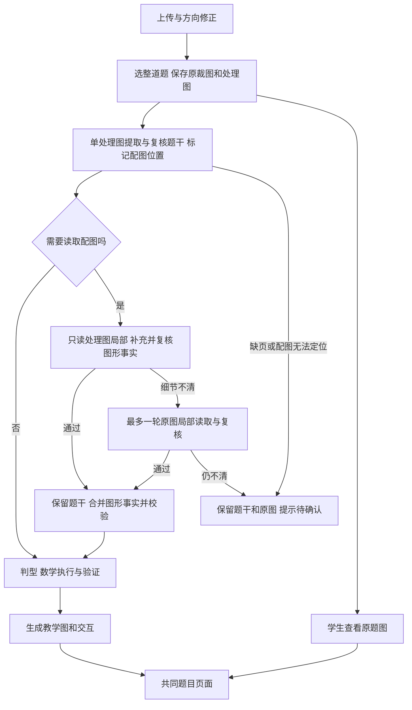

# FR-T2 函数图像及其应用：开发设计

更新：2026-11-03。状态：**G0—G4 本地代表题已贯通；G1／G2／G4 开发照片提取与拍题 API 回放通过。G3 遮挡照片仍待确认；浏览器上传、图形裁框边界、独立留出和部署尚未完成**。所属专题为独立的[函数的表示法](function-representations-topic-and-photo-learning-plan.md)，专题 ID 为 `function-representations`。`type-function-graph` 已激活，接受 G1—G4 已声明的受控输入；不代表任意图像题可解。接口与验证记录见 [G0 验收清单](function-graph-g0-acceptance.md)、[G1 验收记录](function-graph-g1-acceptance.md)、[G2 验收记录](function-graph-g2-acceptance.md)、[G3 本地验收](function-graph-g3-acceptance.md)及 [G4 记录](function-graph-g4-acceptance.md)。

本型采用三条教学路线：**图像变换法、分段作图法、分段图像解不等式法**。首题为例 9：根据 `f(x)=|x−1|+1` 选择图像。题源包括例 9 及三个变式，共四道题、五个原始目标。

**学生上传后，原题中的图必须直接显示；教学过程中的图再由数学数据绘制。** 两者分别保存：原题图来自照片裁片，保证题意完整；教学图来自经过验证的函数、分段区间和点坐标，支持变换、翻折、选点与区间高亮。只有示意图而没有解析式的题，保留原图，以可核对的图形信息推理，不自行拟合一个函数替代题设。

建设沿用[共同开发流程](topic-and-photo-learning-development-workflow.md)，按代表题贯通专题和拍题，再扩充本型范围。用户本轮先启动 FR-T2 设计；FR-T1 的独立新照片 S7、服务及发布状态仍按[原台账](function-formula-course-inventory.md)跟踪，不由本设计改为完成。

## 1. 题源与教学方法

### 1.1 本轮四道题

| 题源 | 原题与目标 | 推荐方法及其他适用方法 | 必须保留的题图 |
| --- | --- | --- | --- |
| B09，例 9，[图 6](../internal/senior-high/source-images/function-representations-planning-20261030/source-image-06.png) | `f(x)=\|x−1\|+1`，选择图像 | 图像变换法；也可分段作图 | A—D 四幅选项图及其标签 |
| B09-v1，变式 1，[图 7](../internal/senior-high/source-images/function-representations-planning-20261030/source-image-07.png) | `f(x)=\|x²−2x−3\|`；①作图；②解 f(x) 与 3 的不等式 | ①图像变换法或分段作图法；②分段图像解不等式法，调用已有二次不等式能力 | 题给的空白坐标网格属于作图区；书上解析中的两幅曲线图属于答案资料，不作为已知图 |
| B09-v2，变式 2，[图 7](../internal/senior-high/source-images/function-representations-planning-20261030/source-image-07.png)、[图 8](../internal/senior-high/source-images/function-representations-planning-20261030/source-image-08.png) | `y=\|−x²+1\|+2` 左移 2、下移 3，选择所得图像 | 图像变换法；也可写出新解析式后分段作图 | 完整题干和 A—D 四幅选项图 |
| B09-v3，变式 3，[图 8](../internal/senior-high/source-images/function-representations-planning-20261030/source-image-08.png) | 给 `y=f(x)` 示意图，选择 `y=f(2−x)` 的图像 | 图像变换法，使用点的对应关系 | 原函数示意图以及 A—D 四幅选项图 |

2026-11-02 对照图 7 题干和页内解答，B09-v1 正式版本冻结为 `f(x)≥3`，编制记录绑定原图哈希。`>` 与 `≥` 已纳入成对单元回归；后续拍题仍按上传题干读取符号，遮挡不清时不以解析的区间括号补猜。

### 1.2 三条方法路线

| 方法 | 学生能识别的题目线索 | 数学步骤 | 结束时交付什么 |
| --- | --- | --- | --- |
| 图像变换法 | “由原图得到新图”，或“由熟悉的函数图像平移、对称、翻折” | 确认原函数和范围 → 写点的对应关系 → 变换关键点及曲线 → 核对选项或完成作图 | 新图的数学模型或经复核的图形对应关系，以及选项判断依据 |
| 分段作图法 | “解析式含绝对值”，可以按正负分段 | 求绝对值内部的零点 → 分区间去绝对值 → 各段按有效范围作图 → 合并并检查边界 | 完整分段表达式、各段定义范围、关键点及绘图模型 |
| 分段图像解不等式法 | “已知函数，求图像在一条水平线上方或下方时的 x” | 写出 `f(x) 与 c` 的比较 → 求精确交点 → 在每段判断大小 → 与原范围相交、合并解集 | 精确解集，以及曲线高亮与数轴表示 |

“看顶点、零点、开口、端点筛选选项”是上述方法的检查步骤，首批不另立一个“看图猜答案”方法。对单一二次函数的不等式，直接复用已有 `quadratic-inequality-solve`；新增第三条方法只负责分段函数的组织、范围筛选与结果合并，不复制二次不等式求解器。

### 1.3 首轮开放范围

**G1 只贯通 `|ax+b|+c` 的变换选图。** 使用原选项裁图、点坐标变换与确定性的 V 形折线教学图，不引入完整 `piecewise_curve`，也不提前登记绝对值分段技能。a=0 作为常函数退化识别并明确转入范围外，不除以 a、不强行画 V 形；常函数作图留至 G2。G1 对 a≠0 的正负系数、顶点与显式范围分别验证。

G1 已实现范围进一步限定为固定有理数 a、b、c、单选“大致图像”、全体实数或顶点严格位于内部的显式区间。选项须完整、顶点有明确标注、左右直线分支及方向均经原图复核；给定区间时，各选项也须明确相应范围。截成单支、精确斜率等价、选项事实模糊、多选、多个选项同时满足等情形拒绝此路线，不按像素外观猜测。负 a 的点映射和区间开闭反转已有单元验证；真实照片证据目前以 B09 为开发回归，尚无独立留出验收。

有解析式的图先限定为固定有理系数、至多二次多项式，以及对它作一次绝对值、平移、轴对称得到的函数。可写成 `ε p(σx+h)+k` 或 `ε |p(σx+h)|+k`，其中 `ε,σ∈{−1,1}`，`h,k` 为固定有理数，`deg(p)≤2`。范围允许全体实数或一个显式区间，区间有限端点首批用有理数；分段产生的根和交点保留精确代数值。

以上是 G1—G3 逐批开放的总范围，不是 G1 的承诺。本型首轮分段模型仅由绝对值及上述变换诱导；题目直接给出的一般分段定义式及其常规求值、求参留给 FR-T3。底层区间、分段绘图可以共用，判型和方法准入不相互扩大。

只有原图的输入，首批支持 `y=ε f(σx+h)+k` 的平移和轴对称，并要求题设和图中信息足以区分选项。未知完整定义域保留为未知；照片中的显示窗口不等于定义域。

一般参数图像分类、多层绝对值、任意隐式曲线、自由手绘评分及纯示意图的自动精确函数恢复不在首轮范围。`f(|x|)` 的知识介绍继续保留，执行不随 `|f(x)|` 自动开放。之后扩展输入绝对值翻折时须另验“保留右半边”、定义域非空、边界与原左半边舍弃等分支。

## 2. 现有能力与需要补齐的部分

下表保留 G0/G1 开工前的代码核查基线；图谱中的“graph”也用于知识图谱，不表示已经支持函数题图。当前实现增量见表后及 G1 验收记录。

| 环节 | 已有实现 | FR-T2 要补齐什么 |
| --- | --- | --- |
| 上传和选题 | [search/dev_api.py](../server/shuxueshuo_server/search/dev_api.py) 处理方向修正、选题裁剪，保存 `original.png` 与 `question.png` | 将原始裁图接入题面配图；建立题干图、作图区、选项图的独立引用 |
| 图片预处理 | [question_image.py](../server/shuxueshuo_server/search/question_image.py) 将送模裁图转灰度、展平纸色、量化到 16 灰阶、长边至多 1600 | 核查细线、虚线、空心点和颜色是否损失；必要时用原始彩色局部图复核，不能仅凭处理后图片判定 |
| 图文区域定位 | [segmentation.py](../server/shuxueshuo_server/search/segmentation.py) 会将 layout 的 figure/image/chart 等区域纳入题目框 | 现有定位不是坐标轴和曲线识别；需补题内图形分区、选项标签绑定及漏图检查 |
| 学生查看原图 | [problem.js](../site/lab/search/problem.js) 已有缩略图与放大查看；当前 `/api/search/problems/{search_id}/image` 返回处理后的 `question.png` | 在题干正文就显示必要图形，而非只藏在缩略图；保留高保真原图查看入口 |
| 题意提取 | [提取契约](../internal/schemas/graph-problem-extraction-v2.schema.json) 已有作用域、目标、缺图和模糊诊断 | 新增图形引用、图形事实、图形选项和作图目标的受控表示；同步提取、原图复核及修复规则 |
| 公共题目身份 | [search/identity.py](../server/shuxueshuo_server/search/identity.py) 已对题干、作用域及文字选项构造和校验身份 | 纳入经过审核的图形语义与选项内容；仅保留“如图所示”会把不同题错误合并 |
| 教学绘图 | [interaction_graphs.py](../server/shuxueshuo_server/graph_lesson/stage_three/interaction_graphs.py) 从数学结果生成图形规格；[components.js](../site/assets/practice/components.js) 用 SVG 绘图 | 当前类型为 quadratic、linear、reciprocal_sum、number_line、axis_explorer，尚无本型所需的完整分段曲线和通用变换图层 |
| 作答和完成态 | [交互契约](../internal/schemas/graph-step-interaction-v1.schema.json) 已支持选项 graph、题干 graph、completion_graph(s)；FR-T1 的 W10 已使用二次图辅助解不等式 | 扩展图形种类、原图选项引用及变换交互，保证自己做、AI 回放、完成态和服务端评分一致 |
| 图谱 | [type-function-graph](../site/data/knowledge-next/nodes/type-function-graph.json) 已登记为 planned；已有图像变换和绝对值知识 | 尚未登记本型方法及执行契约；知识可查看不等于新题已可解 |

因此不用另找一个画图库才能开始。可沿用现有 SVG 坐标系、刻度、图例和数轴，扩展分段曲线及变换图层。识别和数学验证由后端负责，浏览器只展示结构化数据并收集学生操作。

G1 当前增量：已登记图像变换方法、点坐标变换技能和预连线选法节点；新增 `select_function_graph` 目标、受控图形事实、独立核验、原图选项作答与 `absolute_affine` 两段折线绘图。B09 采用共同课程构建器生成正式题页 `/topics/function-representations/q09a/`。完整分段曲线、纯示意图输入和自由作图仍按后续批次建设。

## 3. 拍题后的题图展示

### 3.1 原题图和教学图各自负责什么

| 图的来源 | 展示方式 | 可用于什么判断 |
| --- | --- | --- |
| 学生照片中的原题图 | 从保存的高保真裁图提取图片区域，保留轴、标注、选项标签，支持放大 | 保证原题可读，是图形事实复核的来源 |
| 已知解析式生成的教学图 | 后端计算准确的点、分段、范围；前端确定性绘制 SVG | 支持精确作图、变换和区间讲解，结论仍由数学验证确认 |
| 没有解析式的示意图 | 原图默认可见；叠加可复核的点及对应箭头；必要时另给注明“示意”的辅助图 | 只使用题设及清楚标出的坐标、方向、交点、端点等信息，不从曲线像素拟合精确解析式 |

照片转 SVG 不是原题展示的前置条件。题图能裁出就可先显示；识别没有通过时可以保留原题展示，但不得据此开放一个已经“核对正确”的解题流程。

### 3.2 共同题页的布局

```text
原题                                      查看原始照片
已知……若……则其图像为（  ）

题干图（如有）                  点图可放大

A [原选项图]                    B [原选项图]
C [原选项图]                    D [原选项图]

自己做 / 看 AI 解题
当前步骤：原图 → 关键点变化 → 本步作答或完成图
```

桌面端选项为两列；窄屏按可读性改为一列或两列，不能把刻度压到不可辨认。选项文字标签与图片分开，使用稳定 option ID 绑定，放大按钮和选择按钮分别可操作。可访问性描述应说明原图信息，不能在作答前以替代文字泄露“正确选项”。

PC 双栏时，原题图与选项全部归左侧学习栏，右侧平面图谱不占用选项位置。左栏保留可持续访问的题图面板；进入依赖选项的步骤时，四图直接显示在该步骤旁。空间不足时图谱收起，不能浮在选项或放大按钮上。G0 先提供左栏题图面板和原图查看，G1 再接入作答步骤中的固定选项区。

读屏文案由角色和标签生成，例如“题干配图”“选项 A 的原图”“放大选项 A”；不得包含“正确”“推荐”“应选”或由答案生成的特征描述。未复核的图片不自动生成数学 alt；后续经复核的图形描述只转述题面，不加入推导结论。放大与关闭可用键盘操作，焦点返回原按钮。

原题主图和全部选项在解题前就可查看。随步骤固定的原题栏保留“查看题图”入口；当前步骤依赖的图直接出现在卡片中，学生无需反复回顶部找图。完成态保存本步的图、所选关键点或区间及简洁推导，不退化成一段步骤说明。

题内区域无法可靠拆分时，先显示整道题的原始裁图，保留原选项排布；不得显示四个空白框或凭空补画。识别确认四个标签和对应图后，才可提供独立选图作答。学生重新裁图或补拍的入口沿用已有流程；跨页题的多图关联需要另补契约，当前单裁图接口不能冒称已支持。

### 3.3 资产和接口设计

题图清单采用 `question-figures/v1`。下表为总体设计，G0 已冻结的最小字段见后文；图形语义和模型复核字段随 G1／G4 增补。

| 字段组 | 内容与用途 |
| --- | --- |
| 身份与归属 | figure ID、`scope_ref`、`target_ref`、role；role 区分题干图、选项图、题给作图区、解析图 |
| 选项绑定 | 稳定 option ID、原标签、原顺序；选项图只能绑定一个明确的题目目标 |
| 来源 | 私有 asset ID、来源哈希、图像宽高、裁剪区域、方向和坐标映射；不由模型填写本地路径或下载 URL |
| 数学关联 | 指向 Figure IR 的引用与版本；原图显示不依赖 Figure IR 已通过 |
| 审核 | 区域是否完整、图形事实是否通过复核、具体未读清的字段；显示状态与数学准入状态分开 |

裁剪框统一使用 `same-crop-normalized`：同一裁剪框归一化坐标，与 processed/original 像素尺寸无关；依次为左、上、右、下，范围 0 到 1。当前 `original.png` 与送模 `question.png` 保持同一裁框，预处理只做等比缩小（允许像素取整）和灰度、亮度处理；提取时的归一化框按实际来源图片尺寸换算为像素框。`question_png` 显式约束这一前提，并检查处理后尺寸。后续若引入二次裁切、留白、旋转、透视校正或重新排版，必须先增加并验证坐标映射，不能继续直接复用归一化框。图片、候选事实和复核记录各自保留版本。

原始裁图及其子区域使用受保护的读取接口 `/api/search/problems/{search_id}/figures/{figure_id}`，不改现有 `/image` 的含义。服务端通过题目归属解析资产 ID，沿用私有存储、账号校验和生命周期；缓存不得跨账号复用。图片到期、删除、重新裁剪后，对应清单和查看入口同步失效。

G0 已实现上述 `/figures/{figure_id}` 与 `/figures` 清单接口，并在拍题状态中附带同一清单。文件合同见 [question-figures-v1.schema.json](../internal/schemas/question-figures-v1.schema.json)：`source` 绑定原裁图哈希、尺寸和质量；各区域有 `id`、`role`、`scope_ref`、可选 `target_ref` 与归一化 `box`，选项额外要求稳定 `option_id` 和原标签。数组顺序保留原顺序。G0 的标签限定 A—Z；不支持的标签不能自动改名。

G0 的 role 仅包含 `source`、`statement`、`option`、`workspace`。解析资料不进入此清单；作图区不能冒充题干曲线。没有经过审核的区域清单时，自动退回一张完整原裁图，不自动猜测题内分区。G0 不提供模型写清单的入口，也不将区域完整或图形事实已复核的状态虚标为通过。清单返回的 `content_id` 绑定整份数据；图片 URL 带版本，旧绑定返回冲突而不显示新图。

G1 在此基础上接受提取候选中的归一化 `figure_regions`。只有题干与图形各自对照实际送模图复核通过、合并版本一致、全部选项完整且来源图与送模图可校验时，服务端才安装清单，并自行计算原图及各选项像素哈希。模型不能提供可读文件路径、URL、可信哈希或跳过审核。图形目标的身份和课程准入都要求这份版本绑定；缺图、来源变化或标签不匹配时不开放选图作答。

静态专题使用审核过的公开题图资产；个人上传图片保留私有。两种入口给共同题页提供同结构的图形描述和不同的资产解析器，不把个人照片路径或临时令牌写进公开课包。原题图只展示题面；课本解析图及红笔答案不能混进选项和已知条件。

### 3.4 图片接口迁移

| 消费者 | 当前读取方式 | 兼容与失败处理 |
| --- | --- | --- |
| 新上传的题干提取与复核 | 只发送 `question.png`，同时标记配图状态与位置 | 无需读取配图时不增加调用；保存原裁图不等于发送原裁图 |
| 配图事实提取与复核 | 只发送处理图的局部裁片，题干和选项身份作为只读上下文 | 关键细节不清时最多再读一次有尺寸上限的原图局部；不重新提取题干 |
| 既有 `/image` 客户端与诊断 | 保持返回处理后的 `question.png` | 不静默改变旧 URL 的内容 |
| 新题页的原图、缩略图和放大 | 读取题图清单，经 `/figures/{id}` 取得 `original.png` 的高保真内容 | 旧记录缺少 original 时明确标作“识别用图”；不伪称高清原图 |
| 题干与选项分图 | 使用经过审核、绑定来源哈希的区域清单 | 尚无可信区域时显示完整裁图，不自动把解析区当题图 |
| 静态专题 | 使用同一展示组件及公开审核资产清单 | 不读取私有拍题 URL，不从用户上传目录复制图片 |

新增清单读取接口 `/api/search/problems/{search_id}/figures`。清单、整图与局部图都经过归属及存储生命周期校验，响应禁止共享缓存。旧服务没有新接口时才兼容旧 `/image`；403、图片过期、归属变化等不回退绕过权限。

**2026-11-03 新上传使用 `text-then-figures/v1`。** 先按既有单处理图流程提取、校验与复核题意；`search-text-extraction/v1` 只新增 `figure_detection`，记录 none/present/uncertain、图形角色、对应目标及归一化位置。这里不读图形数学事实。空白作图区不触发补图；公式排版和旁边的解析图不当成题给配图。无配图时保持原有调用数，不追加检测模型或 OCR 流程。

**配图流程的耗时优化。** 初次提取请求不变。候选已标明有配图、所有目标都是 `select_function_graph` 且没有额外 definitions/facts 时，文字复核改用[图像选择题专用复核提示](../internal/llm-prompts/search-graph-text-review.md)和对应目标 schema，不再发送整套数学表达式目录。仍核对完整候选、题文、选项身份与图框，并绑定同一候选版本；有其它目标或共享条件的题目沿用通用复核。无配图的提取、复核、普通修正请求与改动前逐项相同。

复核若**只**指出已有题干图或选项图的 `box` 错误，进入 `search-figure-box-repair/v1`：只要求返回绑定 `base_revision`、获准路径和 `figure_id` 的坐标补丁，代码将它合并到原候选。未授权字段不可出现在补丁中；题文、公式、目标、选项文案及身份保持原值。混合文字/公式错误、区域增删、身份修改和空白作图区继续原有修正流程，不借坐标修正扩大权限。原始响应、合并候选和后续完整复核分别保存；补丁只有经过既有权限校验及新一轮原图复核才可进入图形读取。坐标越界或版本不符按原预算重试，确实看不清则停止，不能部分采用其它框或发布绑定。调用预算和原图重读条件不增加。

2026-11-03 分阶段开发实测（`b66ff9aa2c49` 同一张照片）：沿用原首次复核指出的五处图框问题，坐标补丁一轮完成，耗时 23.244 秒，原记录两次完整候选修正合计 62.354 秒。对这次修正后的**同一份候选**分别执行完整通用复核和精简复核，均通过，耗时分别为 68.769／31.937 秒，输入 token 为 17021／3281。题文、数学目标和公开选项内容不变。这是开发照片的修正与复核环节测量，未重新计量整题上传流程，不据此将原 212 秒整题耗时替换为推算值，也不代表独立照片的准确率或平均时延。

需要读取配图时，保留已复核的题干、解析式、目标和选项 ID／标签，进入独立的 `search-figure-extraction/v1`。请求只发送处理后的图形裁片和只读文字上下文，输出只允许 `base_revision`、各 `figure_id` 的 facts／uncertainties；禁止输出或改写题干。图形复核沿用同组裁片，成功后由代码确定性合并并验证完整数学结构。题干图与选项图分别绑定，缺页、缺选项或目标对应不明时保留待确认，不靠补图流程猜题干。

图形复核使用独立的 `search-figure-review.md`，只输出 `status`、`findings`，不沿用提取阶段要求返回 `base_revision`／`figures` 的输出指令。复核仍严格校验格式及字段指向，不能剥掉多余字段后直接认定通过。`review.invalid_response`、调用失败和预算耗尽保留真实失败状态，显示系统重试；只有真实的读图疑点才提示未看清并进入有预算的原图补读。旧记录若曾把图形失败统一记为 `needs_confirmation`，展示时按最后一次图形尝试的真实状态纠正，原始证据不改写。

图形复核响应格式不合规时，最多对同一份候选、同一组裁片再复核一次，附上格式反馈；不重提题干、不改图形事实、不以错误响应中的 confirmed 放行。再次失败返回系统错误，不能因此切换原图。正常通过和实际看不清的响应不触发这次格式重试。

2026-11-03 开发记录 `755a001ead7e`：图形复核多返回 `base_revision`，被严格格式校验拒绝，且原流程误显示为无具体原因的“没看清”。分离复核提示词后，沿用原来已复核的文字与同一份图形候选，只执行一次真实图形复核，12.74 秒通过；重新核验图片绑定、合并结构与身份后恢复原记录，学习流程生成完成。原失败结果和图形账本保留在该记录的 `*-before-review-recovery` 文件中。这是失败环节恢复耗时，不是整题识别耗时。

同日整流程重试 `0de724c6742d` 仍因文字轮反复修框在 338.452 秒后耗尽预算，表明裁框稳定性和整体时延尚未解决。附加实际裁片供复核的实验仍出现误报，未启用；实验记录在 `/private/tmp/figure-preview-review-20261103` 与 `/private/tmp/figure-preview-valid-review-20261103`。无配图题的提取、复核、普通修正请求已逐项对比哈希，与图形优化前完全一致。

图形轮的 `uncertainties` 只记录妨碍核对所需图形事实或图文对应的实际疑点。示意图未给解析式、全定义域、图外走势或渐近线，不构成识别失败；`shown_monotone_curve` 只描述展示部分。横轴交点清楚对应数字刻度可作为 `labelled` 证据，无须另有坐标对；仅按像素间距估读仍是 `estimated`。已有非空疑点不能由代码按文案删掉放行，必须重新读取并通过图形复核。

程序同时检查结构化证据：即使 `uncertainties=[]`，关键点的 `evidence=estimated/unknown`、G1／G4 必需的方向未知，仍属于未读清。处理图阶段直接触发有预算限制的原图局部重读，不能先“复核通过”再等合并失败；原图仍未读清时不发布图形绑定。G3 可按已有标注点排除选项，不把可选的未知对称性或两端方向强制升级为补读条件。

示意图、部分图象、大致图象选项题使用 `rough_shape`，即使题干给出完整解析式，也不能据此认为每个选项都有完整规则。它表示根据已核对的图形特征排除选项，不宣称有限特征确定整条未知函数。文字轮若将图形选项误标为 `exact_equivalence`，应在读取配图前只修正 `comparison` 并重新复核文字候选；该检查同时覆盖题给函数式与题给原图，不仅检查 `source_graph`。合并阶段不偷改已复核题意，求解器仍拒绝用有限图形事实验证精确等价。

2026-11-03 `917e13dc8369` 回归：题给 `f(x)=abs(x-1)+1`，四幅选项顶点均读取并复核成功；错误的 `exact_equivalence` 直到合并才被拒绝。另有同一函数定义在 `definitions` 和目标 `expression` 中重复记录，原 G1 会将它误认为额外条件。现仅接纳一条与目标 AST 完全一致的 `f(x)` 定义，保留来源引用，并在数学验证中重新核对；不匹配定义、额外事实、多条定义仍拒绝。纯选图且只有这一条重复定义时复用精简文字复核，完整候选仍送审；混合目标或其它条件继续通用复核。

此次恢复保留旧失败记录与两轮账本，开发者基于留存原图提出比较类型修正，并扩展实际截掉 A/B 标签的裁框，未改写题干或图形事实。修正候选重新通过真实文字复核（25.028 秒），原有图形事实在新绑定裁片上重新通过复核（7.241 秒），恢复合计 32.6 秒；这是增量恢复耗时，不是完整新上传耗时。数学执行、学习页面及 8779 原记录恢复通过，答案为 A。证据目录：`/private/tmp/graph-comparison-fix-20261103/recovery-live/`。无图题仍为一张处理图、一次提取和一次复核；请求对比确认通用复核完全不变，提取/修复请求仅有图形目标 schema 的比较类型字段说明更新，未加入图形调用。

2026-11-03 开发照片回归：`c6abbca01536` 的错误比较类型保留为失败输入；真实重试 `d194d4deac8e` 已正确分类，另暴露 B／D 交点标为 `estimated` 但疑点数组为空的漏检。修复后沿用这次真实复核的文字候选，只补执行一次原图局部提取与复核，五图事实、版本与图像来源全部核验通过；判型和教学执行完成，答案为 C。旧结果、处理图失败过程与补读过程均保留。自动切换及原图仍不清晰时停止由单元回归覆盖；这是同一开发照片的恢复验收，不替代独立新照片留出验证。合并合同失败显示系统错误和重试入口，不再提示用户避反光或重拍。

合并成功后移除文字轮的临时 `figure_detection`，公开候选只保留经过核对的 `figure_regions`／`statement_figure_regions`；原定位记录仍保存在文字轮工作流中。`represented` 仅校验受支持的图形目标及其裁框，同题的求值域、求值等目标按各自合同校验，无选项小问不阻止图形绑定；图形目标仍须具备完整选项及对应原图。

每轮最多 8 张裁片，长边不超过 960 像素，单张不超过 384 KiB，合计不超过 2 MiB；保持裁框中的全部内容，只按预算缩小，不锐化、不补点、不拟合。处理图中的关键细节不可读时，且已有对应原裁图，可最多追加一轮原图局部读取与复核，尺寸与字节限制相同。每轮正常为 1 次提取、1 次复核；仅复核格式错误时可追加 1 次复核，每轮最多 3 次语义调用、6 次网络尝试。结构错误、题图缺失或来源冲突不触发原图重试。仍不清晰即待确认，不继续循环。高保真原图继续供学生查看；默认不会作为第二张整图送模。

`workflow` 保存题干流程，`workflow-figures` 保存处理图裁片流程，`workflow-figures-original` 保存可选原图局部重试，失败记录均保留。裁片清单绑定题干版本、来源图哈希、归一化框、像素框、宽高、字节数与裁片哈希。安装展示清单前重新核对两个已复核候选、确定性合并结果及实际发送账本；不能把仅复核处理图标成原图复核。原裁图与处理图仍须可重建对应，私有权限、`/image` 含义和图片生命周期不变。

公共分段公式说明只保留：“按原题顺序记录每段的解析式及适用条件，保留开闭边界，不补默认分段。”另保留必要格式及一个例子。图形细节要求只在图形补充请求中加载，不把各批次题目的长说明放入公共提示词。

**历史记录兼容。** 2026-11-02 的 `search-question-images/v1` 双整图、v2 双整图加局部图记录，仍按原合同离线回放，由显式历史入口处理；新上传不进入该入口，不补记旧记录未发送的图。此前 G1／G2／G4 真实照片证据属于当时的流程，新流程本轮只做必要的离线单元测试，真实模型的准确率、时延及原图局部重试效果另验。仍不支持跨页合并，也不扩大已声明的图形事实支持范围。

G0 的图像身份是保守的展示身份：绑定来源内容、区域、作用域、选项 ID 和版本。未结构化图题继续拒绝公共数学身份合并，不把照片内容摘要等同于已验证的数学身份；`figure=unrepresented` 的准入限制继续保留。

## 4. 从照片得到可用的图形信息



### 4.1 Figure IR 的最小契约

Figure IR 表示“图里给了什么”，不直接写正确答案。拟新增受控字段如下，具体 JSON schema 在实现批次冻结：

| 内容 | 首轮字段与要求 |
| --- | --- |
| 图的类型 | 有解析式、经审核的分段模型、原题示意图；不能由外观直接升级为有解析式 |
| 坐标系 | 原点、轴方向、轴名、明确刻度；分清数学坐标和图片坐标，未知比例可留空 |
| 已知点 | 点 ID、题图明确的精确坐标或定性位置、来源区域；精确值用受控数学记法 |
| 曲线信息 | 分支 ID、连通关系、已标出的交点、方向信息及适用区间；定性观察须声明范围和证据性质 |
| 边界 | 空实端点、断点、箭头、渐近线与辅助虚线的角色；图片裁断不自动成为函数端点 |
| 语义引用 | 对应题给函数、图号、选项、当前小问；同一题的不同坐标系分别登记 |
| 证据状态 | 每项事实附原图位置，以及已核对、模糊、缺失或冲突状态；区分题面明确标注与依照图示读取 |

本型设计“选函数图像”和“作函数图像”的目标表示，分别包含函数／变换来源、图形引用、选项全集／绘图要求。G1 已冻结 `select_function_graph`；G2 已接入 `draw_function_graph` 和 `solve_graph_inequality`。选图目标还要区分“判断大致图像”和“精确图像等价”：B09 的原题要求部分图像大致形状，应保留这一措辞；不能由没有比例标注的示意直线推定精确斜率。精确等价则须核对完整规则与定义域。B09-v1 后问仍表达原不等式所求的 x 范围，不能在提取阶段写入交点或解集。提取 schema、公开题面 schema、身份构造、特征、判型和目标验证必须一起接线。

### 4.2 原图复核与准入

提取与复核是两项工作。程序先检查区域完整、标签不重复、引用可解析、端点和范围不矛盾，再对照原图检查决定答案的事实。模型自报高置信度不代替这一流程。程序也不能仅因几条图形事实彼此一致，就宣称它们一定来自照片。

对不同目标使用不同的证据需求：B09 需要选项的顶点及折线方向；B09-v3 需要原图与选项之间能核对的对应点、方向和相对位置。若两幅选项在已读出的事实下仍无法区分，补读局部图或返回待确认，不能用“看起来更像”给出唯一答案。

G0／G1 固定检查三类输入：单裁图含完整题干与全部选项；缺一页或漏掉选项；混有教辅解析的页面。逐页核对后，B09-v2 的题干和四个选项位于图 7，图 8 是解析续页；图 7 的 D 右端有书页遮挡。本地编制课程只使用可见左折点的纵坐标 0 排除 D，未补画右端；这不等于自动照片复核通过。其他输入的完整性仍按题干和四个选项是否齐全核对，不能按“上传了一张图”推定完整。跨页合并暂不支持；缺页提示“请把完整题干和全部选项拍在同一张图中；跨页题暂不支持合并”。解析区域即使出现清晰曲线，也不能补作漏掉的原选项。

当前新上传按 §3.4 的单图题干提取、独立补图流程执行。G4 已有正向实际调用属于历史双整图流程，未触发当时的局部重读；这些记录不作为新流程的实际验收。新流程只在图形读取歧义时尝试有预算限制的原图局部重试，实际准确率和时延待真实照片验证。

### 4.3 题目身份与选项身份

两个题干都写“函数的图像如图”而配图不同，是不同题。公开数学身份须纳入审核后的图形内容及完整选项；图片 URL、拍摄角度、学生 ID 不作为数学内容。若仅有未结构化图片，使用版本化图片内容摘要形成保守的独立身份，不按文字合并，也不声称不同照片已识别成同题。

作答保存稳定 option ID，显示时映射到当前标签。重排选项仍须判对对应图形；改图、改空实点或改目标会使相关识别、数学证据、课包及旧作答版本失效。变换后端点的开闭必须跟着对应点移动，不能按新左右位置沿用旧标签。

## 5. 如何绘制教学图

### 5.1 有解析式时绘制准确的分段曲线

以 `y=|x²−2x−3|` 为例，先由数学执行得到：

\[
p(x)=(x-1)^2-4=(x+1)(x-3)
\]

\[
|p(x)|=\begin{cases}
x^2-2x-3,&x\le -1\text{ 或 }x\ge3,\\
-x^2+2x+3,&-1<x<3.
\end{cases}
\]

教学图使用三段二次曲线，零点 `(-1,0)`、`(3,0)` 和中间顶点 `(1,4)` 是精确计算结果。边界在相邻段中只归属一次，合并后的零点为实心；不得因为中间段开区间而把整个图的零点画成空心。

拟增加 `piecewise_curve` 绘图类型：每段包含已准入的一次／二次表达式参数、有效区间和开闭、关键点及来源证据。沿用当前数轴、坐标轴和图形描述规则。后端给出分段和精确关键值，前端使用有限数值进行 SVG 路径采样；**采样只影响曲线显示，不参与求根、判断可达性或评分**。

G2 已接入至多二次绝对值诱导的分段曲线合同，见 [G2 本地验收](function-graph-g2-acceptance.md)。G1 只增加服务 V 形教学图的最小折线路径：由顶点、左右射线方向及显示窗口确定坐标，不提前承诺任意分段曲线的识别、作图与评分。

绘图时按断点拆开路径，在视窗外裁剪，不跨越不连续点连线。刻度、点标签和水平参考线来自同一数学模型；保留精确的 `1±√7` 等标签，不能只显示四舍五入后的数。无法容纳标签时换视窗、放大或分图，不能删去决定答案的刻度。

### 5.2 图像变换按点来做

设原图上的点为 `(u,v)`，新图中的横坐标是 x。使用同一张点对应表驱动推导、动画及检查：

| 新函数 | 点的对应 | 定义域 |
| --- | --- | --- |
| `f(x−h)+k` | `(u,v) → (u+h,v+k)` | `{u+h : u∈D}` |
| `−f(x)` | `(u,v) → (u,−v)` | D |
| `f(−x)` | `(u,v) → (−u,v)` | `{−u : u∈D}` |
| `f(2−x)` | `(u,v) → (2−u,v)` | `{2−u : u∈D}` |
| `\|f(x)\|` | `(u,v) → (u,\|v\|)`，按 v 的符号分段 | D |

组合变换记录实际顺序。例如 `f(2−x)` 可先关于 y 轴对称，再向右平移 2；也可先左移 2，再关于 y 轴对称。两条路线都应通过点映射核对，不能只接受其中一种正确次序。

变换图层同时绘制原图、当前结果和关键点箭头。原图淡色、当前图实线，并配文字图例；不只靠颜色区分。动画是点与曲线坐标的插值，最终状态由精确映射确定，减少动态效果设置下直接显示前后图。

### 5.3 只有示意图时不补造解析式

B09-v3 不知道 f 的具体公式。可以确定 `u=2−x`，故 `x=2−u`，原点 `(0,0)` 对应 `(2,0)`；若原图在展示范围内递增，反射后相应部分递减。将这些结论与全部选项核对，得到有证据的选择过程。

首轮默认用原图与选项裁片展示，叠加标注点和对应箭头。需要辅助新图时，只绘制已确定的对应点；曲线形状未完成复核便不自动生成整条曲线。专题可额外使用人工审核过的示意路径，但不能把这种人工资产当成任意新照片已自动重建的证据。

后续若要自动生成连续的示意变换图，可建立“坐标系定位 → 曲线像素分离 → 分支路径 → 原图叠加复核 → 路径变换”的流程。路径只是可视化对象，不是 f 的解析式；不能据此计算未标出的精确交点或范围。只有所有满足已确认图形信息的情况都支持所选判断，才可给出确定结论。若选项区别依赖未读清的局部弯曲或交点，则继续复核。

**不能直接镜像整张照片来充当变换后的函数图。** 那会把坐标轴文字、刻度和标签一起翻转。应仅变换曲线路径和相应数学点，重新绘制坐标轴；在曲线分离不可靠时保留原图讲解即可。

### 5.4 图形数据与渲染边界

新增图形类型同时进入后端生成器、JSON schema、前端 `validateGraph` 和绘图分发，不能只让前端认识新名字。模型只能提交受控图形事实或路径数据，不生成可执行 JavaScript、任意 HTML/SVG 或未经解析的函数代码；数学表达式走已有记法解析与准入。

每个教学图引用当前步骤的已验证产物，区分作答前图和完成图。作答前不高亮正确选项，也不显示待判断区间；完成后显示关键点、结果图和完整数学推导。无效的可选教学图可保留文字步骤；原题必需图或图形选项缺失时，不能沿用现有“图画不出就只保留文字选项”的降级规则继续判题。

## 6. 图谱方法 技能与选法判断

### 6.1 拟新增与复用

本轮设计增量为 **3 个方法、2 个技能、1 个选法判断**，按批次登记，不在文档阶段激活。其中新技能是数学操作；图片裁剪、SVG 绘制和路径提取属于系统能力，不作为学生知识图谱中的解题技能。

| 节点 | 拟用 ID | 契约与登记时机 |
| --- | --- | --- |
| 图像变换法 | `method-function-graph-transform` | 已知解析式或经过复核的原图信息，输出点映射与目标图／选项；G1 登记解析式分支，G4 才开放纯图像输入 |
| 分段作图法 | `method-absolute-piecewise-graph` | 受控绝对值表达式 → 覆盖完整定义域的分段模型 → 图形；G2 登记 |
| 分段图像解不等式法 | `method-piecewise-graph-inequality` | 分段模型与水平线比较 → 各段精确解集 → 合并结果；G2 登记，内部调用已有二次能力 |
| 点坐标与范围变换 | `skill-graph-coordinate-transform` | 对点、区间端点及开闭执行同一映射；输出新坐标、范围和对应证据；G1 登记 |
| 按符号分段去绝对值 | `skill-absolute-sign-split` | 求零点并按符号构造互不冲突、覆盖原域的分段表达式；独立核验各段恒等；G2 同时实现执行、验证与教学 |
| 函数图像题的选法判断 | `rule-function-graph-method` | 根据任务、输入形式和所需证据列出适用方法，区分可选、推荐、尚未开放；G1 登记 |

实际复用 `skill-simplify`、`skill-factor`、`skill-solve-quadratic`、`skill-quadratic-sign`、`skill-equality-transform`、`skill-inequality-transform` 和 `method-complete-square`（现有 kind 为 skill）。求解一元二次不等式复用 `quadratic-inequality-solve`。新增分段方法负责定义域交集及解集并集的核验；不把现有含参二次不等式选法规则硬套到本型。

图像等价和选项匹配由本型的结果验证器处理，首批不再增一个公共技能。对精确模型逐区间核对函数值和定义域；对示意图按题目要求的大致形状或对应关系验证已准入的信息，保留唯一可选项及逐项排除依据，不宣称有限点已确定整条函数。两者不能混用为“像素相似度评分”。

### 6.2 学生选法卡

延续 FR-T1 已确认的交互：**线索与方法预先连好，学生点选方法**；不让学生先选线索、再手动配线。卡片应随当前目标显示适用路线：

```text
原图经过平移、对称或翻折 ───────→ 图像变换法

含绝对值的解析式 ───────────────→ 图像变换法
                └──────────────→ 分段作图法

求图像在水平线上方或下方的 x ───→ 分段图像解不等式法
```

可同时适用的路线都标为有效；“尚未展开”不算学生答错。选法完成后保留预连线图，高亮实际路线。图中只显示当前已知信息，例如 B09 可以显示 `|x−1|+1` 与基本图 `|x|`，不能提前展示正确选项和最终顶点。

## 7. 逐题交互与数学推导

### 7.1 B09 由绝对值函数选图

题干区先展示原四个选项。图像变换路线采用以下卡片：

| 步骤 | 学生看到的上下文与作答 | 完成后保留 |
| --- | --- | --- |
| 确认任务与选法 | 给出 `f(x)=\|x−1\|+1`；选择“图像变换法” | 预连线选法卡 |
| 分步移动图像 | 卡内先问 `y=\|x\| → y=\|x−1\|`，确认后再问 `y=\|x−1\| → y=\|x−1\|+1`；每次只选择一个移动动作 | 每小步保留移动前的虚线、移动后的实线及单方向箭头；第二步从第一步结果出发 |
| 总结图像变换 | 回顾右移 1、上移 1 的两式，选择最终顶点 | `(0,0)→(1,0)→(1,1)`，左右两侧仍向上 |
| 对照原选项 | 点击原选项图片或卡片主体即选择；独立“放大”按钮只看细节 | 所选原图与教学图并列；指出其余选项具体不符的顶点或方向 |

G1 中 `a=1` 的平移按实际非零动作拆步，零位移不单独提问；其余系数继续使用点映射卡。图形合同的 `reference` 保存当前动作的前一幅图，不能把每一小步的虚线都重置为基本图像。

“完整推导”使用数学关系，例如 `y=|x| → y=|x−1| → y=|x−1|+1`，以及点坐标变化，不填“先看平移，再求顶点”之类操作说明。分段作图替代路线应得到 `x≥1` 时 y=x、`x<1` 时 y=2−x，并核对分界点归属。

G1 的分段作图路线仅说明数学上适用、尚未展开，不产生未实现的作答入口。

#### B09 特征核对表

本题按“大致图像”评分，白名单为：两条相接的直线分支、顶点坐标、左侧递减／右侧递增、相对坐标轴位置。题设推出顶点 `(1,1)`、两侧向上、全图在 x 轴上方、不经过原点。截图缩放、拍摄斜率、线条长度、颜色、粗细与未标注刻度的像素比例不作为错因。

| 原选项 | 图上可核对的顶点 | 分支方向 | 判定与具体理由 |
| --- | --- | --- | --- |
| A | `(1,1)` | 左降右升 | 符合顶点与分支方向，且其余三项均有明确矛盾 |
| B | `(−1,1)` | 左降右升 | 排除：顶点横坐标应为 1，不是 −1 |
| C | `(−1,−1)` | 左降右升 | 排除：顶点横纵坐标均不符，且图像含负函数值 |
| D | `(1,−1)` | 左降右升 | 排除：顶点纵坐标应为 1，不是 −1 |

选项标签重排后仍按图形事实核对，不绑定答案 A。通过条件是一个候选满足所需白名单特征、其余每项至少有一条经复核的矛盾；存在无法辨认或两项在白名单下等同的情况，返回证据不足。不能只因另外三项有错，就忽略剩余图中的冲突。若新题的区别是精确斜率、额外断点或空实点，必须扩充证据契约或拒绝超范围，不能沿用本题的粗特征判题。

### 7.2 B09-v1 翻折作图与图像解不等式

作图先显示 `p(x)=(x−1)²−4` 的抛物线。学生选择要翻折的部分 `−1<x<3`，再确认中间顶点由 `(1,−4)` 变为 `(1,4)`；图形用原曲线淡色叠加。也可走分段作图路线，逐段显示有效区间并合并。

原题的“作图”目标须对应整个分段模型，不能把“选出三个点”单独判为作图完成。首轮采用引导式构图：确认分段式、区间、曲线方向和边界后生成完整图，由后端校验模型。自由手绘上传评分暂不开放。

G2 的 interaction schema 应显式标记引导式构图及其分段、区间、方向、边界作答字段，完成条件验证完整模型；不接受截图、像素路径或“动画播放完毕”作为 freehand 作图证据。

第二问同屏给出 `f(x)=|x²−2x−3|`、原不等式与参考线 `y=3`。学生按过程完成“交点 → 哪几段在直线上方 → 端点是否取到”。简洁数学推导为：

\[
|x^2-2x-3|=3
\iff x^2-2x-3=3\ \text{或}\ x^2-2x-3=-3
\]

\[
x=1-\sqrt7,\quad 0,\quad 2,\quad 1+\sqrt7
\]

若为 `f(x)>3`，解集为 `(-∞,1−√7)∪(0,2)∪(1+√7,+∞)`；若为 `f(x)≥3`，四个边界均取到。完成图高亮相应曲线并投影到数轴，使用同一精确解集决定空实点。

后问可消费前问已验证的分段模型，绑定目标、来源及数学版本。前问未完成、模型重算或版本改变时，不继续消费旧结果；如后问独立执行，则由原题重新构造并验证模型。

### 7.3 B09-v2 绝对值与平移组合

卡片显式展示三个状态，不只问一句“左加右减”：

\[
y=|-x^2+1|+2
\xrightarrow{\text{左移 }2}y=|-(x+2)^2+1|+2
\xrightarrow{\text{下移 }3}y=|-(x+2)^2+1|-1
\]

原图关键点 `(-1,2)、(0,3)、(1,2)` 分别移到 `(-3,-1)、(-2,0)、(-1,-1)`。学生先选正确的新解析式，再核对关键点与四幅原选项；完成态保留变换前后图。干扰项分别针对水平移动反向、竖直移动反向、绝对值位置误改，避免只问“是否理解”。

### 7.4 B09-v3 只有原图时的变换

G4 已将变换拆成三个卡内小步，同屏保留题干原图：

1. 先关于 y 轴对称：`y=f(x) → y=f(-x)`，点 `(u,v) → (-u,v)`。
2. 再向右平移 2 个单位：`y=f(-x) → y=f(-(x-2))=f(2-x)`，点 `(-u,v) → (2-u,v)`。
3. 总结点映射及方向：`(u,v) → (2-u,v)`，原图展示部分从左往右上升，变换后的对应部分从左往右下降。

然后单独确认横轴交点 `(0,0) → (2,0)`，最后点选四幅原图。完整推导保留上述等式，不用步骤说明替代推导。

完成后在原图与所选图之间标出 `(0,0)→(2,0)` 的对应；其余对应点只有原图确实标明时才给出准确坐标。关于直线 x=1 的对称可作为总结，不能用一个随意选择的 S 形函数代入来冒充题目的 f。

### 7.5 作答 回放与完成态

首次选法与核心图形判断使用 full；求二次根、重复化简默认 light 或 fold，但数学证据完整保留。学生点选关键点、变换或区间后提交的是结构化值；服务端按冻结的数学证据评分，前端动画结束不代表作答通过。

刷新后恢复已选方法、当前目标和图形状态；AI 回放复用同一份图形数据。每张卡片都带当前公式、原关系或参考线，避免再次出现“代回原式”“判断图像”却没有上下文。“完整推导”展示等式、分段条件、点映射和集合计算，方法提示另放说明区。

## 8. 难点与处理边界

| 难点 | 对学生的实际影响 | 处理方案与相对难度 |
| --- | --- | --- |
| 题干与选项图跨行、跨栏，邻近解析图混入 | 漏选项、把答案当条件 | 保留完整原始裁图；题内角色与标签单独复核。展示基础较低，自动分区中等 |
| 小刻度、空心点、虚线经灰度处理后丢失 | 端点或辅助线读错，答案改变 | 高保真图展示，关键区域按需复核；现有预处理要增加图形边界样例。中高 |
| 手机拍摄透视、纸面弯曲、非等比例坐标 | 从像素距离误读坐标或斜率 | 优先使用刻度文字和明确标注；只为显示做可追踪的校正，不把像素距离直接当数学量。高 |
| 无解析式示意图不能唯一确定函数 | 拟合出一条漂亮但错误的曲线 | 原图可见，使用有证据的点对应；自动连续路径重建分后续阶段。高 |
| 含绝对值、断点及开闭边界的绘图 | 错误连线、漏分支、空实点错位 | 先验证分段模型，再按段绘图；采样只服务显示。中等 |
| 图像选项区别很细或证据不足 | 粗略特征相同却误判唯一答案 | 每个被排除选项有具体矛盾；未能区分时保留未知，不依赖答案字母。中高 |
| 图片语义变化未进入身份与版本 | 同文异图串题、复用错误答案 | 图形语义及选项绑定参与身份，私有资产单独管理，重裁与重识别使下游失效。中等 |

无需使用生成式图片模型绘制数学图：公式明确时，程序绘图更可控；只有照片时，原图本身就是可靠的展示来源。真正需要投入的是题内图形关联、视觉信息复核与数学准入，而不是让模型生成一张相似图片。

## 9. 实施批次与必要验收

| 批次 | 交付与范围 | 最小通过条件 |
| --- | --- | --- |
| G0 原题图基础 | 高保真题图引用、作用域与选项绑定、共同题页显示、原图放大、身份与权限适配 | 选项顺序正确；未重建也可看原图；漏图明确；不同配图不会按同文合并；静态题与私人照片分离 |
| G1 B09 首题贯通 | 仅图像变换法、点坐标变换技能、预连线选法卡、V 形折线教学图和原选项图 | `\|ax+b\|+c` 的 a≠0 正负系数及范围边界；a=0 明确拒绝 V 形路线；按 B09 特征表判选项；专题与真实拍题贯通，不依赖 B09-v1 |
| G2 B09-v1 | 启动门：原题关系符号已冻结；绝对值分段技能、完整 piecewise_curve、分段作图、水平线不等式、两目标依赖 | `>`／`≥` 成对回归；至多二次内部式的常数／一次／二次、0／1／2 个实根；相切／相交／不相交；严格性、空集和全域均可验证 |
| G3 B09-v2 | 复合变换次序与公式、关键点联动 | 两条等价变换序列一致；左右、上下、内外负号错误可区分；变换后域与端点一致 |
| G4 B09-v3 | 原图事实准入、纯图像变换与选项判断 | 不补造 f；证据不足停止判断；原图始终可查看；必须另有未参与开发的纯图像新照片，B09-v3 开发图不能代替留出 |

节点随相应批次开放；G0 只解决图片展示，不宣称图像题可解。G1—G4 的数学分支先用少量参数化单元样例核验，不为每个分支造一套教材页面。像素描摹和任意曲线重建不作为 G1 的阻塞依赖。

必要验收分三层：

1. **确定性单元测试**：图形清单引用和坐标换算、标签绑定、图形语义参与身份；点变换和区间开闭；分段覆盖与逐段恒等；精确交点及解集；评分、回放数据与完成图一致。复用当前题页组件，只对新增分支和受影响行为补测试。
2. **少量真实照片验收**：原题及对应结构的独立新照片，保留原图、实际送模图与复核记录。至少包含图形选项重排、模糊端点／漏图，以及一题纯示意图；不使用手写金标绕过提取。开发用过的原四题不能充当独立留出。
3. **针对性展示核查**：检查代表页的原题图、窄屏可读性、完成图和刷新恢复即可，不为每次文案修改跑全仓或全量浏览器测试。服务开放前仍按共同流程验真实照片与私有读取，单元测试不能替代这两项。

若独立验收发现新问题，用原失败输入补回归并换新的留出样本。记录本地实现、静态专题、真实拍题、服务部署四种状态，不能以“画得出来”代替“学生拍照后能完整学习”。

**当前进度：G0—G4 的本地代表题已贯通，专题共 26 题；G1／G2／G4 开发照片提取与私有 API 回放通过。** G3 的 D 图遮挡及 G4 早期交点存疑记录继续保留，并验证不会被强行转为课程；G4 的新正向记录另列，不替换失败证据，也不证明识别已稳定。G3 限于全实数域、两个不同有理零点的绝对值二次式平移；G4 限于原图展示部分单调、有明确横轴交点的 `f(±x+b)` 选图，不拟合 f、不扩大到全定义域、不绘制猜测曲线。题干原图和原选项都参与身份绑定。G3 成功拍题、局部重读实际触发、浏览器上传与裁框边界、独立纯图像新照片及部署仍待完成。见 [G3 记录](function-graph-g3-acceptance.md)、[G4 记录](function-graph-g4-acceptance.md)。
