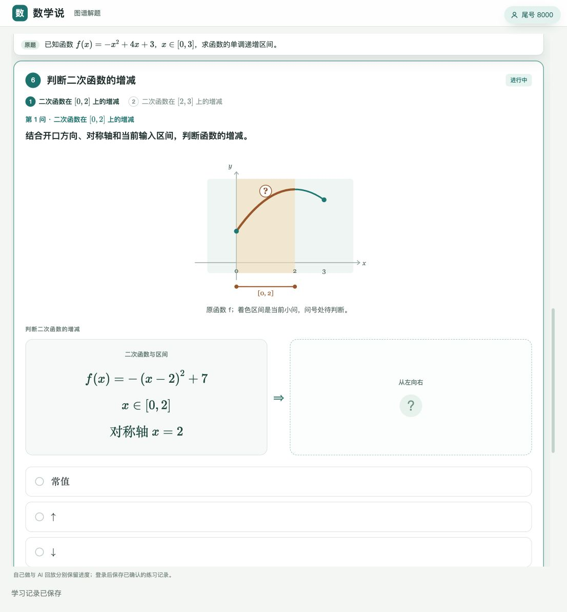
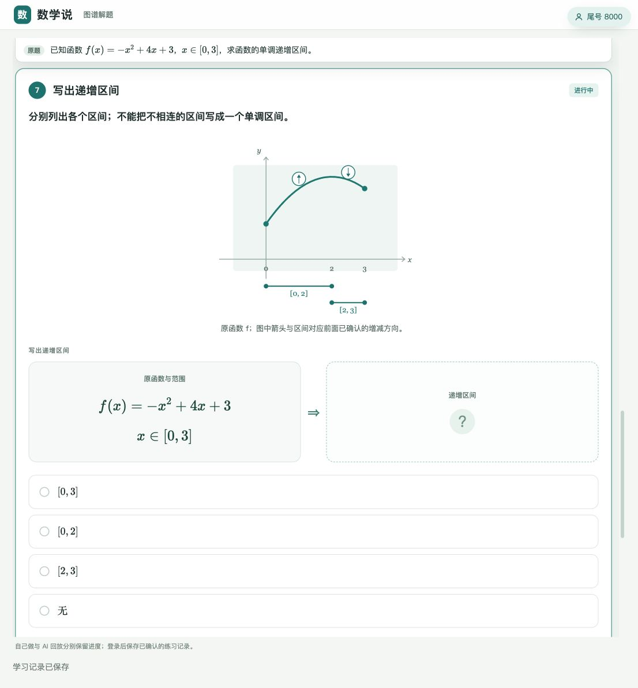
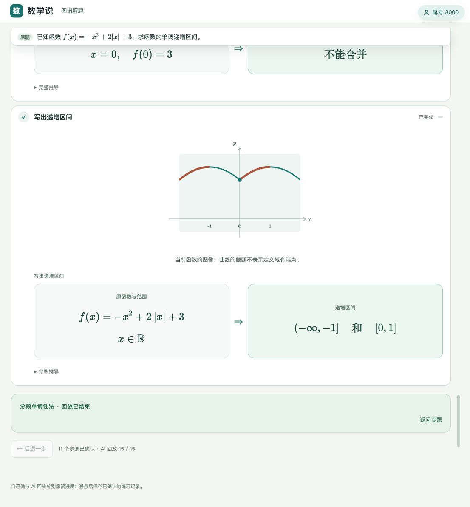

# FM-T1：实现范围、原图与专题验收

日期：2026-11-04。对应 [T1 设计](function-monotonicity-problem-type-design.md) 与 [专题计划](function-monotonicity-topic-plan.md)。状态：首轮具体函数范围已实现，提交前 review 和定向验收通过；本地可用，未部署生产。

## 1. 交付范围

专题入口：`/topics/function-monotonicity/`。五种题型均在专题和 3.2 图谱中登记，只有 T1 有可练课程；T2–T5 标为建设中。

| 题序 | 规划编号 | 页面 | 方法 | 独立校核的递增／递减区间 |
| --- | --- | --- | --- | --- |
| 1 | A03 | `q03/` | 基本函数与复合法；先配成顶点式 | 递增 $[0,2]$，保留题给 $[0,3]$ |
| 2 | A02 | `q02/` | 定义域子方法 → 基本函数与复合法 | 递增 $[-3/2,1/4]$ |
| 3 | A15 | `q15/` | 定义域子方法 → 基本函数与复合法 | 递增 $[1,2]$ |
| 4 | A12 | `q12/` | 定义域子方法 → 基本函数与复合法 | 递减 $(-\infty,-1]$ |
| 5 | A04 | `q04/` | 定义域子方法 → 二次函数 → 开方 → 倒数 | 递增 $(-\infty,-1)$，分母零点排除 |
| 6 | A01 | `q01/` | 绝对值拆段 → 每段调用基本函数与复合法 → 跨段检查 | 递增 $(-\infty,-1]$ 和 $[0,1]$ |

当前课包身份：A01、A03 为 `function-monotonicity-aXX-v2`，A02、A15、A12、A04 为 `function-monotonicity-aXX-v4`。此前配方作答和选法调整、此次复合步骤的交互卡与图像更新，均按课程合同使用新身份。网址保持 `qXX/`，数据库中的旧版本记录保留。

新增三种方法：`method-monotonicity-definition`、`method-monotonicity-structure`、`method-piecewise-monotonicity`。新增两个技能：`skill-composite-monotonicity`（复合函数增减性判断）、`skill-piecewise-order-join`（跨段单调性检查）。

定义法实际调用既有 `method-difference-comparison` 的四步契约，复用整式化简和不等式操作；根式实际调用 `method-domain-intersection`；二次式复用配方；绝对值分段后向 M2 传递子问题，再校验子问题返回值。专题与拍题走同一套阶段二、阶段三和交互编译器，未手写独立题解页。

“函数运算增减性判断”完整技能仍按计划放在 T2；T1 的正数倒数层属于已实现复合链。单调性与不等式互译仍留在 T3。

## 2. 数学与准入边界

- 支持固定有理系数的一次／二次多项式、`sqrt(q)`、`1/sqrt(q)`，其中 `q` 次数不超过二；以及 `P2 + c abs(r*x+s)` 的单绝对值结构。
- 支持题给单个区间；先保留原式限制，再取合法讨论范围。题目声明完整定义域时若与原式冲突，会拒绝，不会偷偷取交集。
- 首轮输入区间端点及定义域二次零点限有理数或无穷。表达式有节点数、深度和系数预算。
- 常值段独立记录，不输出为严格递增或递减。多段答案使用区间族，不能用集合并集把不同单调段合成一段。
- 指定区间证明目前只开放具体多项式；方向错误、区间越过转折点不能得到成功证明。自由参数、抽象关系、多重绝对值、无理输入端点等均不冒充已支持。
- 独立验证器不调用求解函数：重新解析原式，检查定义域、原分段、任意两点差商的严格符号、每层复合的合法性、端点取得性、覆盖与区间最大性；同时核对冻结原目标和子方法返回内容。

## 3. 教学与图像

方法选择使用公共方法关系卡。根式与倒数显示真实曲线；定义域空隙不连接，分母为零处不画端点。原多项式曲线沿用既有二次 Bézier 渲染。

选法关系卡逐项补充小字解释和例子，说明一次、二次、反比例等常见函数与复合结构、绝对值分段以及任意两点作差。具体函数求区间的课程只开放结构法或分段法，定义法在地图中说明但不开放作答；显式要求证明时仍可使用定义法。

遇到二次函数，学生先确认配方所得顶点式，再查看图像、判断增减。主步骤明确写“判断二次函数的增减”，小问分别标出正在判断的区间。图像对当前区间着色并标问号；下一小问保留上一段已确认的箭头；汇总区间时同时展示已确认的两段方向。完成态只保留一幅合并后的增减图，避免重复。

作答时隐藏待求结论，完成后显示对应结论。复合方向逐层确认：先确认开方保序，再确认正数倒数反序；每层显示输入身份、符号条件和函数图像，回放完成态只保留一组内层／原函数对照图。分段题只在真正的绝对值分界点检查跨段合并，不把每个二次函数的对称轴重复当成跨段检查。范围仅落在一段时明确说明无需跨段合并。

复合步骤采用“本层输入 → 本层运算 → 输出函数的增减”的公共交互卡。中间明确展示“开方，$v=\sqrt{u}$”或“取倒数，$f(x)=1/v$”，答题前仅隐藏输出方向，答对后显示保序／反序的推导。图中突出当前输入区间，附区间标识、分割线和已经确认的输入增减箭头；第二层使用开方后的真实图像，不能沿用二次函数图像或把输出方向提前当成输入方向。

## 4. 真实题图与录制证据

题源原图见 `internal/senior-high/source-images/function-monotonicity-planning-20261104/`；人工核对的课程原稿见 `internal/senior-high/authored-courses/function-monotonicity-t1-20261104/`。人工原稿和真实图片识别证据分开保存。

六道题均使用原图裁剪，未擦除笔迹、重画公式或注入人工候选，实际执行 `run_question_image` 的提取和复核调用，每题均为 `extract → review` 两次模型调用，得到 `reviewed_candidate`；随后完成判型和共享阶段三求解。A03 的题给区间被保留，其他题的手写答案没有成为题给定义域。

可复现录制位于 `server/tests/search/fixtures/function-monotonicity/{a01,a02,a03,a04,a12,a15}/`：原裁图、送模图、题源哈希和裁剪坐标、候选、复核、账本、请求与响应及逐文件校验清单。普通测试只回放这些实际响应，禁止意外调用模型。

这六张是开发题源，不冒称未见照片留出集。新拍摄角度、模糊反光和其他教材版式仍待独立留出照片验收。

## 5. 自动化验收

| 层次 | 结果与范围 |
| --- | --- |
| 首轮教学调整后的后端定向回归 | 185 项通过，覆盖单调性数学与交互、阶段三方法注册、执行契约、图形交互合同及拍题录制回放 |
| 单调性专项测试 | 50 项数学、拒绝边界、子方法、交互与结构变式测试；7 项真实录制／拍题服务测试，均包含在上一行内。新增检查配方实际调用、顶点式等价性、逐段揭示箭头，以及定义法只对证明任务开放 |
| 新结构完整执行 | 8 个新增系数／端点变式走实际方法契约、子方法返回及每步交互编译；包含一次退化、常值、单支绝对值和可跨段合并情形 |
| 首轮教学调整后的课程前端 | 127 项通过：8 项本专题完整路线／图像测试，119 项共享图谱练习、流式引擎及函数图像回归；六题均评分到终态、逐步序列化恢复、KaTeX 渲染及 SVG 校验。检查当前区间问号、历史方向保留、完成图去重及无穷端点约束 |
| 生成物 | 新六题教学证据检查通过；公开图谱、专题目录及本专题课程确定性检查通过；旧 `teaching/problems/*.json` 合同未被重写 |
| 代码规范 | 新增 Python 文件 Ruff、`git diff --check` 通过 |

首轮曾完成 502 项更广的后端回归；本次教学反馈修改后重新执行的是上表列出的定向测试。首轮全站检查遗留一项问题：`buildCourses({check:true})` 会要求所有历史 authored 课程都匹配当前全局教学代码指纹，首先报告 `function-concepts-q23b-v2` 需刷新。本轮没有为通过该检查而批量重新求解、改版旧课程，并以文件哈希确认本轮未重写任何非单调性课程数据。新六题已单独检查；历史静态课的运行合同与本地学习服务按题兼容校验保留。不能把定向回归通过表述为全仓库检查全部通过。

后续复合步骤展示调整仅执行必要单元测试：4 项后端交互测试、3 项推导卡 DOM 测试、2 项生成课程图像测试，共 9 项通过。覆盖开方／倒数的运算标识、待答结论隐藏、输入方向、当前区间、分割线、无穷端点和分母零点排除；未重新运行上述完整套件或浏览器验收。修改的 Python 文件 Ruff 与 `git diff --check` 通过。

随后修复运算栏公式抖动：居中的弹性布局使公式容器随字号缩小，触发尺寸监听反复缩放／换行；将公式容器横向撑满运算栏后，测量宽度不再取决于字号。2 项既有缩放与监听单元测试通过，Q02 浏览器复查公式宽度稳定为 142px、字号保持 17px。此次只修改样式和资源引用，六题课包及回放 JSON 均逐字校验未变，未改课程身份或重新发布学习数据。

重跑主要测试（需先按产品测试文档准备隔离实例；实例名与目录用实际配置替换）：

```sh
cd server
PRODUCT_TEST_DATA_DIR=/private/tmp/shuxueshuo-fm-t1-test \
PRODUCT_TEST_INSTANCE=fm-t1-test \
uv run pytest -q tests/solver/test_graph_function_monotonicity.py \
  tests/search/test_function_monotonicity_photo.py
```

仅重建本专题课程（在仓库根目录）：

```sh
for id in a03-v2 a02-v4 a15-v4 a12-v4 a04-v4 a01-v2; do
  node tools/build-graph-walk-topic.mjs \
    --source "site/data/graph-walk/function-monotonicity-$id.source.json"
done
node tools/build-public-knowledge-graph.mjs
node tools/build-topic-overviews.mjs
node --test tools/tests/function-monotonicity-topic.test.mjs
node tools/build-public-knowledge-graph.mjs --check
node tools/build-topic-overviews.mjs --check
```

## 6. 本地发布与人工验收

日常本地学习库已使用 `manage.sh --mode local deploy` 备份后原子同步，学生记录保留；重新加载 8779 服务，`verify-release --site-version site/knowledge/teaching/version.json` 返回 `ok: true, site: match`。本地同步不等于生产发布。

本轮浏览器已验证 A03：读题 → 原生方法选择 → 输入范围 → 配成顶点式 → 两侧方向 → 最终区间；错误顶点式不推进，正确作答保存，刷新显示“已恢复服务端确认的练习进度”。选法说明和例子正常排版；定义法不可选。第一小问图中标出 $[0,2]$ 与问号，第二小问保留前一段的向上箭头并标出 $[2,3]$ 与问号，汇总图同时保留两段方向。

首轮浏览器已验证 A04 的 AI 回放终态及分母零点排除；A01 两个子方法返回、仅在 $x=0$ 检查跨段、用“和”分别列出递增区间。本轮新增步骤后的六题回放、保存状态序列化及恢复由上述前端测试再次覆盖。

此前重新打开旧专题 `/1/q01/` 后正常连接，未出现版本不一致提示。此次复合步骤展示调整后，本地再次完成备份和同步，发布摘要为 `dbe635e04a253c67dc971a9d800041470cb9162c6c700ad6413d95a05a13f57b`；`verify-release` 返回 `ok: true, site: match`。重启后的 Q02 HTTP 返回 200，页面引用 v4 课包与最新展示资源；此次未做浏览器人工验收。隔离测试数据库保持停止，日常 8779 服务保留运行。







## 7. 提交前 review 与拍题回归

本轮 review 修复两项边界问题：

- 原文同时要求“递增区间和递减区间”时，原先只识别一个方向或“单调性”关键词，会拒绝正确的 `both` 目标。现在同时绑定两个方向，也拒绝把双向目标错误提取成单向。
- 教学模板中的区间、对称轴、作差和函数名不再固定为 `x`、`f`；使用原目标的变量及函数名。原自变量为 `u` 或 `v` 时，中间层选择不同名称，避免变量自指。

本轮没有修改识别 prompt。发布导出测试同步加入六题及后续四种规划题型的检查。

| 验收 | 提交前结果 |
| --- | --- |
| 后端与拍题 | 150 项通过：单调性求解、原文方向绑定、变量名、教学交互、六张真实题图录制回放、拍题课程 API、原有文本与配图流程 |
| 拍题完整 API | A01 绝对值、A02 开方、A04 根式倒数完成课程生成；检查各层运算及区间标记，重开恢复同一快照且不重新求解 |
| 前端及发布导出 | 199 项通过：六题完整路线评分／状态恢复、公式与图像、共享流式引擎、课程身份兼容、公开图谱与专题生成物检查 |
| 旧课程兼容 | 当前有生成数据改动的 13 个旧课程，与 HEAD 逐一比较，作答合同和 `bundleVersion` 全部相同；旧题的公开作答合同文件未修改 |
| 新课程重建 | 六题教学证据刷新并检查通过；重建前后的作答合同及课包版本全部相同，不新增版本号或重置进度 |
| 静态检查 | 27 个改动 Python 文件 Ruff 通过；`git diff --check` 通过 |

本次使用已保存的真实模型响应进行回放，未重新调用线上模型，也未重新上传照片做浏览器端验收。上述测试不作为新拍摄角度、模糊反光或带配图性能的验收；带配图题处理较慢仍是已知问题。全历史 authored 证据依赖全局教学指纹的检查限制仍见第 5 节。

本地已在备份后原子同步并重启 8779。最新发布摘要为 `411cdbe5f9949033eeb11a96da31450dd6f370a492b2a399b15fa3946b915855`，`verify-release` 返回 `ok: true, site: match`；Q02 HTTP 返回 200。隔离测试数据库已停止，日常预览服务保留运行。未 push 或部署生产。
