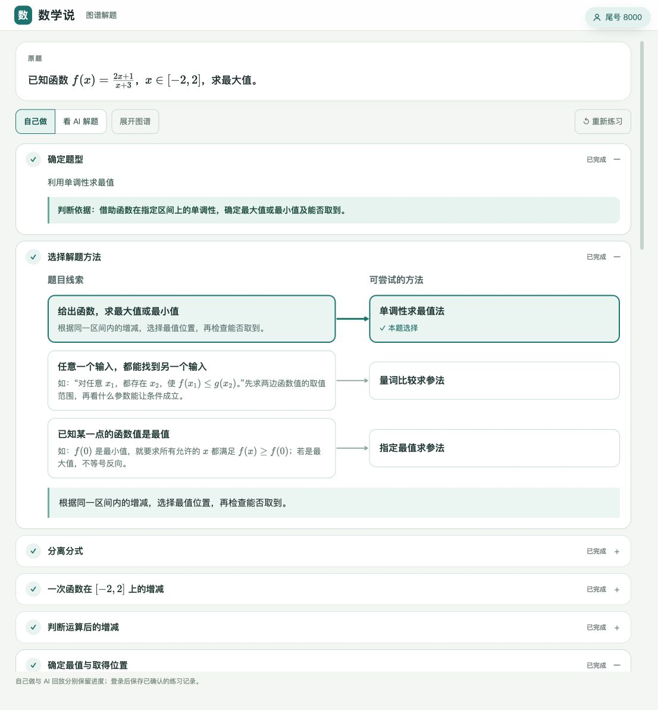
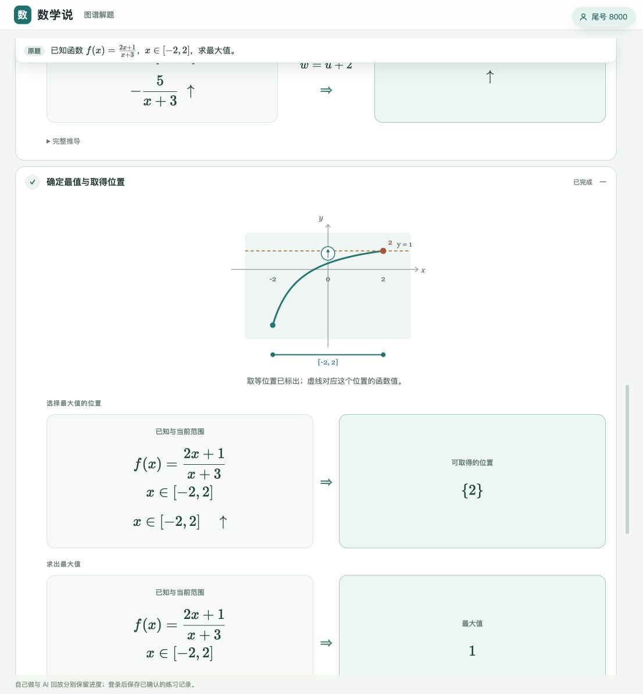
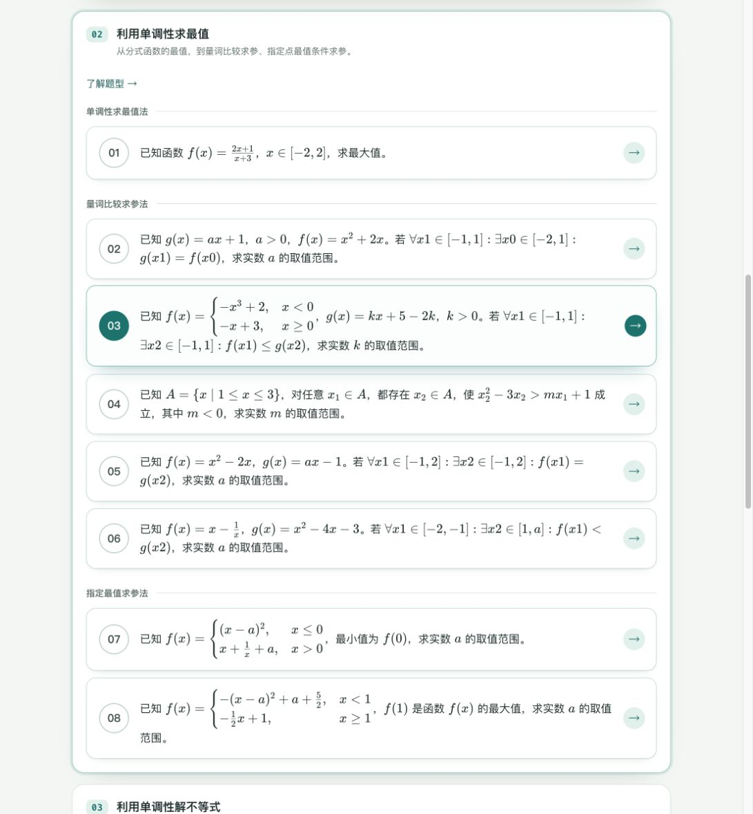

# FM-T2：实现范围、拍题与专题验收

日期：2026-11-04。承接 [FM-T2 开发设计](function-monotonicity-extremum-problem-type-design.md)。本次落实 R0–R3 的受限能力：9 道规范题意可执行并生成交互课包，其中 8 道通过原照片链路后加入本地专题；A14 保留开发预览。R4 的 B15 递推拓展尚未实现。本记录不是整个 T2 或生产发布完成声明。

## 1. 本次入口与题源台账

[函数单调性专题](http://127.0.0.1:8779/topics/function-monotonicity/) 当前包含原有 6 道 T1 和新增 8 道 T2。题源仍是[原四张照片及摘要](../internal/senior-high/source-images/function-monotonicity-planning-20261104/manifest.json)，只按印刷题意定标，不采纳手写答案。

| 原题 | 方法与关键结构 | 数学结果 | 本次状态与入口 |
| --- | --- | --- | --- |
| A16 | M4；线性分式分离、倒数与常数运算 | 最大值 $1$，在 $x=2$ 取得 | 原照片、数学、教学通过；[Q16](http://127.0.0.1:8779/topics/function-monotonicity/q16/) |
| A14 | M4；仿射根式与二次式同向求和 | 最小值 $3$，在 $x=\frac12$ 取得 | 规范题意和教学通过，照片根号范围误读；[仅开发预览](http://127.0.0.1:8779/lab/graph-walk/function-monotonicity-a14-v1/) |
| A07 | M7；独立全称／存在、完整像集包含 | $a\in(0,2]$ | 原照片、数学、教学通过；[Q07](http://127.0.0.1:8779/topics/function-monotonicity/q07/) |
| A18 | M7；受限立方段与一次段、最值比较 | $k\in(0,2]$ | 原照片、数学、教学通过；[Q18](http://127.0.0.1:8779/topics/function-monotonicity/q18/) |
| B16 | M7；命名集合、严格比较、负斜率 | $m<-1$ | 原照片、数学、教学通过；[Q16B](http://127.0.0.1:8779/topics/function-monotonicity/q16b/) |
| B11 | M7；一次函数斜率正／零／负分类 | $a\in(-\infty,-4]\cup[2,+\infty)$ | 原照片、数学、教学通过；[Q11B](http://127.0.0.1:8779/topics/function-monotonicity/q11b/) |
| B10 | M7；非空动区间、二次函数端点竞争 | $a>2+\sqrt7$ | 原照片、数学、教学通过；[Q10B](http://127.0.0.1:8779/topics/function-monotonicity/q10b/) |
| B08 | M8；指定分界点最小值、二次与对勾段 | $a\in[0,2]$ | 原照片、数学、教学通过；[Q08B](http://127.0.0.1:8779/topics/function-monotonicity/q08b/) |
| B14 | M8；指定最大值、顶点分类、开边界 | $a\in(-\infty,-2]\cup[\frac{3+\sqrt{13}}2,+\infty)$ | 原照片、数学、教学通过；[Q14B](http://127.0.0.1:8779/topics/function-monotonicity/q14b/) |
| B15 | C1；倍增递推、无穷块与前缀区间 | 设计金标 $m_{\max}=\frac92$ | R4 待实现；无可执行课包，不进入专题清单 |

9 份[人工审核题意记录](../internal/senior-high/authored-courses/function-monotonicity-t2-20261104/)经过共同语法、特征、源绑定、执行及数学验证后导出，保留人工内容的来源身份。拍题验收使用单独的实际模型输出，不以这些人工题意冒充识别结果。

## 2. 方法、技能与复用

| 对象 | 本次实现 | 复用关系与界限 |
| --- | --- | --- |
| M4 `method-monotonicity-extremum` | 单调性求最值法 | 正式调用 T1 的 M2 子方法；复用配方、分式分离与复合教学；返回最值及取得证据 |
| M7 `method-quantified-range-comparison` | 量词比较求参法 | 复用二次完整值域、含参区间分类和对勾范围计算，保留每次返回的检查；等号要求完整像集覆盖 |
| M8 `method-extremum-condition-parameter` | 指定最值求参法 | 把指定点实际函数值作为界，正式借用区间最值子方法；各段内分类取并集，各段条件取交集 |
| `skill-monotonicity-operations` | 运算增减性判断 | 同区间的和／差、乘常数、加常数、同一非零符号侧取倒数；条件不足时不推断方向 |
| `skill-quantified-range` | 扩展原技能 | 区分两层独立量词的变量、函数和值域角色；不是新增同义技能 |
| `rule-monotonicity-extremum-method` | 本型选法规则 | 对应直接求最值、量词比较求参、指定点最值求参三条路线 |

执行与独立验证位于 `graph_lesson/extremum_math.py`、`stage_three/extremum_runtime.py`；教学和图形投影分别位于 `extremum_presentation.py`、`extremum_graphs.py`。新模块已纳入执行／教学指纹、方法准入、路由、结果和交互协议。

支持范围仍按设计分批限定：固定有理系数的二次／一次式，可分离的线性分式，同向仿射根式与二次式之和；独立的两层 $\forall\exists$；已认证的区间像集；受限 $Ax^3+C$；一端移动的闭区间；两段指定点最值条件。一般乘积／商、任意三次多项式、相互依赖的量词域、未取得最值的量词推广和倍增递推均未因此开放。

原分母禁取点不会因约分消失；界与最值分开记录。等值量词不把有空隙的像集填成区间。B08 不额外要求最值点唯一，B14 保留开边界对应的参数等号。

## 3. 教学流程

- M4：分离分式或核对有效范围 → 必要的辅助函数判断 → 明确命名的运算传递 → 选择合法最值位置 → 代回原式求值。实际子方法仍完整验证，学生卡只复用与当前最值目标有关的步骤，不再重复要求写完整单调区间。
- M7：非空域（如需）→ **不等号先化归为 max／min 比较** → 等号读值域／不等号读最值（二次可先配方**无图**；读图卡标单调箭头；无边界／转折点候选卡）→ 讨论覆盖／比较 → **求参只解参数**（单分支建立＋解，可挂约 2 轴；多分支每支一卡且选项为「判断 \(\Rightarrow\) 参数」）→ 分类合并。B10 比较两端函数值，不只检查顶点位置。交互卡细则见 [interactive-step-card-design-spec.md](interactive-step-card-design-spec.md) §9。
- M8：先求指定点的值 → 写成全域条件 → 分析各段、顶点和边界 → 检查界的取得性 → 建立各参数分支条件 → 先并后交。
- 待答结论隐藏，错误答案不推进；分式／根式图只画合法输入，最值点及水平线在确认位置后出现。候选位置卡从有效证据筛选，B08 正半轴段不再列出区间外的 $-1$；开端点明确作为逼近边界。
- 静态专题与拍题课程共用同一课包和交互运行时，保留自己做／AI 回放、服务端判定、状态恢复及知识图谱入口。

2026-11-05 再次收紧选法卡文案：量词线索改为「一边随便取，另一边都能配上」，小字先说谁随便取／谁配合，再比取值范围求参数；指定最值线索改为「指定某一点已经是最大或最小」，小字用“其他点都不比它更小／更大”，避免只说“不等号反向”。选法值 `quantified`／`specified` 与评分不变。

同日调整 M7 教学顺序与用语：去掉「分清随便取／配合」卡；`ranges` 改为由图像读值域（标单调箭头，无边界／转折点候选卡）；覆盖讨论后再求参，且求参阶段不再计算值域。A07／B11 课包已重建。

同日继续收紧交互卡（写入[交互步骤卡片设计规范](interactive-step-card-design-spec.md) §9）：题面未命名引入 \(g/f\)；完整推导扁平化；多分支求参合并为每支一卡且「条件 \(\Rightarrow\) 参数」进选项；配方卡去图、完成图跟小问；小问确认锚到下一问；选项规范化去重（避免两个 \(\mathbb{R}\)）。A07／B11／B10／B16 已按此重建。

同日补不等号路径：`ranges` 在读最值前增加「先把量词关系化成最值比较」；等号路径不加。B10／B16 已重建。

同日：未命名题先确认 \(g/f\) 记号；不等号 `conditions` 改为代入最值写不等式，不再重问比较关系。

同日收紧 B10 端点竞争板书（写入[交互步骤卡片设计规范](interactive-step-card-design-spec.md) §9.3–§9.4）：函数式／顶点式带 \(g(x)=\)；读最值不重复裸式；比较两端结论用完整差式；分类卡左只留差式、右写 \(g_{\max}=g(1)/g(a)\)；示意为静态虚线 \(y=g(1)\)；参数答案与标签点名 \(a\)（禁止 `a\text{…}` 乱码标签）。B10 已重建。

同日 M8／B08：分离参数准入放宽；学生主线「全域恒成立 → 逐段复用 `quantified_subproblem`（判断转化＋plane 选法）→ `method-separation` expanded」；两段正路均为分离参数（左段放开 \(x=0\) 端点）；对勾式选法前清分母以便落格。父侧无自建选法卡、无「第 N 段／左／右」称谓。讨论结论已写入[交互步骤卡片设计规范](interactive-step-card-design-spec.md) §9.5「调用子方法时要注意什么」与[最值题型设计](function-monotonicity-extremum-problem-type-design.md) §7.2；B08 课包已重建。



浏览器预览已检查 A16 完整回放与 B08 参数分类回放，使用 `preview=1`，没有将自动回放记入日常学生练习记录。A16 的区间、增减方向、最值位置和水平线如下：



## 4. 真实拍题与失败保留

本轮实际调用模型，对归档照片裁出的单题经过提取／复核、题型识别、执行与答案验证。随后把响应和图片冻结为[回放样本](../server/tests/search/fixtures/function-monotonicity-extremum/)，清单逐文件记录摘要。以下时间仅为**阶段一识别时间**，不代表从上传到课程完成的总耗时。

| 题目 | 识别耗时（秒） | 实际调用序列 | 结果 |
| --- | ---: | --- | --- |
| A16 | 10.328 | 提取 → 复核 | 通过 |
| A07 | 25.753 | 提取 → 复核 | 通过 |
| A18 | 27.341 | 提取 → 复核 | 通过 |
| B08 | 17.332 | 提取 → 复核 | 通过 |
| B10 | 14.379 | 提取 → 复核 | 通过 |
| B11 | 15.827 | 提取 → 复核 | 通过 |
| B14 | 25.061 | 提取 → 修复 → 复核 | 通过 |
| B16 修复后 | 26.252 | 提取 → 复核 | 通过 |
| A14 首次／重试 | 88.249／15.125 | 4 次／2 次调用 | 根号横线范围误读，未通过 |
| B16 历史失败 | 54.111 | 提取 → 修复 → 修复 → 复核 | 调用预算耗尽；原记录保留 |

A14 两次都把根号外的二次式包进根号。虽然模型复核状态为 `reviewed_candidate`，这不代表题意正确；误读后的结构不准入 T2。2026-11-06 恢复既有值域路线后，重试记录中的错误表达式可被该路线计算，但这仍是读图失败，不能算作原题验收通过。该题只能使用人工规范题意做开发预览，尚未加入公开练习；历史模型响应保持原样。

B16 原来不支持量词域引用已声明的集合 $A$。本次保留 $A$ 的集合定义与量词内的命名引用，补齐编译与源绑定，再以新照片调用记录验收；没有重写历史失败记录，也没有在识别阶段代求参数。

本次同时修改了共用题源 prompt：明确根号范围、嵌套量词、命名集合及指定最值条件的源语义。规则不含本批题目的答案。固定源语料用于开发，不能冒充陌生照片留出集；新拍摄角度、模糊反光、全页选题及带配图性能未在本轮重新验收。带配图识别慢仍是已知问题。

## 5. 定向验证与兼容性

| 验证 | 结果与范围 |
| --- | --- |
| 数学、T1、参数区间、源片段与记法回归 | 首轮 379 项通过；覆盖原域、常值、孔点、开端点、严格性及独立验证 |
| 最终 T2 数学／教学 | 55 项通过；新增正半轴候选位置回归，涵盖九题金标、参数分支覆盖及证据篡改拒绝 |
| 拍题与执行 | 88 项联合测试通过：T2 数学、T2 原模型录制、T1 原模型录制、两端课程 API 与执行指纹注册 |
| 完整拍题课程 API | M4／M7／M8 各一题完成生成、交互与重开恢复；沿用账号归属和冻结快照，不重复求解 |
| 前端课包与导出 | T2 11 项、T1 12 项、图谱 25 项、导出隔离 1 项，分轮全部通过；验证正确／错误作答、公式、图形和序列化恢复 |
| 服务端原生评分 | 九题完整回放逐步与前端结果一致，错误选项被拒绝 |
| 旧题兼容 | 与本轮开始的 HEAD 对比，107 道已有题的公开作答合同及路径均未变化；T1 六题身份和顺序不变 |
| 生成物 | 公共图谱和专题 `--check` 通过；不手动批改各题 JSON 版本 |
| 静态检查 | 29 个改动 Python 文件的 Ruff F 类检查、`git diff --check` 通过 |

这些测试组有重叠，不累加成一个独立用例总数。没有运行全仓库测试。额外运行的记法协议测试中，`test_schema_documents_each_goal_and_uncertainty_kind` 仍有既有失败：测试枚举遗漏 HEAD 中已存在的 `match_range`，部分既有字段也缺少描述。本次未改该 schema 或放宽测试；同组其余测试与原生评分共 75 项通过。

定向复跑（先准备隔离产品实例，在仓库根目录）：

```sh
PRODUCT_TEST_DATA_DIR=/private/tmp/shuxueshuo-fm-t1-test \
PRODUCT_TEST_INSTANCE=fm-t1-test \
uv run --project server pytest -q \
  server/tests/solver/test_graph_function_extremum.py \
  server/tests/search/test_function_extremum_photo.py \
  server/tests/search/test_function_monotonicity_photo.py \
  server/tests/auth/test_function_extremum_courses.py

node --test \
  tools/tests/function-monotonicity-extremum-topic.test.mjs \
  tools/tests/function-monotonicity-topic.test.mjs \
  tools/tests/public-knowledge-graph.test.mjs \
  tools/tests/public-knowledge-output-isolation.test.mjs
node tools/build-public-knowledge-graph.mjs --check
node tools/build-topic-overviews.mjs --check
```

只刷新本次九题的教学证据和课包，不批量刷新旧专题。源码、照片录制、人工审核题意及生成课包分别保留其职责；历史课包不因教学代码指纹变化被自动重置。

## 6. 本地发布与剩余工作

本地按[内容同步流程](site-login-local-testing.md#专题内容同步)停止 8779、备份后事务发布，再核验学习库与静态清单一致并重启。该操作保留既有学习记录，只是本地内容同步；本轮没有提交、push 或生产部署。

本轮首次本地同步后，又修正了运算输入标识、顶点式显示及候选位置作答卡。由于新题作答合同已变化，八道公开 T2 课程分配 `-v2` 内部身份，学生网址保持不变；本地初次发布的 `-v1` 及其历史记录由学习库保留。A14 从未公开发布，继续使用开发预览 `-v1`。这次没有修改原有 107 道题的内部身份或作答合同。

2026-11-04 发布摘要为 `616b4398b5a457d69fe48eb657be6f82c2f5f3c2c16e86d1258b028a0fda5ae1`；`verify-release` 返回 `ok: true, site: match`。新身份课包再次通过 23 项 T1／T2 前端测试及 9 项服务端评分测试。

2026-11-05 选法卡说明更新后，T2 的 11 项前端课包检查通过；与修改前逐项比较，115 道公开题目的身份、`page_contract_hash` 和 `practice_version` 均未改变。更新后的本地发布摘要为 `e3e0a1c482fa70ed31187efb71a83dd03191ea0b6e1e8e1dc59f786cab371058`，`verify-release` 再次返回 `ok: true, site: match`。

重启后浏览器核对专题共 14 题，T2 的八道题按三个方法排列；打开正式 A16 页面未出现版本不一致提示。最终专题入口如下：



剩余项：A14 原照片根号范围识别；R4 的 B15 递推源语义、无穷分块和前缀验证；独立留出新题及新照片验收。以上均不计入本次通过范围。

## 7. 2026-11-06 代码审查修复

- 同名大卡只在显示层合并，保留各个交互的步骤、完成标记和数学证据。A07 按交互逐次到达、已作答后续传和恢复均通过；不同原选项或情况分支不合并。
- T2 仅接管当前支持的直接最值结构。二次根式等既有值域路线以及上确界请求继续沿用原求解和验证流程。
- 修复零多项式的次数为负无穷时绘图失败，覆盖零函数、根式中的零多项式项及绝对值零函数。

| 本轮验证 | 结果 |
| --- | --- |
| 数学、T1/T2 教学、值域、答案转换、绝对值图像和记法 | 320 项通过 |
| 前端专题、流式追加、恢复和交互界面 | 234 项通过；补充完成卡说明后，受影响的 134 项界面测试再次通过 |
| 拍题录制、T1/T2 课程 API、重开恢复与原生评分 | 隔离数据库中 32 项通过；使用保留的真实模型响应，没有重新调用模型 |
| 公共图谱、生成隔离与跨语言作答兼容 | 31 项通过 |
| 生成物与静态检查 | 公共图谱、专题 `--check`、修复文件 Ruff F 类检查及 `git diff --check` 通过 |

以上分组存在重叠，不累加为独立测试数。九题在本次修复前后的原生作答合同完全一致；同时同步了此前课包与八道公开 T2 教学投影之间的差异。与 HEAD 逐项比较，原有 107 道题的身份、路径、`page_contract_hash` 和 `practice_version` 全部保持不变。没有重算旧专题，也没有同步日常数据库、push 或部署。
