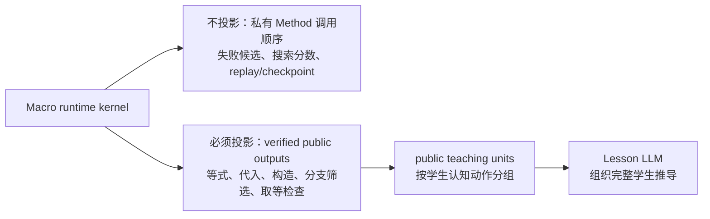
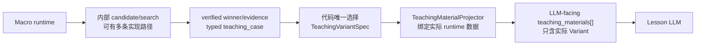
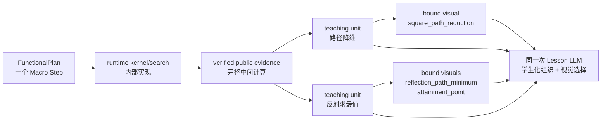
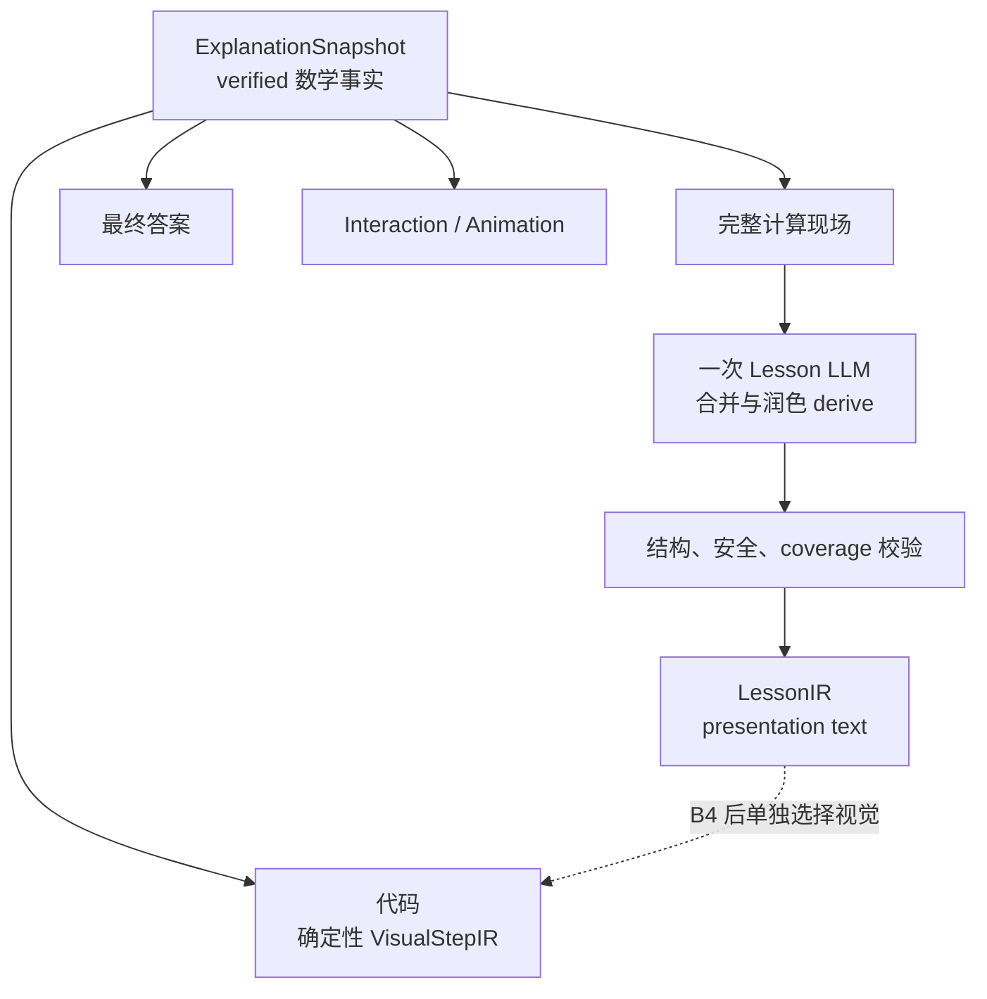
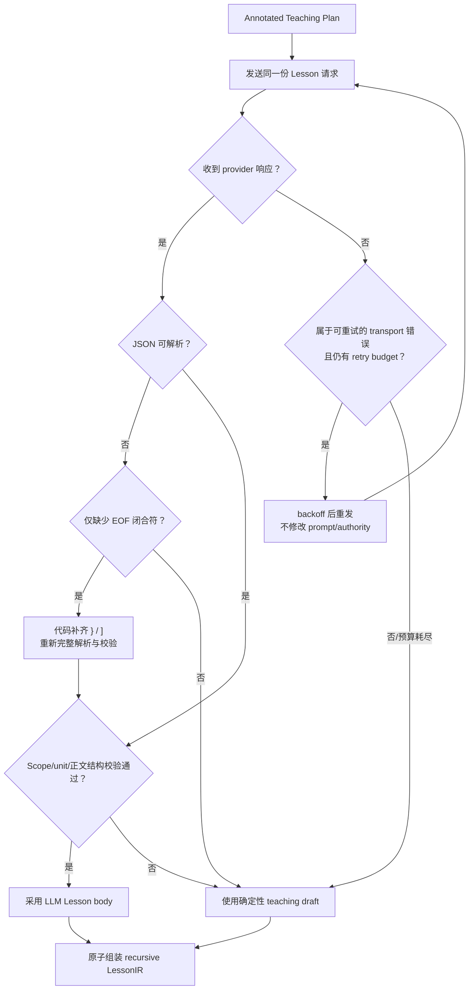
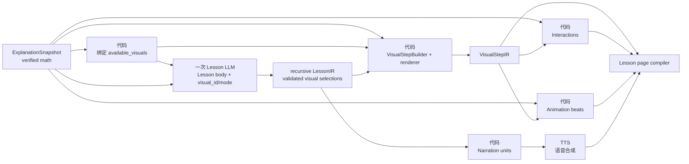

# F5-F5B/G1 Lesson Scope LLM Authoring 与视觉选择 vNext 设计

本文维护 FunctionalPlan 的 Scope Lesson 内容生成契约：完整证据投影、一次内容调用、确定性校验与 fallback、递归 LessonIR。视觉组件由代码绑定；LLM 视觉选择属于可选设计，尚未作为默认能力开放。教学质量须以当前模型与契约重新验收，旧批次成绩不代表当前质量。

## 0. Rule 声明展示与统一绑定

当前基本不等式路径已实现步骤声明与统一绑定。详细约定以
[学生步骤、VisualSpec 与前端组件声明式绑定](student-step-visual-binding-design.md)为准。

- Method 解释代码从成功执行的公开证据产生基础学生步骤和 VisualSpec；Family 引用注册 rule ID，由编排代码保留、合并或新建步骤，并声明对应 VisualSpec。
- rule 与 Method 使用相同的展示规格、角色 binder 和组件绑定注册机制。Family matcher 不判断前端组件，rule 不直接调用 renderer。
- 编排输出是草稿。Lesson LLM 可润色标题/正文，并按声明边界合并同 Scope/Goal 的连续材料；数学内容、来源、依赖和必要独立边界由代码保持。
- LLM 继续用局部 `source_steps` 声明材料组合，不回写 VisualSpec 或前端参数。内部 authority 保留步骤内 `visuals`；LLM 后统一校验、处理展示组合和组件绑定，才生成最终学生步骤及导航。
- 数学对象图形使用对象 identity、Frame 继承与生命周期；自定义教学图使用并存、覆盖、组合或独立规则，默认不继承。两类可以在同题或同一步并存，不能一概套用二次函数场景合并。
- 概览只读引用后续证据，不重复占用详细片段覆盖，不伪装成 Runtime Step。后续才获得的结论不能作为观察阶段已知事实。
- 非法合并局部恢复 rule 的确定性草稿与展示，LLM 不可用时直接使用草稿；不新增 Lesson 语义 retry，也不声称结构校验能证明每句文案。

Method 多学生单元、rule 步骤内 `visuals` 与统一绑定使用当前注册契约。下文 G1 的 LLM 视觉候选选择仍仅为可选未来方案，基本不等式 4B 不启用该方案，不要求 LLM 选择组件。

## 1. 结论

F5-F5B vNext 采用以下边界：

1. 输入是与 Canonical Plan 同构的递归 Scope/Goal/Step 树。
2. 每个 Step 都携带完整的 student-safe 输入、实际 runtime outputs，以及从 verified evidence
   投影出的中间计算结果。runtime checks 只保留在 Snapshot/authority/debug；教学必要事实先
   提升为 calculation 或 teaching material，不直接进入 LLM wire。
3. Method 保留声明一个最小 `TeachingUnitSpec` 的能力：声明了就使用，未声明时由代码根据
   Method intent/capability 生成一个默认 unit。原子 Macro 隐藏多个认知动作时，声明有序的
   `TeachingUnitSpec[]`；若 Macro 存在多种学生推导真正不同的数学分支，则声明内部
   `TeachingVariantSpec[]`，由 verified evidence 唯一选择实际 Variant。内部候选搜索或等价
   实现路径不建立 Variant。稳定 variant/unit key 只属于代码内部 authority；代码先用
   verified runtime 数据绑定实际 Variant 的 unit 模板，再按 Canonical 顺序向 LLM 直接内联建议的
   `title/nav_title/goal/derive/conclusions` 和完整计算材料，不存在 guide/unit registry、
   unit ID 或视觉字段。
4. LLM 根据绑定完成的建议草稿和当前题真实输入、输出、中间计算结果，直接输出学生化
   `title/nav_title/goal/derive`，并自行决定同一 Scope/Goal 中 canonical-contiguous
   teaching materials 的合并（新增 rule 路径遵守声明的独立与合并边界，见 §0）；verified conclusions/box 由代码注入，不回显
   `fact_ids/uses`，也不使用 locked math spans。
5. LLM 在代码固定的 Scope/Goal 容器中填写完整 Lesson body；不输出 owner，不移动步骤。
6. 原子 Macro 在 FunctionalPlan 中始终是一个 Step；教学层只展开 verified public
   teaching units。该 Step 必须同时向 LLM 提供支撑所有 units 的 student-safe verified public
   outputs 和中间计算结果；这些事实只在 Step execution 中保存一次，不按 unit 复制或静态
   分配。只隐藏内部 Method chain、search candidate、replay trace 等执行实现。换言之，隐藏的
   是“代码怎么运行”，不是“数学上怎么算出来”。
7. F5-F5B v1 不设计 Lesson 语义 retry。代码只校验结构、owner、coverage 和安全边界，
   不证明 LLM 每一行推导的数学语义；结构校验失败则回退确定性教学草稿。网络超时、
   限流等 provider transport retry 不属于 Lesson 协议。
8. 最终 LessonIR 由代码按原 Scope/Goal topology 原子组装为递归树。
9. B3 不包含视觉字段；Method/Macro 的视觉候选在后续独立阶段提供，不能增加当前教学
   文本合同复杂度。
10. 后续 Visual selection 只能选择代码绑定的 `visual_id/mode`，不能填写坐标、点线角色、
    样式或动画结构，也不反向修改 B3 教学正文。
11. 视觉组件选择与渲染放在本计划最后一个实现阶段；前面的 Snapshot、输入投影、Lesson
    output、评测和 recursive LessonIR 必须先独立通过。

核心目标不是让代码替 LLM 写完课程，而是：

> 代码提供完整、真实、可追溯的数学计算材料；LLM 把这些材料组织成学生能读懂的步骤。

下述视觉选择原则仅属于可选 G1，§0 的 4B 路径由代码声明并绑定组件：

> 代码提供已验证、已绑定、可渲染的视觉选项；LLM 选择当前教学阶段最合适的选项；代码
> 负责最终图形。

## 2. 当前实现事实

### 2.1 F5-F5A 已有事实边界

当前 `ExplanationSnapshot` 已经保存：

```text
root_scope
├── scope_ref
├── steps[]
│   └── TeachingSource
├── goals{goal_ref}
│   ├── steps[]
│   └── answer_from
└── children[]

TeachingSource
├── source_step_id
├── capability_id
├── inputs{}              # 精确 ref + 已验证 runtime value/display
├── outputs{}             # 全部实际公开结果
├── calculations[]        # evidence projector 生成的学生可读计算
└── checks[]              # 学生可读校验结论
```

Scope/Goal owner 来自 Canonical Plan 容器，不从 runtime placement、标题、点名或依赖关系
猜测。当前 `explanation-snapshot/v3` 已物理删除 `cross_scope_references`、stub trace 和
Step 侧 `evidence_refs`；精确依赖内联到 consumer input ref。Evidence 的数学内容已经投影为
就地 `calculations/checks`，不透明 evidence key 只在代码内部按 Canonical `step_id` 归属，
不进入 Annotated Teaching Plan 或 LLM 输入。

### 2.2 当前代码中的 Lesson retry

当前代码存在一个可选的 `LLMLessonPlanner`：

- 默认 `max_attempts=3`；
- 每轮把前一轮 draft、normalization、diagnostic 和 repair summary 再发给 LLM；
- 校验成功后生成旧 flat LessonIR；
- repair budget 用尽后抛出 `ExplanationRepairLoopError`；
- `ExplanationBuilder` 捕获异常并回退 deterministic skeleton。

它主要检查：

```text
JSON / steps Schema
candidate_group_id / source_step_id 是否存在
是否跨 Scope 合并
是否违反 cognitive merge boundary
是否遗漏 required candidate group
derive 是否是要求的二维格式
是否引用未知 handle、点、事实或结论
最终答案是否出现在相关 box
```

但是 `ExplanationBuilder()` 默认的 `lesson_planner=None`，当前仓库中显式注入
`LLMLessonPlanner` 的调用主要位于专项测试；默认路径是确定性 Lesson builder。因此：

> 当前代码拥有旧 repair 能力，但当前默认 Lesson 生成没有生产可达的 LLM retry。

## 3. 设计目标与非目标

### 3.1 目标

- 给 LLM 足够完整的当前题计算现场，而不是只给抽象模板或片段。
- 让 LLM 真正负责讲解组织，而不是只给代码生成的固定文案换几个词。
- 让 Scope/Goal owner 由 JSON 容器直接表达。
- 同时支持：
  - 普通 Function 的一个计算动作；
  - 相邻机械 Function 的合并；
  - 一个原子 Macro 的多个学生认知动作；
  - Scope-owned shared producer；
  - 跨 Goal/Scope 的公开结果引用。
- 所有公式、数值、对象、构造和取等条件可追溯至 runtime output 或 verified evidence。
- 一次 Lesson 语义生成失败不影响页面生成：连接超时、网络错误、provider 5xx 或限流先按
  通用 LLM client 的有限 transport retry 策略重试；重试耗尽后才使用确定性 fallback。
  已收到响应仅允许安全补齐 EOF 缺失的 JSON 闭合符；其他 JSON/结构错误不做语义 repair，
  直接按整题或 Scope 粒度 fallback。
- 视觉选择留给最后的独立阶段，不进入 B2/B3 输入输出。

### 3.2 非目标

- 不让 LLM 重新解题或验证数学正确性。
- 不把 Macro 内部 Method chain 重新变成 Planner/Lesson wire。
- 不让 LLM 生成 runtime handle、checkpoint、search candidate 或内部 synthetic object。
- 不让 LLM 修改 Scope/Goal topology、answer producer 或依赖图。
- 不让 Lesson LLM 发明或选择视觉组件、填写几何 role binding、坐标布局、颜色偏移、
  interaction formula 或 animation timeline。
- 不在 v1 增加第二个 Visual LLM 调用或让 LLM 直接输出底层 `Point/ColoredLine/SVG`。
- 不在 F5-F5B v1 建立另一套复杂 retry/patch/merge 协议。

## 4. 权威与职责

### 4.1 代码负责

代码只负责不能交给 LLM 猜测的事实和边界：

- Scope/Goal topology；
- Step owner、canonical order 和 dependency edges；
- Step 的 resolved student-safe inputs；
- 全部实际物化的 public runtime outputs；
- verified evidence 中可教学的中间计算结果；
- Macro 当前 winner 的公开等价证明、构造、最值表达式和取等检查；
- calculation provenance 和应完整提供给 LLM 的实际 verified results；
- Method 声明或代码兜底生成的单个教学单元，以及原子 Macro 当前 verified 学生推导所选中的
  有序教学单元；
- runtime value 的 student-safe `value/display` 投影；
- 后续视觉阶段的组件 registry、Method/Macro 候选与 verified role binding；
- 最终答案、Visual geometry、interaction 和 animation 的数学权威；
- 输出 Schema、校验、fallback 和 LessonIR 组装。

代码不应继续替每一道题完成：

- 当前题学生标题；
- 当前题讲解目标的完整措辞；
- 每一行之间的自然语言过渡；
- 输入中哪些已经验证的可选计算值得展示；
- 同一 Scope/Goal 中哪些 canonical-contiguous teaching materials 值得合并；
- 学生讲解应该强调哪一个已验证机制。

### 4.2 LLM 负责

LLM 根据绑定完成的 suggested draft 与完整计算现场负责：

- 润色每个学生步骤的 title、nav_title 和 goal；
- 以 suggested derive 为可信底稿，结合 verified calculations 调整为完整的
  `∵ / ∴ / 作 / 设 / 计算` 推导；
- 可以改写已有推导的措辞、合并重复表达，并补充不产生新数学事实的自然语言衔接；只能
  使用当前 materials 的 `derive/calculations/conclusions` 中已经明确给出的计算，不能自行
  新增代入、化简、方程、坐标计算或数值运算；
- 不回显关键结论；代码从所消费材料的 verified `conclusions` 生成 box；
- 为关键跳步补充少量不引入新数学事实、学生能理解的自然语言解释；
- 选择必讲事实之外的可选细节；
- 在同一 Scope/Goal 中自行判断 canonical-contiguous teaching materials 的讲解粒度与合并；
- 决定一个 Macro 的 public outline units 是保持分开，还是合并成一个较长步骤；
- 删除重复但不影响证明闭合的表述；
- 形成学生友好的导航标题。

LLM 不负责产生新的数学量。TeachingUnitSpec 保存通用讲解模板，但不保存当前题答案；代码
必须先用 verified runtime 数据把模板绑定成含具体公式、对象和结论的 suggested draft，再交给
LLM。LLM 也不负责把视觉组件绑定到本题对象或选择组件。

### 4.3 运行时 role 与讲解 role

需要区分两种“角色绑定”：

```text
runtime role resolution
    决定哪个真实对象是 moving_point、fixed_endpoint、square 等
    属于 Solver 正确性，必须由代码验证

lesson wording role mapping
    决定学生文本中如何称呼这些已验证对象、先讲哪个关系
    可以由 LLM 根据完整 evidence 完成
```

例如 `quadratic_square_path_minimum` 的 runtime 已经验证：

```text
moving_point = G
fixed_endpoint = M
reflect_source = A
moving_locus = y=-c/2-1/2
```

这些必须由 runtime evidence 给出。Explanation 层不需要再写一个专用 binder 来重新发现
这些对象；LLM 只负责把已给出的 `G、M、A、轨迹` 组织成学生语言。

## 5. 输入合同：Annotated Teaching Plan

建议新增：

```text
functional-annotated-teaching-plan/v1
```

它只用于 Lesson LLM prompt，不进入 Canonical Plan hash。

### 5.1 树结构

```text
AnnotatedTeachingPlan
├── problem
├── answers
├── root_scope
│   ├── scope_ref
│   ├── steps[]?                    # 仅非空时
│   ├── goals{goal_ref}: steps[]?   # 仅含有材料的 Goal
│   └── children[]?                 # 仅非空时
```

LLM-facing Plan 不回显 `schema_version`，并省略所有空集合。Scope/Goal topology 与顺序仍由
树和容器表达；完整 Canonical topology、owner 与 hash 保存在代码内部 authority。

教学层不再区分 `scope_steps` 和 `lesson_steps` 两种字段。Scope 与 Goal 容器都使用
`steps[]`；在同一 artifact 内，两处数组的元素类型完全相同，只有 owner 不同。所在容器
已经唯一表达 owner：

```text
Canonical Scope.scope_steps  -> Teaching Scope.steps
Canonical Goal.steps         -> Teaching Goal.steps
```

这只是教学投影时的字段名归一，不要求 FunctionalPlan 修改已有的 `scope_steps`
公开合同。

不再保存单独的 `cross_scope_references[]`。Projector 在发送前仍按 Snapshot 的精确
SourceRef/StepResultRef 验证依赖；LLM 只接收已经解析出的实际输入值，不接收 ref。

同样不保存 `teaching_guides{}`。普通 Method 可以声明一个最小 `TeachingUnitSpec`，未声明
时由代码生成默认值；单一学生推导的原子 Macro 可以声明有序的 `TeachingUnitSpec[]`，多种
学生可见推导的 Macro 则声明 `TeachingVariantSpec[]`，每个 Variant 内含自己的有序 units。
代码解析声明、生成内部 stable key/owner/provenance sidecar 后，只把实际 Variant 的教学信息
按顺序直接投影到当前 Step。LLM 不通过注册表查找教学提示，也不看到或回显任何 unit/variant
ID。

多数学分支 Macro 在投影前必须已由 verified `teaching_case` 唯一选择
`TeachingVariantSpec`；`materials[]` 只包含实际 Variant 的 units。未选择 Variant、
其他候选及 Variant key 不属于 LLM 输入合同。

### 5.2 Step 结构

```text
AnnotatedTeachingStep
├── inputs{}?                 # type + value + display
├── outputs{}?                # type + value + display
├── calculations[]?
└── materials[]
    ├── title
    ├── nav_title
    ├── goal
    ├── derive[]              # "∵ ..." 等完整字符串
    └── conclusions[]         # verified，代码最终生成 box
```

每个 verified Step 至少投影一份 material。`step_id/capability_id/intent/ref/execution` 不进入
LLM wire；它们与 source/unit/evidence provenance 保留在同步 authority 中，代码用容器内
材料位置完成响应绑定。

`derive` 是已经套入本题 runtime 数据的学生数学语言，每行是以
`作/设/∵/∴/计算` 加空格开头的字符串，不是“代入、求解、写出结果”这类空泛动作清单。删除
`important_calculation_ids`、unit calculation/check mapping、`merge_policy` 与 `must_separate`。
每个 Step 的完整 calculations 只出现一次；建议草稿引用其公开数学内容，但不取代 verified
facts。runtime checks 属于 Snapshot、authority 与 debug，不进入 LLM-facing 合同；如果某项
check 含有学生理解推导所必需且尚未出现的数学事实，projector 必须先把该事实提升为
calculation 或绑定后的 teaching material，不能依赖 `checks` 字段传达。LLM 自行判断详略以及
如何组织最终学生步骤。`materials[]` 的数组位置
就是 Canonical 顺序；稳定 key、source Step、owner、evidence 和 bound visual ownership 只
保存在代码内部 sidecar。代码只校验材料覆盖、owner、canonical order 与 contiguous grouping，
不判断教学上应不应该合并。

LLM 只需要当前题实际值，不需要理解 Planner 引用。例如：

```json
{
  "type": "Parabola",
  "value": "-x**2 + (1-c)*x + c",
  "display": "y＝－x²＋(1－c)x＋c"
}
```

`value` 用于精确审计，`display` 用于学生文本。Prompt 中不得要求 LLM 自己把 SymPy 字符串
翻译成数学排版。

### 5.3 已绑定视觉候选（后续阶段）

B2/B3 不投影任何视觉候选。以下设计仅供最后的视觉阶段使用，不能反向修改已经审阅的
Annotated Teaching Plan 或 Scope Lesson 合同。

普通 Method 的 visual spec 和 Macro outline unit 可以声明“哪些语义组件可以表达这个数学
动作”。它们不声明当前题点名，也不写底层页面元素。组件 registry 声明 required roles、
supported modes 和确定性 renderer；代码用 Snapshot/evidence 完成 role binding 后，才把
成功绑定的候选内联到当前 teaching material 并投影给 LLM：

```text
Method/Macro visual options
    + verified evidence
    + geometry inventory
    → bound visual candidates
    → student-safe available_visuals
```

LLM-facing 形态保持紧凑：

```json
{
  "visual_id": "derive_path_minimum_ii:square_reduction",
  "component_id": "square_path_reduction",
  "description": "展示正方形、中点和中心关系如何把原路径化为 AG＋MG。",
  "shows": [
    "正方形 AEKG",
    "HF＋FM＋MG＝AG＋MG"
  ],
  "supported_modes": [
    "static",
    "progressive_reveal"
  ],
  "recommended": true
}
```

内部 authority envelope 另外保存 renderer 所需的绑定：

```json
{
  "visual_id": "derive_path_minimum_ii:square_reduction",
  "component_id": "square_path_reduction",
  "role_bindings": {
    "square": ["A", "E", "K", "G"],
    "midpoint": "F",
    "center": "H",
    "original_segments": ["HF", "FM", "MG"],
    "replacement_segments": ["AG", "MG"]
  },
  "source_evidence_refs": [
    "evidence:derive_path_minimum_ii:path-minimum"
  ]
}
```

第二份 envelope 不进入 LLM response，也不允许 LLM 回显或修改。其规则是：

- 只暴露本教学 unit 实际可用且 role binding 唯一成功的候选；
- 零候选时不伪造组件，记录 typed VisualGap/default diagnostic；
- 同一 `visual_id` 在一次请求内唯一并绑定当前 Snapshot hash；
- `description/shows` 是组件的学生效果说明，不是底层 renderer API；
- 不向 LLM 暴露 `from/to/at/dx/dy/color`、geometry internal ID 或 timeline beat；
- 每个 unit 通常只暴露 `1–4` 个候选，不发送全局组件目录。

这意味着 LLM 可以选择“展示路径等价替换”，但不能把其中的 `G` 换成 `E`，也不能自造
一条页面直线。

## 6. “完整中间计算结果”的定义

LLM 需要看到的不只是最终 Step output。

这里必须区分“内部执行过程”和“公开数学推导”：



因此，Macro 虽然在 Plan 中只有一个 Step，LLM 仍会收到这个 Step 求解过程中所有对学生
有意义、经过 runtime 验证且允许公开的中间数学结果。代码只是不把这些结果背后的私有实现
拓扑暴露成可编辑的 Lesson/Plan 结构。

### 6.1 必须投影

对每个成功 Step，输入必须包含：

1. 所有实际物化的 public runtime outputs；
2. 输出的 student-safe display；
3. 产生结论所需的 verified intermediate calculations；
4. 当前题实际使用的构造、等式、代入、候选过滤、分支选择和取等条件；
5. 与最终 answer/后续 Step 直接相关的结果；
6. Macro public evidence 中的等价证明和 attainment checks；
7. symbolic closure 中真正使用的方程、已知代入、解和被排除分支。

### 6.2 不投影

“完整”不等于把 runtime debug 全部交给 LLM。以下内容禁止进入 prompt：

- StateVersion、CallResult、checkpoint 和 transaction；
- Macro shadow branch、失败 candidate 和 search score；
- 内部 MethodInvocation chain；
- synthetic PointRef/path；
- cache key、hash 实现细节和 replay trace；
- 未被 winner 使用的 provisional output；
- 只用于代码证明器的低层 SymPy 调用过程。

多数学分支 Macro 的 verified evidence sidecar 可以额外保存 typed `teaching_case`，仅供
TeachingVariantSpec 选择。它不是学生数学事实，不进入 calculation、Annotated Teaching Plan
或 prompt；选择完成后只保留实际 Variant 绑定生成的学生材料。

### 6.3 统一 calculation 形态

所有 Method/Macro evidence projector 最终都转换为统一 student-safe calculation：

```json
{
  "kind": "equivalence_chain",
  "value": {
    "statements": ["FM=AE/2", "HF=AG/2", "AE=AG"],
    "result": "HF+FM+MG=AG+MG"
  },
  "display": ["FM＝AE/2", "HF＝AG/2", "AE＝AG", "HF＋FM＋MG＝AG＋MG"]
}
```

calculation/evidence ID 只在内部 authority/debug 中存在，不进入 Lesson LLM wire。

## 7. TeachingUnitSpec、默认兜底与 few-shot

### 7.1 当前代码事实

当前仓库没有 `TeachingGuide` 类型、独立 JSON 文件或全局注册表。接近该概念的旧数据实际
分散在：

- 普通 Method：类型定义是
  [`MethodExplanationSpec`](../server/shuxueshuo_server/solver/contracts.py)，实例通常直接写在
  `runtime/methods/*.py` 的 `SPEC.explanation` 中，例如
  [`quadratic_from_constraints.py`](../server/shuxueshuo_server/solver/runtime/methods/quadratic_from_constraints.py)；
- Macro/Recipe：类型定义是
  [`RecipeExplanationSpec`](../server/shuxueshuo_server/solver/runtime/recipes/_spec.py)，实例直接
  写在 `runtime/recipes/*.py` 的 `RecipeSpecSource.explanation` 中，例如
  [`quadratic_square_path_minimum.py`](../server/shuxueshuo_server/solver/runtime/recipes/quadratic_square_path_minimum.py)；
- Macro 拆步提示：`recommended_lesson_splits`、`TeachingSubstepSpec` 与 recipe visual 的
  `teaching_substep_templates`，同样分散在 recipe、contract 和 visual spec 中。

这些字段服务当前 deterministic/flat Lesson builder，不是已存在的 vNext TeachingGuide。
当前和平 Macro 甚至同时在
[`runtime/methods/quadratic_square_path_minimum.py`](../server/shuxueshuo_server/solver/runtime/methods/quadratic_square_path_minimum.py)
和上述 recipe 文件中声明 `MethodExplanationSpec` 与 `RecipeExplanationSpec`，两边都保存
标题、目标或推导模板，正说明旧结构存在重复。

当前生产链确实把这些模板交给 Lesson LLM：`teaching_expansion.py` 一方面投影原始
method/recipe explanation metadata，另一方面先绑定本题 role 生成
`teaching_expansion_draft.student_title/student_nav_title/proof_draft/box`；当前 prompt 要求 LLM
优先使用该可信草稿。vNext 的目标不是删除这类教学先验，而是合并重复 spec、只发送绑定后的
student-safe suggested draft，不再发送原始 role schema、binder ID 或占位符模板。

### 7.2 vNext：Method 保留一个可选 TeachingUnitSpec

普通 Method 通常已经是一个细粒度计算动作，但仍保留声明教学意图的能力：

```text
TeachingUnitSpec（代码侧）
├── unit_key                    # required，仅内部稳定 key
├── title_template?             # 建议步骤标题
├── nav_title_template?         # 建议短导航标题
├── goal_template?              # 建议教学目标
├── derive_templates[]          # 建议 ∵/∴/作/设/计算 数学推导
└── box_templates[]             # 建议框出的结论
```

除 `unit_key` 外均允许省略；投影器必须用 verified 数据补齐为 LLM-facing material 字段。
模板变量只允许引用该 Step 的 student-safe verified binding namespace。

```python
teaching_unit=TeachingUnitSpec(
    unit_key="derive_model",
    title_template="代入已知点求函数解析式",
    nav_title_template="求函数解析式",
    goal_template="把已知点坐标代入二次函数，求出待定系数。",
    derive_templates=(
        ("∵", "{constraint_points_display}在{curve_template_display}上"),
        ("∴", "分别代入得{equation_system_display}"),
        ("∴", "解得{coefficient_solution_display}"),
        ("∴", "{result_curve_display}"),
    ),
    box_templates=("{result_curve_display}",),
)
```

如果声明存在，代码使用该声明；如果未声明，代码确定性兜底生成：

```text
title/nav_title/goal
    ← Method intent/capability title

derive
    ← student-safe calculations 的 dependency order

conclusions
    ← materialized public outputs / answer producer
```

模板占位符只能读取 typed evidence projector 暴露的 student-safe verified bindings。代码在
投影前先完成绑定；`unit_key`、原始占位符、role schema 和 binder identity 都不进入 prompt。
例如本题 runtime 已经求得具体点、方程与系数后，LLM 直接收到：

```json
{
  "materials": [
    {
      "title": "代入已知点求函数解析式",
      "nav_title": "求函数解析式",
      "goal": "把 A、D 的坐标代入二次函数，求出待定系数。",
      "derive": [
        "∵ A(-1,0)、D(2,-3)在 y=ax²+bx-3 上",
        "∴ 分别代入得 a-b=3，2a+b=0",
        "∴ 解得 a=1，b=-2",
        "∴ 抛物线解析式为 y=x²-2x-3"
      ],
      "conclusions": ["y=x²-2x-3"]
    }
  ]
}
```

因此 suggested derive 已经是“因为哪些具体条件，所以推出哪些具体等式和结论”的数学语言，
不是让 LLM 根据“代入、解方程、写答案”等动作词重新补数学内容。LLM 读取 Step 的完整
`inputs + outputs + calculations` 审核上下文，并把 suggested
`title/nav_title/goal/derive/conclusions` 作为可信参考进行润色、详略调整与相邻材料合并；
其中 conclusions 只供代码生成 box，LLM 不回显。

vNext 不继续读取旧 `MethodExplanationSpec` 对象，但不会丢弃其中有价值的标题、导航标题、
目标、推导和结论模板；这些字段迁入可选 `TeachingUnitSpec`。旧 role schema/binder 中若有
内容承担 student-safe fact projection，则迁入 typed evidence projector；视觉信息继续留在
独立 MethodVisualSpec。

### 7.3 单一学生推导的原子 Macro 声明有序 TeachingUnitSpec 数组

原子 Macro 在 FunctionalPlan 中只有一个 Step，却可能隐藏多个学生必须理解的认知动作，
因此在公开 Macro/Recipe spec 上声明有序的最小 units：

```python
teaching_units=(
    TeachingUnitSpec(
        unit_key="path_reduction",
        title_template="利用正方形关系化简路径",
        nav_title_template="路径降维",
        goal_template="证明原三段路径等价于一条单动点折线路径。",
        derive_templates=(
            ("∵", "{midpoint_relation_display}"),
            ("∵", "{center_relation_display}"),
            ("∴", "{path_equivalence_display}"),
        ),
        box_templates=("{reduced_objective_display}",),
    ),
    TeachingUnitSpec(
        unit_key="reflection_minimum",
        title_template="利用反射求路径最小值",
        nav_title_template="反射求最值",
        goal_template="确定动点轨迹，利用反射拉直路径并说明取等位置。",
        derive_templates=(
            ("∵", "{moving_locus_display}"),
            ("作", "{reflection_construction_display}"),
            ("∴", "{straightened_path_display}"),
            ("∴", "{minimum_and_attainment_display}"),
        ),
        box_templates=("{minimum_expression_display}",),
    ),
)
```

如果 Macro 只有一种学生可见推导且未声明，代码同样兜底生成一个 `default` unit；存在多种
学生可见推导时使用下一节的 Variant 合同。声明只回答“这个原子 Macro 中有哪些公开认知
动作，以及代码建议学生如何讲清这些动作”。它仍不指定：

- 哪个 calculation 最重要；
- calculation/check 应属于哪一个最终 Lesson Step；
- units 必须分开还是允许合并；
- 当前题点名、表达式、答案或取等值。

LLM 不需要知道 `path_reduction`、`reflection_minimum` 或拼接后的 unit ID。投影时保持声明
顺序，模板套入本题 verified runtime 数据后，直接提供建议草稿：

```json
{
  "materials": [
    {
      "title": "利用正方形关系化简路径",
      "nav_title": "路径降维",
      "goal": "证明 HF＋FM＋MG 等价于 AG＋MG。",
      "derive": [
        "∵ F 是 AE 的中点，所以 FM＝AE/2",
        "∵ H 是正方形中心，所以 HF＝AG/2",
        "∵ AE＝AG",
        "∴ HF＋FM＝AG",
        "∴ HF＋FM＋MG＝AG＋MG"
      ],
      "conclusions": ["HF＋FM＋MG＝AG＋MG"]
    },
    {
      "title": "利用反射求路径最小值",
      "nav_title": "反射求最值",
      "goal": "确定 G 的轨迹，利用反射拉直 AG＋MG 并求取等点。",
      "derive": [
        "∵ G 在直线 y=-c/2-1/2 上运动",
        "作 A 关于该直线的对称点 A′",
        "∴ AG＋MG＝A′G＋MG≥A′M",
        "∴ A′、G、M 共线时取得最小值",
        "∴ 最小值为 sqrt(5)|c+1|/2，并得到对应点 G"
      ],
      "conclusions": ["最小值为 sqrt(5)|c+1|/2"]
    }
  ]
}
```

完整 calculations 仍只在 Step execution 中出现一次。runtime checks 只保留在内部
Snapshot/debug；教学必要信息必须已经进入 calculation 或 suggested material。LLM 自行选择详略、把数学材料
分配到学生步骤，并决定两个 materials 是分开还是合并；但建议草稿中的公式、对象
和结论必须已经由 runtime/evidence 验证。内部 unit key 仅供代码在组装 LessonIR 时注入
source/evidence provenance。

### 7.4 Macro 多数学分支：TeachingVariantSpec

“Macro 有多条路径”必须先区分两种含义：

| 路径类型 | 是否声明独立 Teaching Variant |
|---|---|
| kernel 调用不同 helper、枚举不同候选、使用不同 SymPy 证明过程 | 否 |
| 输入数值不同，但学生推导结构相同 | 否；共用 Spec，runtime binding 填入实际数据 |
| 最终数学策略、分情况依据或取等逻辑不同 | 是 |
| 最终结果本身是 Piecewise，学生必须同时理解多个分支 | 是；声明一个包含全部必要分支的组合 Variant |

因此 Spec 粒度不是“每条内部执行路径”，而是“每种学生可见的 verified public derivation”。
单一学生推导的 Macro 直接声明 `teaching_units`；多种学生推导的 Macro 改为声明：

```text
MacroTeachingSpec
├── teaching_units[]?                # 单一 public derivation
└── teaching_variants[]?             # 多个 public derivation，二者恰有一个存在
    └── TeachingVariantSpec
        ├── variant_key              # internal only
        ├── evidence_case            # 必须匹配 typed verified evidence case
        └── units[]                  # 有序 TeachingUnitSpec
```

示例：加权路径 Macro 可能有内点取等、边界取最小值和 Piecewise 三种学生推导：

```python
teaching_variants=(
    TeachingVariantSpec(
        variant_key="interior_attainment",
        evidence_case="interior_attainment",
        units=(
            TeachingUnitSpec(unit_key="weight_reduction", ...),
            TeachingUnitSpec(unit_key="interior_minimum", ...),
            TeachingUnitSpec(unit_key="attainment", ...),
        ),
    ),
    TeachingVariantSpec(
        variant_key="boundary_minimum",
        evidence_case="boundary_minimum",
        units=(
            TeachingUnitSpec(unit_key="weight_reduction", ...),
            TeachingUnitSpec(unit_key="domain_boundary", ...),
            TeachingUnitSpec(unit_key="endpoint_comparison", ...),
        ),
    ),
    TeachingVariantSpec(
        variant_key="piecewise_minimum",
        evidence_case="piecewise_minimum",
        units=(
            TeachingUnitSpec(unit_key="weight_reduction", ...),
            TeachingUnitSpec(unit_key="case_split", ...),
            TeachingUnitSpec(unit_key="branch_summary", ...),
        ),
    ),
)
```

选择权属于 runtime authority，不属于 LLM：



选择规则：

1. Macro runtime/evidence projector 必须产生 typed `teaching_case`；它属于 verified execution
   sidecar，不新增 Planner argument、Macro public return 或 LLM 字段。
2. `TeachingMaterialProjector` 只能按 typed case 精确匹配 Variant；禁止从 method trace、候选
   分数、字符串表达式、标题或最终数值启发式猜测。
3. 恰好一个 Variant 必须匹配。零匹配或多匹配产生
   `teaching_variant_selection_invalid` configuration diagnostic，并对该 Macro 使用由实际 verified
   calculations 生成的完整 generic draft；不得选择一个“看起来最像”的 Variant。
4. 非 winner Variant、失败候选和内部搜索过程不进入 Annotated Teaching Plan、prompt、
   LessonIR 或 VisualStepIR。
5. LLM 不看到 `teaching_case`、`variant_key` 或未选择 Variant 的存在；它仍只看到实际
   Variant 绑定后的 ordered `teaching_materials[]`。
6. Piecewise 若是本题真实 public result，选择一个 composite Variant，并把所有必须讲解的
   分支声明为其 units；不能把各分支当作互斥候选后只发送其中一个。

同一个 Macro 内部即使试过十个候选，只要它们最终共享同一种学生证明，就只维护一套
TeachingUnitSpec。只有学生推导结构发生变化时，才增加 TeachingVariantSpec；如果每条公开
路径确实对应不同的学生推导，那么每条路径各声明一个 Variant，而不是为每个内部 helper 或
candidate 各写一份 Spec。每个 Variant 自己可以包含一个或多个 TeachingUnitSpec。

### 7.5 与 few-shot/projector 的区别

```text
TeachingUnitSpec（Method 可选一个；单一推导 Macro 或已选 Variant 使用有序数组）
    保存建议的 title/nav_title/goal/derive/conclusion 模板
    未声明时由代码生成一个 default unit
    unit_key 仅供内部 authority，不投影给 LLM
    不规定 importance、calculation mapping 或 merge policy

TeachingEvidenceProjector
    投影真实 verified outputs/calculations
    runtime checks 仅作为内部验证来源；必要数学事实先提升，不直接进入 LLM wire
    提供模板所需的 student-safe runtime bindings
    是当前题数学事实来源

TeachingMaterialProjector
    用 verified bindings 填充 TeachingUnitSpec
    只把绑定后的 title/nav_title/goal/derive/conclusions 给 LLM

few-shot
    展示完整输入如何被组织成学生 Lesson body
    只约束通用风格、粒度和 JSON 形态
```

必要数学事实不能依赖 outline 或 few-shot 生成。旧 role binder 如果只是把 verified output
重新拼成固定文案则删除；如果承担 student-safe evidence 投影，则迁为 typed evidence
projector。

## 8. 原子 Macro 示例：和平二模正方形路径最值

FunctionalPlan 中仍只有一个 Step：

```json
{
  "step_id": "derive_path_minimum_ii",
  "capability_id": "quadratic_square_path_minimum",
  "args": {
    "parabola": {
      "step_id": "derive_parametric_parabola_ii",
      "return": "parabola"
    },
    "path_minimum_target": "HF+FM+MG",
    "square": "正方形 AEKG"
  }
}
```

本题实际 runtime outputs：

```text
minimum_expression = sqrt(5)*Abs(c + 1)/2
attainment_point = G(1/4 - 3*c/4, -c/2 - 1/2)
```

本题 verified public calculations 至少包含：

```text
FM=AE/2
HF=AG/2
AE=AG
HF+FM=AG
HF+FM+MG=AG+MG
G 的轨迹为 y=-c/2-1/2
A 关于该轨迹直线的对称点为 A′(-c,-c-1)
AG=A′G
AG+MG=A′G+MG
当 A′、G、M 共线时路径最短
最小值为 sqrt(5)*Abs(c+1)/2
取等时 G=(1/4-3*c/4,-c/2-1/2)
```

Macro spec 把它声明为两个有序的 public teaching units；内部 key 只供代码关联 provenance：

```text
derive_path_minimum_ii/path_reduction
    正方形、中点和中心关系完成路径等价替换

derive_path_minimum_ii/reflection_minimum
    动点轨迹、反射拉直、最小表达式和取等点
```

这不是展开内部 kernel：



本题代码投影给 LLM 的是按顺序内联的教学信息和视觉候选，不包含上述内部 key：

```json
[
  {
    "suggested_title": "利用正方形关系化简路径",
    "suggested_nav_title": "路径降维",
    "suggested_goal": "证明 HF＋FM＋MG 等价于 AG＋MG。",
    "suggested_derive": [
      ["∵", "F 是 AE 的中点，所以 FM＝AE/2"],
      ["∵", "H 是正方形中心，所以 HF＝AG/2"],
      ["∵", "AE＝AG"],
      ["∴", "HF＋FM＝AG"],
      ["∴", "HF＋FM＋MG＝AG＋MG"]
    ],
    "suggested_box": ["HF＋FM＋MG＝AG＋MG"],
    "available_visuals": [
      {
        "visual_id": "derive_path_minimum_ii:square_reduction",
        "component_id": "square_path_reduction",
        "description": "展示正方形、中点、中心和路径等价替换。",
        "supported_modes": ["static", "progressive_reveal"]
      }
    ]
  },
  {
    "suggested_title": "利用反射求路径最小值",
    "suggested_nav_title": "反射求最值",
    "suggested_goal": "确定 G 的轨迹，利用反射拉直 AG＋MG 并求取等点。",
    "suggested_derive": [
      ["∵", "G 在直线 y=-c/2-1/2 上运动"],
      ["作", "作 A 关于该直线的对称点 A′"],
      ["∴", "AG＋MG＝A′G＋MG≥A′M"],
      ["∴", "A′、G、M 共线时取得最小值"],
      ["∴", "最小值为 sqrt(5)|c+1|/2，并得到对应点 G"]
    ],
    "suggested_box": ["最小值为 sqrt(5)|c+1|/2"],
    "available_visuals": [
      {
        "visual_id": "derive_path_minimum_ii:reflection",
        "component_id": "reflection_path_minimum",
        "description": "展示 A′、A′G 与拉直后的最短线段 A′M。",
        "supported_modes": ["static", "progressive_reveal"]
      },
      {
        "visual_id": "derive_path_minimum_ii:attainment",
        "component_id": "attainment_point",
        "description": "突出显示路径取得最小值时的点 G。",
        "supported_modes": ["highlight"]
      }
    ]
  }
]
```

这里的点名只来自本次 smoke 输入的 student-safe candidate description；通用组件、prompt 和
few-shot 不写死和平二模的点名或答案。

LLM 可以：

- 把两个 teaching units 写成两个学生步骤；
- 自行合并为一个较长步骤；
- 决定哪些等式逐行展示；
- 解释“为什么想到反射”；
- 把 runtime 已验证的表达式写成学生语言。
- 为每个最终学生步骤从其覆盖 units 的候选中选择最合适的组件；
- 选择组件已经声明支持的静态、高亮或逐步揭示模式。

LLM 不能：

- 自己选择另一个反射点；
- 删除 `G` 的合法轨迹；
- 把参数化 `G` 说成已经求出的最终定值点；
- 在没有 verified `c>1` domain fact 时自行删除 `Abs(c+1)`；
- 提前写出后续 Step 才得到的最终点 `E`。
- 输出 `A/E/G/M/A′` 等 role binding、坐标、颜色、偏移或任意底层 scene item；
- 选择未出现在当前 unit `available_visuals` 中的组件。

## 9. 输出合同：Scope Lesson Body

建议新增：

```text
lesson-scope-content/v1
```

### 9.1 顶层结构

```json
{
  "ii": {
    "goals": {
      "ii.E": []
    }
  }
}
```

规则：

- 顶层直接使用代码动态 Schema 给定的非空 Scope keys，不再回显
  `schema_version/scope_bodies`；
- body 只在有 Scope-owned 材料时包含 `steps`，只在有非空直属 Goal 时包含 `goals`；
- `goals[goal_ref]` 直接是 `LessonStepDraft[]`，不再包一层 `{steps: ...}`；
- Scope body 与 Goal body 中的 `steps` 都是同一个 `LessonStepDraft[]` 类型；
- 顶层 `scope_ref.steps` 的 owner 是该 Scope，`scope_ref.goals[goal_ref]` 的 owner 是该 Goal；
- child Scope 不嵌套在 parent body 中；
- LLM 不填写 `scope_ref`、`owner_scope_ref` 或 `owner_goal_ref`；
- 空 Scope、空 `steps`、空 `goals` 和没有材料的 Goal 均不发送、不回显；
- 最终递归 topology 由代码从 Snapshot 复制。

### 9.2 LessonStepDraft

为了同时支持 Method 合并和 Macro 拆分，代码先把当前 Scope/Goal 内的 teaching materials
按 Canonical 顺序展平，并为它们分配只在当前容器内有效的学生步骤编号 `s1/s2/...`。
该编号不是 FunctionalPlan `step_id`：一个 Macro 的多个 public teaching units 会得到多个编号，
内部 authority 再把它们映射回同一个 Canonical Macro Step。LLM 不看到 unit ID，也不回显
provenance；每个 LessonStepDraft 直接列出它合并的相邻教学步骤编号：

每个被消费材料都已经包含绑定完成的 `title/nav_title/goal/derive/conclusions`。LLM 参考
这些建议，完整输出最终四类正文；`conclusions` 是代码拥有的 verified 结论，LLM 不回显。
合并多个材料时，LLM 负责把多份建议整合为一份连贯的学生步骤，而不是简单拼接标题。

```json
{
  "source_steps": ["s1"],
  "title": "把三段路径化为单动点路径",
  "nav_title": "正方形路径降维",
  "goal": "利用中点和正方形关系证明原路径与 AG＋MG 等价。",
  "derive": [
    "∵ F 是 AE 的中点，所以 FM＝AE/2",
    "∵ H 是正方形中心，所以 HF＝AG/2",
    "∵ AE＝AG",
    "∴ HF＋FM＝AG",
    "∴ HF＋FM＋MG＝AG＋MG"
  ]
}
```

例如，合并前两步应返回 `"source_steps":["s1","s2"]`。代码要求每组编号非空、相邻且
保持原顺序，并要求当前 Scope/Goal 的 `s1...sN` 恰好各出现一次。因此无法跨 Scope/Goal
合并，也不能跳项、逆序、遗漏或重复。编号只表达“合并哪些教学步骤”，不承担 Canonical
身份或数学引用职责。
LLM 只输出 `source_steps/title/nav_title/goal/derive`，不返回 conclusion、box、visual、
calculation/fact/unit ID。代码按被消费材料确定性合并 `conclusions` 并生成最终 Lesson box。
一个材料需要更详细时，只能选用其输入中已有的 verified calculations，并在同一个
LessonStepDraft 的 `derive` 中展开更多行，不能由 LLM 自行补算；若某个原子 Macro 当前实际推导必须
形成多个学生阶段，应由已选中 Variant 的 `TeachingUnitSpec[]` 预先提供相应材料边界。

### 9.3 VisualSelection（B3 不启用）

B3 的请求与响应中完全不存在 `available_visuals/visuals`。视觉选择作为后续独立阶段实现，
不能为了未来视觉功能增加当前讲解协议复杂度。以下候选约束只适用于后续视觉阶段：

每个 LessonStepDraft 的可选视觉集合是其 `source_steps` 对应材料的
`available_visuals` 并集。LLM 只能返回：

```text
visual_id
mode
```

规则：

- `visual_id` 必须来自当前 Lesson Step 的动态枚举；
- `mode` 必须来自该候选的 `supported_modes`；
- LLM 不返回 `component_id`、role bindings、几何参数、style 或 timeline；
- 一个步骤默认最多选择一个 primary 和一个 supporting visual；
- 合并两个 teaching materials 时允许选择两边的候选，代码按 Canonical order 渲染；
- unit 声明 `visual_required=true` 而 LLM 未选择时，代码使用该 unit 的 recommended default；
- 选择未知、重复、不兼容或超量候选时，不拒绝合法讲解正文，只把该步骤的视觉选择替换为
  deterministic default；
- Visual selection 不参与数学 authority，也不能改变 Lesson Step coverage。

### 9.4 数学文本边界

v1 决定让 LLM 直接输出推导过程。原因是 LLM 已经收到完整的 resolved inputs、runtime
outputs 和 verified intermediate calculations，它执行的是受材料约束的教学改写，不是从
题面重新求解。

接受这个设计的同时，也明确接受以下限制：

> 代码不能证明 LLM 每一行自由数学文本都与 verified calculations 语义等价。

因此：

- `derive` 是 presentation text，不是新的数学事实源；最终 box 由代码从 verified
  `conclusions` 注入；
- LLM 可以润色已有数学语言，但输出中的每项计算必须已经明确存在于所消费 materials 的
  `derive/calculations/conclusions`；允许补充不产生新事实的自然语言衔接，不允许自行完成
  新的代入、化简、解方程、坐标或数值计算；
- LessonIR 保存由代码注入的 `source_step_ids/capability_ids/teaching_substep_ids`，以及经过
  校验的 visual selections；opaque evidence key 留在内部 authority envelope，不进入 LLM
  request/response 或公开 LessonIR；
- 最终答案继续来自 Snapshot `answer_from`；
- Visual renderer 继续从内部 bound candidate 与 Snapshot/evidence 读取坐标、公式、轨迹和
  对象 identity；只从 LessonIR 读取“选择了哪个 visual_id/mode”；
- interaction 和 animation 继续读取 Snapshot/evidence 与 registered component contract，
  不从 `derive` 解析数学状态；
- Voiceover 可以朗读 LessonIR，但不能把旁白文本回写为数学 Context。

### 9.5 下游权威隔离



即使自由推导文本存在细微错误，也不能污染 Solver、最终答案、几何、交互或动画；它只会
成为可通过模型、prompt、teaching-unit projection 和发布抽样改进的教学文案质量问题。

## 10. 确定性校验

新校验器只验证明确的结构和 authority，不重新做 Solver：

### 10.1 Schema 与容器

- 顶层直接是动态枚举的 Scope keys，不存在 LLM 回显的协议版本或包装层；
- Scope keys 精确，无缺失和新增；
- 每个 Scope 的直属 Goal keys 精确；
- 空 Scope、空 `steps/goals` 和空 Goal 不出现在 wire；
- LLM-facing Schema 不存在 `scope_steps` 或 `lesson_steps`；
- 不允许 execution、owner、answer producer 或 child Scope 字段出现在响应。

### 10.2 teaching material 覆盖

- 每个 `source_steps` 必须是非空、无重复的局部 `sN` 数组；
- 每个 Scope/Goal body 的编号拼接必须精确等于其 Canonical `s1...sN`；
- 代码要求每组从当前容器的下一项开始，因此不能跳项、逆序或选择不连续步骤；
- Scope/Goal body 分开计算，天然不能跨 Scope、Goal 合并；
- Macro 声明的材料不得遗漏；既有基线不校验它应独立成步还是与相邻材料合并。rule 路径校验声明的独立/合并边界和展示组合，具体契约见步骤绑定规范。

### 10.3 visual selection

B3 不接受任何 visual 字段。后续视觉阶段必须重新用内部 authority envelope 校验 Snapshot
hash、source evidence 和 Method/Macro 声明的候选，不从 B3 自由文本推断几何状态。

### 10.4 provenance 与答案边界

- LessonStep 的 source/evidence provenance 由内部 teaching-material authority 与
  `source_steps` 确定性注入；
- LLM 不填写或修改 source/evidence refs；
- 当前教学步骤只能使用其 source material、实际输入以及已经可见的 verified 结果；代码对
  全树 verified conclusion 建立 fingerprint 索引，父 Scope 提前写入 child Goal 结果、或
  sibling/无依赖结果时 fail closed 并只回退该 Scope；
- partial、failed、shadow、provisional evidence 永远不进入 Lesson LLM 输入；
- 最终答案仍由 Snapshot `answer_from` 提供，代码可做规范化 answer coverage 检查；
- 代码不尝试证明每条自由 `derive` 与 source evidence 语义等价。

### 10.5 自然语言安全

- title、nav_title、goal、derive 非空并受长度预算约束；
- derive item 是一个以 `∵/∴/作/设/计算` 和空格开头的字符串；
- 不允许 runtime handle、hash、checkpoint、Python repr 或内部路径；
- 可以对明显不存在的新对象名做保守审计，但不能把它伪装成完整数学验证；
- 不允许在自然语言字段中写 HTML、CSS、JavaScript、raw Visual component、geometry 参数或
  animation 指令；B3 没有视觉字段；
- 不从自由 `derive` 中提取数学 state、几何坐标或下游 runtime 参数。

这些校验用于决定“接受 LLM body 还是 fallback”，不用于构造下一轮 LLM repair prompt。

## 11. 无 Lesson 语义 retry

### 11.1 v1 决策

F5-F5B v1 不保留：

```text
previous_attempts
repair_summary
accepted_steps
current_blocker
next_actions
do_not
max_attempts=3 的 Lesson repair loop
```

流程是：



原因：

1. Scope/Goal keys 由 Schema 固定，不需要反馈 owner 错误；
2. LLM 不接触 Canonical step/unit ID，只使用每个容器内的局部 `sN` 编号声明合并组；
3. LLM 已收到完整计算现场，讲解生成是一次受材料约束的改写任务；
4. teaching-step coverage 可由 `source_steps` 的精确有序分区和确定性 fallback 完成；
5. 代码不做逐句数学语义验证，因此也没有可靠的 semantic repair diagnostic；
6. Lesson 讲解失败不应阻断已经成功的 Solver；
7. 多轮 repair 增加耗时、token、debug 和状态机复杂性，但不增加数学权威。
8. B3 不包含视觉选择，视觉不会扩大当前协议与 retry 状态机。

### 11.2 transport retry

一次 Lesson 语义生成只具有一份固定的输入、Scope authority 和输出合同，但在取得 provider
响应之前，可以包含多次物理请求。以下失败由通用 LLM client 按有限预算重试，不属于 Lesson
语义 repair：

- 连接超时；
- 读取超时或临时网络中断；
- provider 5xx；
- 限流 backoff；
- 可证明没有到达 provider 的请求重发。

每次 transport retry 必须重发完全相同的 prompt、Schema 和 authority，不携带上一轮 Lesson
draft，也不产生 `previous_attempts` 或 repair diagnostic。每次物理请求应在 debug/metrics 中
单独记录，但统一归属于同一个 Lesson semantic attempt。

处理顺序固定为：

```text
timeout / network / 5xx / rate limit
    → 有 transport retry budget：backoff 后重发同一请求
    → budget 耗尽：deterministic fallback

收到 response，仅在 EOF 缺少一个或多个 `}`/`]`
    → 字符串感知扫描器按未闭合栈补齐
    → 重新执行严格 JSON、动态 Schema、coverage 和 authority 校验
    → 记录 raw、repaired text、added suffix 与 syntax_repaired=true

收到 response，但属于缺逗号、缺引号、错序括号、缺值、Markdown fence、尾随垃圾，
或 Scope body / derive 结构非法
    → 不做 transport retry
    → 不做 Lesson semantic retry
    → 按 §11.3 deterministic fallback
```

因此，“无 Lesson retry”只表示不把失败讲解反馈给 LLM 再改一轮，并不表示遇到超时或临时
网络故障时只请求一次。

### 11.3 fallback 粒度

建议行为：

- 顶层 JSON 无法解析：整题 deterministic fallback；
- 仅 EOF 闭合符缺失且满足安全扫描条件：先补齐闭合符，不算 semantic retry，也不 fallback；
- 已知容器中至少保留一个合法 LLM Lesson Step、全部已返回 `source_steps` 均严格有序且不重叠，
  并且全容器恰好只遗漏一个局部 `sN` 时：代码在该 `sN` 的 Canonical 位置插入对应的
  deterministic teaching material，其余 LLM 正文原样保留；记录
  `lesson_scope_single_source_step_completed` warning 与
  `source_step_completion_repaired=true`，不进行 Scope fallback；
- 空容器、遗漏两个及以上 `sN`、重复/逆序/非连续引用，或同时存在正文、Scope、authority
  错误时，不适用上述窄兜底，仍按下一条回退；
- 顶层可解析，单个 Scope body 校验失败：该 Scope deterministic fallback；
- 其他 Scope 的合法 LLM body 可以保留；
- 所有 Scope body 准备完成后一次性组装和提交 LessonIR，不产生半成品 artifact。

这个策略没有 LLM retry，也没有 ghost write。

## 12. 确定性 fallback

fallback 不是旧 flat LessonIR fixture，也不是硬编码某道题答案。

它按统一规则生成：

```text
ordered teaching materials
+ complete verified calculations
+ runtime student display
→ deterministic Lesson body
```

默认规则：

- 一个 Method 声明或兜底生成的 unit 生成一个 Lesson Step；
- 已选中 Macro Variant 中的一个 `TeachingUnitSpec` 生成一个 Lesson Step；
- 不做可选跨 Step 合并；
- title/nav_title/goal 直接使用绑定或兜底生成的 suggested 字段；
- derive 直接使用数学语言 `suggested_derive`；若显式模板缺失，该字段已经由 calculation
  dependency order 兜底生成；
- box 直接使用 `suggested_box`；若显式模板缺失，该字段已经由 required public result/answer
  fact 兜底生成；
- B3 不生成 visual 选择；视觉由后续独立阶段处理；
- 未声明 TeachingUnitSpec 的普通 Method 始终由 generic projector 生成单一默认 unit，并
  使用 capability intent/title + verified outputs，而不是 runtime method 名。

因此即使 LLM 完全不可用，LessonIR 仍然数学正确、Scope 正确、可追溯，只是措辞和粒度较
机械。

## 13. 递归 LessonIR 组装

代码从 Snapshot 复制 topology：

```text
LessonIR
├── problem_id
├── problem_revision
├── source_snapshot_hash
├── root_scope
│   ├── scope_ref
│   ├── steps[]                        # LessonStep; owner = current Scope
│   ├── goals{goal_ref}.steps[]        # LessonStep + validated visual selections
│   └── children[]
```

顶层 `[scope_ref]` 只填充该 Scope 的本地 body。代码不从 LessonStep 的 source ID
反查 owner，也不允许 LLM 移动 owner。每个 body 的 Canonical teaching-material authority
保存在同步 orchestrator envelope 中，由局部 `source_steps` 精确映射。

`root_scope.steps` 与 `root_scope.goals[*].steps` 都存放同一 `LessonStep` 类型。前者是
Scope-owned 的共享教学步骤，后者是 Goal-owned 的局部教学步骤；差别只来自容器
路径，不来自 Step Schema。

必要的内存 index：

```text
selected_teaching_variant_by_step_id
teaching_material_authority_by_position
fact_by_id
fact_visibility_by_id
bound_visual_candidate_by_id
lesson_step_by_id
```

这些 index 由输入树派生，不写入 LLM wire 或最终 LessonIR authority。

## 15. 测试门禁

### 15.1 输入投影

- Annotated Teaching Plan 保留 Snapshot Scope/Goal 顺序与非空教学容器；空集合省略；
- Teaching Scope 与 Teaching Goal 的非空 Step 数组使用同一 compact Step Schema；不出现
  `scope_steps`/`lesson_steps`；
- 每个 Step 的全部实际 public outputs 均出现；
- 普通 Method 的关键中间计算可见；
- Method 显式 TeachingUnitSpec 的模板先绑定为完整
  title/nav_title/goal/derive/conclusions；未声明 Method 确定性生成完整 material；
- 单一推导 Macro 的 `TeachingUnitSpec[]`，或多分支 Macro 当前选中 Variant 的 units，均按
  声明顺序投影为多个 materials；
- 多分支 Macro 由 typed verified `teaching_case` 精确选择唯一 TeachingVariantSpec；单一分支、
  interior、boundary 和 Piecewise synthetic fixtures 均覆盖；
- 非 winner Variant、失败 candidate、variant/unit key 和 teaching_case 均不进入 LLM payload；
- teaching case 零匹配或多匹配产生 typed configuration diagnostic，并使用 actual verified
  calculations 生成 generic draft，不猜 Variant；
- 每个显式 `derive_templates` 都先绑定为含本题公式、对象与结论的结构化数学语言，不向 LLM
  发送未解析占位符或空泛动作清单；
- 任一模板变量无法绑定时记录 typed configuration diagnostic，并投影完整 generic draft；
  prompt 中不存在半绑定字符串；
- Macro 的 public proof/construction/attainment facts 完整；
- symbolic closure 的方程、代入、解和分支结果完整；
- LLM-facing teaching material 不含 visual、internal unit key/ID；
- 不含 private runtime identity、shadow candidate 或 internal Method chain。

### 15.2 输出和校验

- Scope/Goal key 缺失或新增 fail closed；
- Scope body 只允许非空 `steps/goals`；Goal key 直接对应 `LessonStepDraft[]`；
- `source_steps` 为空、未知、重复、跳项、逆序或覆盖不完整均被拒绝；
- LLM 不回显 `fact_ids/uses`；
- derive 使用合法 marker-prefixed string 格式；
- response 不允许 box/visual；代码从 consumed conclusions 确定性生成 box；
- 仅 EOF 缺少闭合符时允许安全补齐，并保存完整审计；
- 结构 validator 不宣称验证逐句数学语义；
- LLM body 不得修改 answer producer；
- 同一 Scope/Goal 中 canonical-contiguous Method/Macro materials 由 LLM 通过 `source_steps`
  自行决定是否合并；
- Macro 一个 source step 可生成多个 Lesson steps。
- LLM 无法填写 component args、geometry refs、interaction 或 animation。

### 15.3 无 retry 与 fallback

- 无 `previous_attempts` 出现在 prompt；
- timeout、网络错误、provider 5xx 和限流按通用 client 的有限 transport budget 重试；
- 收到 invalid JSON 后不发起 Lesson semantic retry，直接整题 fallback；
- 单 Scope invalid 时只 fallback 该 Scope；
- fallback 与 LLM body 原子组装，无半成品 artifact；
- provider transport retry 不被计为 Lesson semantic attempt；
- debug 清楚记录 `llm | deterministic_fallback` 来源。
- 只有 visual selection 非法时保留 LLM 正文，并记录
  `visual_source=deterministic_default`；
- visual selection 不触发第二次 LLM 请求。

### 15.4 五题验收

- equal-length、和平、南开、河西、西青的每个 source Step 均有 student-safe outputs；
- 四类 Path Macro 均有完整 public teaching calculations；
- 和平 Macro 能讲出 `HF+FM+MG=AG+MG`、轨迹、反射、最小值和参数化取等点；
- 南开 Macro 能讲出端点替换、单动点路径和取等状态；
- 河西/西青能讲出权重消去、辅助轨迹、定义域和边界分支；
- 不读取旧内部 PathTransformation chain。
- 和平 visual selection 能把 `path_reduction` 绑定到正方形路径降维组件，把
  `reflection_minimum` 绑定到反射最值/取等点组件；
- 最终 VisualStepIR 和编译页面中的点线全部来自内部 bound candidate，不来自 LLM 文本。

## 17. 可视化 LLM 边界

### 17.1 当前代码事实

LessonIR 之后，当前代码中只有一个可选 LLM 组件：

```text
LLMVisualStepOptimizer
```

当前调用顺序是：

```text
ExplanationSnapshot + LessonIR
→ VisualStepBuilder（代码先生成完整 VisualStepIR）
→ LLMVisualStepOptimizer（可选安全 patch）
→ VisualStepIRValidator
→ compiler
```

它只能：

- 追加安全的 visual annotation/highlight；
- 调整 focus/dim/hide；
- 对已存在对象追加允许的视觉强调；
- 在已有 geometry refs 和 component registry 范围内 patch。

它不能：

- 修改 LessonIR、答案或数学事实；
- 发明点、线、坐标或公式；
- 删除代码生成的 scene object；
- 修改 interaction、parameterized point、timeline 或 animation；
- 创建 carry-forward 生命周期。

该 optimizer 当前也是测试显式注入，默认代码路径不启用；它只调用一次，无 semantic retry。
失败时保留代码生成的 VisualStepIR，并记录 optimizer gap。

### 17.2 vNext：一次 Lesson LLM 同时完成视觉选择



因此 vNext 主路径只保留一个 LLM 调用：

1. **Lesson LLM**：写完整学生步骤，并从已经绑定的候选中选择视觉组件与 supported mode；
2. **代码**：校验选择、读取内部 role bindings、生成 scene/interactions/timeline 并编译页面。

当前 `LLMVisualStepOptimizer` 只作为旧实验事实保留，不进入 vNext 主链。完成 recorded 对比后
退役其生产候选入口，避免同一个页面先由 Lesson LLM 选组件、再由第二个 LLM 修改视觉的
双重决策。

### 17.3 组件暴露方式

MethodVisualSpec 与 Macro unit 对应的 visual metadata 声明“该 teaching material 可以使用
哪些语义组件”，而不是最终必须全部渲染哪些组件。代码执行 binding 后，只把安全实例暴露
给 LLM：

```text
global component registry
    定义 component contract / supported modes / renderer

Method declared/default unit / selected Macro TeachingUnitSpec
    引用可用 component + binding spec + recommended default

runtime candidate builder
    verified evidence → 唯一 role bindings → available_visuals

Lesson LLM
    从 available_visuals 选择 visual_id/mode

VisualStepBuilder
    用内部 bound candidate 确定性渲染
```

组件描述必须说明学生将看到什么以及适用教学时机，不能只给内部类名。LLM 不看到也不
填写 `from/to/at/color/dx/dy`。

### 17.4 不增加第二个讲解或视觉 LLM

LessonIR 已经包含完整学生标题、目标、derive 和 box。Voiceover 不应再调用一个 LLM 重写
数学讲解，否则可能：

- 改坏已经 review 的公式或条件；
- 让屏幕文字与旁白不一致；
- 引入额外 token、延迟、cache/version 和质量漂移；
- 迫使系统再建设一套 narration semantic validation/retry。

推荐：

```text
LessonIR title/goal/derive/box
→ 确定性 narration compiler
→ narration units
→ TTS
```

TTS 是语音生成服务，不是新的数学推理 LLM。未来如果确有口语化需求，可以增加一个
可选 narration stylist，但它必须只处理非数学过渡语；这不属于 F5-F5B/G v1。

同理，v1 不在 LessonIR 后再调用 Visual optimizer。若 LLM visual selection 非法，代码使用
Method/Macro recommended default；若选择合法但页面布局不理想，应修复通用 layout、组件
renderer 或 binding，而不是再开启一轮自由视觉改写。

### 17.5 交互、动画和页面编译

- Interaction formulas、domains、point overrides：代码从 Snapshot/evidence 生成，无 LLM；
- Animation beats、timeline、retain/remove：Method/Recipe specs + 确定性 builder，无 LLM；
- geometry/lesson-data/step-decorations/HTML：compiler 生成，无 LLM；
- Lesson LLM 的 visual selection 只能选择 registered presentation intent，不能回写上述
  authority。

### 17.6 为什么视觉放在最后实现

视觉选择依赖前面已经稳定的四项产物：

1. 完整 verified evidence；
2. 稳定但仅内部可见的 teaching-unit authority、Canonical 顺序与 owner；
3. 最终 Lesson Step 分组；
4. 一次调用的 LLM output/evaluation/fallback 链。

若先实现视觉，后续 Lesson unit、Scope body 或分组一变，candidate ownership、component
selection 和 VisualStepIR 都会反复迁移。因此本计划先完成并验收纯 Lesson 链，最后才打开
`available_visuals` 并接入 renderer。
