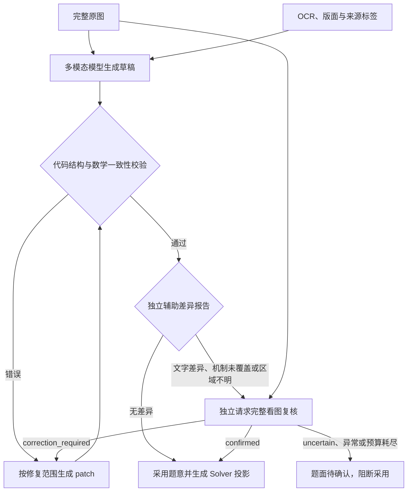

# 原图主导的题意抽取与独立复核

## 职责与处理流程

完整题图是语义依据。多模态模型负责理解题面；OCR 和版面观察负责提供辅助线索，不能以“没有识别到”证明“题面不存在”。代码继续严格检查作用域、实体引用、符号语法、表达式、定义冲突、目标与 Solver 投影。

旧流程的问题：版面只覆盖前两行时，后续 OCR 行保留为 `unknown`，却又被排除在印刷文本证据之外。射线题型的 OCR 关键词硬校验因此失败，修复提示会错误引导模型改换题型。

OCR 差异报告 `problem-source-differences/v1` 独立于 `ProblemValidationReport.issues`。后一报告中的 `ok` 始终表示没有阻止采用的错误。草稿与其自身转录一致，只证明内部一致性；不能用它声称原图支持草稿。

数字、符号和单字符错漏不能被长文本相似度阈值吞掉。差异比较只做排版规范化，不因高相似度忽略数学符号或数值变化。差异不自动修改模型转录，而是交给视觉复核。

## 内部复核与修复契约

`problem-source-review/v1` 返回 `confirmed`、`correction_required` 或 `uncertain`。每项 finding 包含受影响单元、原文、说明、页码和归一化 `[x0,y0,x1,y1]` 坐标。`region_id` 可以引用已有区域，也可以为 `null`；后者支持版面完全漏检的区域。

代码验证 JSON、图像／草稿修订绑定、单元引用、页码和坐标，不把有效坐标当成语义正确的证明。复核请求同时包含完整题图、候选的转录与结构化条件、来源标签和中性差异。错误反馈必须经过原有定向 patch 权限检查；复核本身不修改草稿。

复核后修改草稿会生成新的绑定，旧结论不能继续采用。相同绑定已完成时恢复已有返回，结果未知时保持阻断，不重复付费调用。复核明确授权的字面修正，即使不改变 Solver 等价语义哈希，也允许生成新修订并重新复核；空 patch 仍被拒绝。

规范化保留源语义等价表示，包括共享最值表达式、范围约束和正方形中心。新增“两条对角线上的同一点 → 正方形中心”的反向规范化，只在可见正方形和同一作用域的两条对角线条件均存在时成立，不能拼接兄弟小问的条件。

## 预算、恢复与审计

| 项目 | 固定上限／行为 |
|---|---|
| 草稿生成与 patch | 合计最多 3 次 |
| 独立视觉复核 | 每个图像／修订绑定最多 1 次，合计最多 3 次 |
| 语义请求 | 合计最多 6 次 |
| 底层网络尝试 | 合计最多 12 次；关闭 SDK 隐式重试 |
| 恢复 | 持久化预算不重置；未完成的已保留复核不得重发 |
| 无辅助差异 | 不额外调用复核模型 |

产品有效配置持久化以上预算。执行审计先保留请求名额，再调用 provider；请求、输入图片、原始返回和调用记录进入现有审计。解析后的复核结果单独存储；产品另外登记 `problem-source-review-audit/v1` 产物，记录结果与 `adopted`，便于直接查看。

阶段未提交也可通过持久化完成记录恢复原复核响应，不依赖尚未登记的阶段输出列表。恢复返回不重复累计 token；provider 没有返回 token usage 时保留未知，不估算成已知计费值。

新构建使用 pipeline `v2`，其中 extraction 阶段契约为 `v2`；旧 pipeline `v1` 定义保持不变。重建预览会使旧抽取 checkpoint 及下游失效。公开 HTTP API、领域图和 repair 契约保持兼容，历史构建和原始观察不回写。
