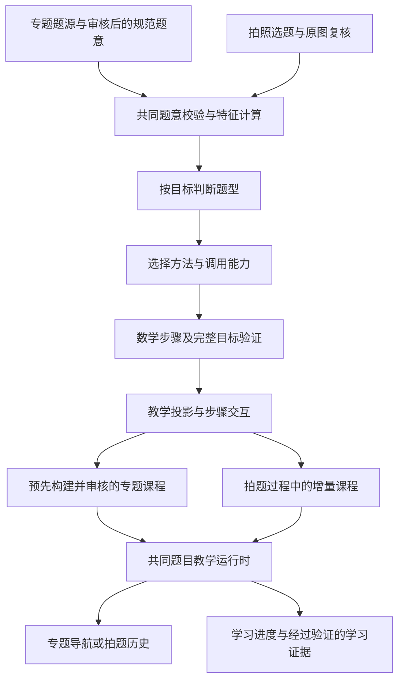
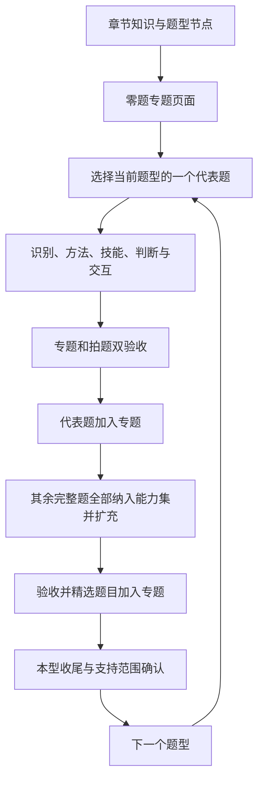

# 新专题与拍题学能力同步建设：开发流程

更新：2026-10-28。状态：**后续新专题采用的开发约定，已按函数专题的真实接题、子方法交互及故障修复经验修订**；并补充子方法交互密度（fold / light / full）的通用原则。章节基础和共同题页已经落地；新能力逐题型建设，已开放方法的常规分支按契约补齐。首个应用见[函数的概念专题实施计划](function-concepts-topic-and-photo-learning-plan.md)；方法侧样例见 [T1 设计 §6](function-equality-problem-type-design.md#6-学生教学与交互设计)。本文规定通用流程，具体题目、批次与进度保存在各专题实施计划和验收记录中。

## 1. 已确定的方向

1. 旧专题及旧题页保持现状，不迁移 `/1/`、`/2/` 或已有教材知识专题。
2. 新专题题目页与拍题学共用教学主体：原题与题意、小问、自己做／看 AI 解题、方法选择、分步作答、反馈、图形与知识图谱。
3. 专题负责知识组织、题目编排和连续学习；拍题学负责拍摄、识别、生成与个人拍题历史。两种入口向共同教学主体提供课程。
4. 建设一个专题时，同步补齐相应的题意表示、题型识别、方法执行、数学验证与教学能力。已有节点和能力按输入输出契约复用。
5. **先建设章节知识、题型节点和零题专题，再按题型逐一推进。** 方法、技能和判断按当前题型的代表题及后续变式需要复用或建立，不在章节阶段一次性预建整章方法体系。
6. **当前题型先选代表题贯通两种入口，双验收通过后加入专题；再用已收集完整的该型其余题扩展能力，精选部分加入专题，收尾本型后进入下一型。** 代表题通过只说明已打通一个范围，不等于题型已经完成。
7. 专题题目加入或发布前，须通过相应范围的专题与拍题双验收。章节知识和待建设题型可先展示，但不得据此宣称该题型已支持或开放未验收练习。
8. **题目决定建设优先级，方法契约决定实现完整性。** 已开放范围内的常规分支一次补齐，具体要求见 §5.2.1；新增方法、新结构或扩大输入范围仍按代表题分批推进。

本流程的外层推进单位是题型，能力验收单位是“题型下一个明确的任务范围及其可用方法”。一个专题可以包含多个这样的单位，一种方法也可被多个专题引用。题号用于验收和编排，不能作为求解分支或支持白名单。

## 2. 共用架构与当前基础



专题构建时可直接使用已审核的结构化题意，仍须经过语法、语义、特征与数学检查。拍题必须经过图片提取及原图复核，不能用专题人工题意替代真实拍题验收。

专题构建需明确人工内容的准入方式及验证来源；沿用适合的现有准入或补充新的契约，不能伪造学生上传身份、原图复核或金标评测通过状态。

### 2.1 2026-10-27 已有实现与使用边界

| 部分 | 已有基础 | 新专题要处理的边界 |
| --- | --- | --- |
| 数学与图谱主链 | `server/shuxueshuo_server/graph_lesson/stage_one/`、`stage_two/`、`stage_three/`，由 `search/` 接入拍题 | 以这条链路扩展；复用 `problem_understanding/` 的记法与语义、已有受限数学部件，不另起一条旧 FunctionalPlan 接题流程 |
| 题意与特征 | 已接入具体函数求定义域、已知定义域求参及原式结构特征 | 已开放范围以机器契约为准；抽象定义域、函数求值、同一函数等仍须逐项核查，不能仅新增题型 JSON |
| 图谱机器契约 | `recognition/`、`selection/`、`execution/` 分别负责识别、选法、执行 | 图谱展示节点存在不等于机器契约或执行器可用；每项复用都要核对能力注册与输入输出 |
| 待建设题型与零题专题 | 已有 `planned`、`knowledge_only`、显式专题路径及零题构建 | 沿用生命周期和运行隔离；目录展示不自动开放执行能力 |
| 教学交互 | 已有程序生成的交互、图形、交互任务与恢复，支持路线中再次选择子方法 | 新结构仍需核对证据、作答、回放及父目标返回；自由问答按实际接线验收 |
| 新题页挂载 | `site/assets/graph-walk/walk.mjs` 接静态课包和拍题增量课程 | 两入口复用教学主体、图谱工具栏和回放逻辑，外层只负责入口及导航 |
| 课程构建 | `tools/build-graph-walk-topic.mjs` 从共同执行证据生成专题课包 | 不手写另一套专题题解；保留旧 Demo 入口和已审核课包的来源 |
| 图谱发布与学习记录 | 已有公共导出及 `graph-walk` 原生评分契约 | 新交互同步验证前端判定、服务端评分、幂等及恢复，不伪造旧 teacher 格式 |
| 拍题服务 | 已有登录、归属、公共题目身份、个人历史及 PostgreSQL 执行存储 | 不重复建设这些基础；新题意要通过身份构造和私有数据隔离检查。公共课程缓存属于另一期能力 |

本表是核查时的实现快照。每个专题启动时核查涉及的代码及测试，不把已有代表题的通过扩大成整个题型支持，也不沿用旧设计文档中过时的“未实现”表述。

### 2.2 四种状态分别记录

| 状态维度 | 判定依据 |
| --- | --- |
| 内容与图谱 | 题源、知识、题型、方法及关联已经审核和登记 |
| 数学能力 | 对明确输入范围可执行，步骤有效，结果完整且目标验证通过 |
| 专题教学 | 已发布课程、交互、图形、导航及进度通过验收 |
| 拍题服务 | 新照片、新题和边界输入通过完整链路与服务验收 |

台账按“题型 + 子情形 + 方法 + 输入范围”记录以上状态，以及版本、证据位置、已知缺口。另记录题型推进位置：待建设、代表题贯通中、范围扩展中、本轮收尾。状态名称在实施时纳入明确协议，不把本文名称当作已有代码枚举。专题已上架、一道金标题通过、图谱能展示，都不能自动改变另外三个维度的状态。

## 3. 新专题沿用的公共基础

章节阶段核对待建设题型和零题专题的发布支持，优先复用已落地基础；其余公共能力由代表题驱动。方法一旦开放，仍须覆盖其声明范围内的常规分支，不能只覆盖代表题的一条轨迹。

### 3.1 章节知识、待建设题型与零题专题

- 按已审核材料建立章节知识、题型定义、涉及知识与题型特征，登记教材目录和跨章节复用。题型范围与识别线索须明确；方法、技能和判断的具体组织留到代表题开发时确定。
- 为题型增加显式生命周期：待建设节点可以进入知识目录与图谱展示，但不自动进入运行时的可用识别结果、选法候选、执行注册或拍题支持范围。若学生入口触达未覆盖任务，明确说明能力缺口，不尝试不存在的方法。
- `site/assets/knowledge-next/model.mjs` 已在首个专题 P0 增加 `planned` 题型校验：保留已定义的知识和特征，方法、规则、例题暂为空；知识正文使用 `knowledge_only` 状态可不附例题。既有节点保留完整校验，进入可运行状态仍须通过完整契约检查。不得放入占位方法、假规则或虚构例题绕过校验。
- 为新专题声明显式 `path`，支持零道题、空分组和后续增量编排。P0 已调整 `tools/lib/public-knowledge-export.mjs`，不再要求从第一道题推导新专题路径；旧源兼容原路径。零题首页展示章节知识、题型结构和待建设说明，不显示虚构题量、作答入口或完成率，使用 `node tools/build-topic-overviews.mjs` 生成并以 `--check` 核验。
- 验证零题专题可构建、可导航，待建设题型可查看却不会被判为可执行；已有题型、旧专题的校验和运行行为保持兼容。

### 3.2 一份内容源与两种课程供给方式

- 明确规范题面、结构化题意、目标、小问依赖、图谱引用、方法轨迹、交互、图形、回放及版本之间的关系。
- 从现有 Demo 原稿／阶段三公开投影提取公共协议和校验器。新专题从规范源构建，拍题从实时产物投影，二者进入同一教学运行时。
- 提供通用构建入口，保留 Q01 Demo 的兼容入口。题目正文、答案和步骤不分别维护在 HTML、teacher JSON 和拍题代码中。
- 预先构建的课程使用明确的静态加载模式，加载后不轮询执行接口、不伪造运行 ID。实时课程保留事件、快照、重连及取消语义。
- 保存经审核的课程快照与构建来源。人工修订若影响数学内容，应产生新版本并重新验证；文案修订也须维持步骤和证据引用一致。

静态课包的公共加载能力不依赖“拍题公共课程缓存”完成。首期可发布专题自己的不可变构建产物；不同学生拍同题后复用公共课程，继续遵循[公共题库与解析复用设计](shared-problem-library-and-student-learning-design.md)的发布、权限与兼容检查。

### 3.3 新专题外层页面

- 专题首页提供知识引入、知识组织、分组练习和学习进度；题目页提供所属专题、题号、上一题／下一题及返回目录。
- 连续练习默认“自己做”，允许切换“看 AI 解题”，两边分别保留进度。按学习模式控制答案揭示，进入题页不直接暴露最终答案。
- 读题、判型、选法的教学呈现允许按题目难度简化；读题只对容易混淆且影响解题方向的含义设问，不强求题面每句话都出一道题。内部仍保留识别依据、方法适用性和数学验证。
- 题目配置不得复制运行时逻辑。新组件应有明确输入、输出、判定与可访问性约定，供专题和拍题共同调用。
- 现有[教材学习专题公共契约](../internal/senior-high/knowledge-points/learning-topic-page-contract.md)属于另一种页面模式；其中 `lesson-data.json` 编译、详情默认展示答案等规则不自动套到新图谱练习页。

### 3.4 进度、证据与发布适配

- 统一保存账号或匿名作用域、稳定题目身份、课程版本、目标、小问、方法路线、作答记录、草稿及回放位置。草稿与已确认答案分别保存。
- 静态和实时课程均验证刷新恢复；账号切换不串数据，匿名记录不会自动归给登录账号，版本变化时明确处理旧进度。
- 新专题以稳定题目身份记录学习；拍题保留公共题目、私有提交、运行和课程版本的区别，不强制让新专题依赖 `search_id`。
- 新课程格式接入发布清单与学习记录服务。服务端以发布的版本化判题契约确认答案，浏览器的“已通过”字段不能直接作为掌握证据。
- “看过解析”“完成引导练习”“独立作答”“请求提示”分别记录；一次完成不直接等同于掌握整个知识点。
- 扩展图谱构建器中题目格式与例题地址检查，支持新专题路由；保持旧格式和旧链接兼容。新模式不通过伪造旧 HTML／teacher 数据接入。

## 4. 章节起步后，逐题型完成建设

### 4.1 外层推进顺序



1. **建立章节基础。** 审核章节知识和题型定义，完成第 3.1 节的待建设生命周期与零题专题；记录题型顺序和当前题源范围。此时不要求全章方法、技能和判断预先齐备。
2. **为当前题型选一个代表题并写设计。** 优先选择题源完整、能体现主要结构和核心路线、便于核验且能贯通两入口的题。先讨论任务范围、方法命名、技能／判断与交互，写入题型 Markdown 设计，再进入实现。新的输入结构或方法路径可在后续扩题时选新的代表题；常规分支按 §5.2.1 覆盖。不要只选最容易的数字实例或把特殊技巧题当作全型代表。
3. **由代表题贯通能力与双入口。** 建立或复用所需的识别、方法、技能、判断、数学验证和教学交互，完成专题题页与真实拍题验收，再把通过的代表题加入专题。尚未通过两端验收的课程可保留开发预览，不进入正式专题练习清单。
4. **纳入该型全部已收集完整题源。** 将代表题之外、题源完整的本型题全部纳入能力语料台账，按结构归类、留出和验证；用它们发现新路径、适用条件、节点和实现缺口，按需扩展。不能只处理准备展示的题，或把失败题从范围台账删除。不完整题源单列待补，不据残缺题意编造答案。
5. **精选专题练习。** 从双验收通过的题中选择覆盖主要子情形、方法路径、关键边界及合理难度梯度的题，减少结构重复；保留来源与选择理由。未入选展示的题继续作为能力语料、回归或留出材料，不因未上架而退出能力建设。
6. **收尾本型，再进入下一型。** 对照范围台账处理全部已收集完整题源，完成留出新题、真实照片、边界与相关旧能力回归，更新支持范围、缺口和精选题清单。未解决项应有明确原因与范围外／待建设状态，不记为通过；本型收尾后才启动下一型的同一循环。

“能力语料全集”指本轮已收集的完整题源及补充的验证材料；“专题展示精选”只是其中经双验收的教学子集。全部已收集题通过也不代表穷尽了数学上的题型范围，开放范围仍由输入契约和结构边界限定。代表题与每条新增路线只扩大已证明的范围，不自动把整个题型标为完成。

### 4.2 题型范围台账与样本使用

台账至少记录：题型、子情形、目标、输入限制、方法路径、已收集完整题、待补来源、代表题、开发／回归／留出角色、是否精选展示、四维状态、证据版本与已知缺口。选题和留出在开发前确定；全部完整题源进入台账不等于全部可用于调试或 few-shot。

留出题保持新题地位，不参与提示词、规则或答案编排。留出失败被用于修复后，将其转为回归题并补充新的留出样本；保留原失败和角色变更记录。本型收尾须说明已覆盖、尚未覆盖和明确不支持的子范围，不能用“代表题通过”代替这一检查。

### 4.3 每道代表题及扩展批次的内部技术步骤

S0–S7 是当前题型内的技术工作与验收清单，**不是先全章做 S0、再全章做 S1 的跨题型顺序**。章节基础完成后，用它们贯通当前代表题，再围绕本型剩余题的小批次补差异；正式编排依赖两入口及对应范围验收通过。

| 步骤 | 输入与工作 | 必须保存的产物 | 通过条件 |
| --- | --- | --- | --- |
| S0 范围与复用核查 | 明确当前题型、子范围、目标、输入限制；讨论方法与技能，核对已有执行能力 | 题型设计 Markdown、范围台账、复用／新增／缺口表、代表题和完整题源全集 | 方法命名和职责清楚；关键能力探针通过；缺失知识依据先登记；不以题号定义支持范围 |
| S1 题源与金标 | 审核题面、图、选项、小问、人工解答和答案；按独立目标拆解 | 规范题意、数学金标、题型／选法金标、来源和目标依赖 | 原式限制与题面一致；答案经过独立核验；训练与留出集分开 |
| S2 表示与特征 | 扩展记法、语义、目标和特征；用共享规则完成原图提取、复核及必要修复 | 三阶段共同契约、特征和原文引用、识别录制、正反例 | 题给目标不被提前改为求解条件；原文等价写法可绑定；未知有原因 |
| S3 图谱与路由 | 按当前题所需登记方法、技能和必要判断；补识别契约、选法契约及学生线索 | 节点、条目、识别与选择规则、D1–D4 投影 | 同一目标正确识别；多问不串条件；适用性、推荐和实现状态分别判断；待建设节点不自动启用 |
| S4 求解与验证 | 按声明范围列分支矩阵，实现技能绑定、子方法及结果收束；核对准入预算和版本依赖 | 分支验证、执行轨迹、局部证据、完整目标校验、数学版本指纹 | §5.2.1 分支完整；准入与执行预算一致；新增共享依赖进入版本校验；错误与能力缺口如实结束 |
| S5 教学与共同题页 | 从验证轨迹生成步骤、交互、反馈、图形、图谱及回放；两端接同一投影 | 课程原稿／快照、构建物、交互测试、浏览器验收 | 两端数学和交互一致；答案不提前显示；问答附加不重置已作答步骤 |
| S6 专题编排与学习记录 | 预备题序、精选理由、提示与记录；S5、S7 及记录验收通过后才正式加入专题 | 专题候选／正式清单、题目关联、公开版本、进度／证据检查 | 题目双入口通过；目录和题页一致；切题、刷新、换号及版本升级正确 |
| S7 新题与服务验收 | 测本范围留出变式、真实照片、异常恢复和旧能力回归 | 验收矩阵、真实录制、支持范围及缺口台账 | 支持范围内新题通过；范围外如实拒绝或说明缺口；作为专题正式纳题与拍题开放的共同门槛 |

一个批次包含多条路线时，可先贯通一条路线，再用本型其余题扩展另一条；仍需完成本型收尾再转下一型。尚未实现但数学上适用的方法应标明暂不可用，不能作为错误选项。

## 5. 必须守住的数学与教学契约

### 5.1 题意和目标

- 输入保留原表达式、函数定义、定义域、输入输出角色、量词及各自作用域。化简不能删除原式中的禁取值。
- 按 `target_ref` 处理目标。一个大题可以有多个题型；子问继承祖先条件，但不得读取兄弟小问条件。
- 将某小问独立收录时，只保留公共题干与该问条件，明确是否仍依赖前问。记录原页、裁片、拼接及独立题面来源；组合图不冒称原始上传图片，独立题号不用于识别或执行特判。
- 前问结论供后问使用时，显式记录依赖，只有经过验证的模型、范围和结论才能作为后问输入。不能把后问答案写回前问题意。
- 当前多目标主路径按目标独立执行。首次需要前后问依赖时，新增依赖无环检查、已验证产物与版本绑定、失败阻断、重算失效及按依赖顺序恢复；不能仅传递一个前问答案字段。某路线在自身内部由原题重新推导条件，则按该路线的证据依赖处理。
- 题意、身份构造、答案和展示使用兼容的语义；新增目标须同步检查公共题目身份及选项身份，不能只修改特征提取。
- 教材默认约定应有明确规则及来源，提取结果不足时返回未知或待核对。

### 5.1.1 提取、复核与修复共用规则

三阶段引用同一份题源与语义规则，当前入口为 [graph-stage-one-source-rules.md](../internal/llm-prompts/graph-stage-one-source-rules.md)。规则变更同步进入工作流冻结文件及契约回归，不分别维护互相冲突的要求。

共享 prompt 保持简洁，只约定忠实转录、变量与作用域、字段含义和修复权限。新增题型不追加题号、变式清单、执行能力边界或解题步骤；已有规则能表达的要求不重复添加。新表示确有必要时补充最小字段契约，结构识别、适用性判断、条件推导与分支求解由代码及测试承担。原图提取的语法示例不能包含推导答案；模型提取效果须用新照片调用核验，单元测试和录制回放不能替代。

- 区分原始转录、公开题干、内部数学表示。原题号可以保留在转录中，公开题干按公开契约去号；无冲突的内部函数别名可以规范化，原文仍保留题面写法。复核必须检查实际被指认的字段。
- 提取保存题给对象和目标。例如已知定义域求参保留函数定义与 `match_domain`，不提前生成根式非负条件或改为一般 `find_range`。条件推导交给经过验证的求解阶段。
- 修复权限与诊断类别一致：已有错误原位修正，遗漏内容按作用域追加，无题面依据的新增内容才按授权删除。改后重新复核，不强制确认，也不靠增加调用预算掩盖规则冲突。

### 5.1.2 原文匹配与证据来源

原式与内部表示的匹配覆盖当前支持的 TeX／ASCII 写法、普通空白、间距命令及隐式乘法，同时保留原文、引用偏移、表达式位置和运算结构。不能通过清空全部空白、代数约分或忽略致命诊断来匹配；这些做法可能合并数字／指数或丢失分母限制。

回归同时验证应接受的记法变化和必须拒绝的数字、指数、分母及严格性变化。条件来源即使不影响最终集合，也应保留并单独断言；不能只比较最后答案。展示中的“限制位置”等阶段从对应技能产物的位置字段投影，不另猜一套数学信息。

### 5.2 方法与执行

- 每种方法声明任务、输入、适用条件、输出、子调用、分支、终止条件及验证方式。技能负责可复用操作，方法组织完整路线。
- 同名或近名节点不表示可互换；最值输出不能代替完整值域，求二次不等式参数不能代替所有原像的存在性证明。
- 求定义域须证明所有合法输入且仅有合法输入；求值域须证明输出范围和可达性；恒等／同一函数须覆盖全部定义域。
- 使用原目标、原限制验证最终结果；测试金标不参与生产求解或生产答案确认。符号计算无法确认时保留未知，不以少量数值抽样代替证明。
- 共用能力在适用前提相同的情况下复用；新增实现必须进入能力注册、方法绑定、验证和展示链路，不能成为仅由题号触发的旁路。
- 方法、技能按当前代表题或新增子情形的实际输入输出按需复用。已有契约适用则直接引用；只缺注册、绑定或执行支持时补齐该层，不为同一能力按章节另建同义节点，也不预先要求整章所有方法登记完成。
- 准入、执行和独立验证核对同一原式语义及展开预算。新增共享转换器时避免各阶段各写一份；已准入输入不能因为另一套幂、节点或系数预算在执行阶段意外失败。预算内／外相邻样例都要验证。

### 5.2.1 方法内部的分支完整性

方法实现前，依据输入契约列出互斥且覆盖全范围的条件，而不是从已收集题目的答案反推需要哪些分支。以全实数二次恒成立为例，应同时覆盖二次项系数正／负／零、降为一次式或常数式、常数正／零／负、判别式为正／零／负，以及参数解集为空、单点、区间或并集。当前契约不允许的结构明确列为范围外，不借此回避范围内的退化情况。

每个可达分支都要检查执行结果、原式独立核验、教学步骤、作答契约和回放；数学算对但需要学生判断的环节无法作答仍算缺口。已完成判断后的重复总结可明确声明只读，不能把意外降级当作已覆盖。使用少量结构化、参数化边界样例覆盖这些分支即可，不要求为每个分支收集一道教材题或加入专题。后续具体题目主要验证方法复用、真实识别与教学效果；出现已声明范围内的小分支缺漏时，修复通用逻辑并补分支回归，不新增按题号处理的逻辑。

### 5.3 判断规则的层次

- 公共图谱已有 `kind=judgment_rule`，包含 `method_selection` 和 `step_selection`。对需要独立复用、具有明确输入与分支输出的选法或选步骤规则，按现有类型登记，不新造一套“判断”节点类型。
- 方法内部的 `steps[].judgments`、`cases`、`when` 表达该方法的局部判断、分类或调用条件，保持在相应执行契约内；并非每个条件都需要升格为公共判断规则节点。
- 学生看到的判断题、选择项和提问是教学交互，应映射到已验证的条件或推理依据。一次学生问答不对应一个公共节点；对错反馈也不能代替方法适用性检查。
- 随代表题和本型剩余题发现规则复用需要时再抽取公共规则，保留原数学依据与分支覆盖；不为让待建设题型通过旧校验而伪造规则。

方法调用子方法时，先说明已经证明的子目标。若该子问题有适用的公共选法判断节点，让学生再次判断并选择方法；没有适用判断节点、但已验证可以直接借用时，可用只读确认，不为凑交互新造判断规则。子方法完成后明确返回父方法，最终仍验证原目标。

适用但当前未展开的方法属于有效选择，说明尚未展开并允许改选，不计为数学错误，也不提前完成本步。前端判定、服务端评分和 AI 回放保持一致。图谱使用实际判断节点、子方法目标及选择边；日志写实际选中的方法名，验证撤销、图谱晚到和旧多路线状态不串线。

#### 5.3.1 子方法交互密度

**数学完整不等于交互完整。** 父方法仍可完整执行并验证子方法；学生侧交互按本步学习目标选择密度，不因后台调用了子方法就默认展开其全部步骤。

通用原则：

1. **主线目标优先**：当前方法在练什么，交互就钉什么；借用工具默认轻量，不把子方法的完整教程嵌进每一处调用。
2. **非显然才升级**：子问题结果平凡、已验证可复用、或学生本专题已掌握时，只读或轻问结果；结果非显然、易错、或本步明确以该子技能为教学目标时，再加深展开。
3. **证据可展开、步骤不默认展开**：折叠或轻问不省略数学执行、局部证据与可回看依据；需要时再打开完整推导，而不是默认多轮点击。
4. **选择题／解答题是信号，不是唯一开关**：任务形态（逐项选择、单对判定、叙述证明等）影响默认密度；真正决定升级的是子问题难度与主线相位。禁止写成「凡选择题禁用子方法」或「凡解答题必须全展开」。

交互档位（由**父方法**在题型设计中声明，执行契约按档位投影）：

| 档位 | 学生侧 | 典型用途 |
| --- | --- | --- |
| `fold` | 只读一句结论；证据可展开 | 平凡结果（如多项式定义域为 \(\mathbb{R}\)）、同版本已验证复用 |
| `light` | 直接问结果或关键判断（如清单自选定义域、对应关系是否等价），不走子方法逐步卡 | 父方法主线练习；子技能只作工具 |
| `full` | 完整借用子方法交互（选法／列条件／逐步推导等） | 本步以该子技能为教学目标，或 `light` 无法钉住关键误解 |

`needs_borrow`（或等价的「需要处理该子问题」）只表示数学上要调用或核验子能力，**不等于** `full`。实现上应区分：数学借用始终可发生；交互档位由父方法的教学表面（`teaching_surface`）与升级条件决定。

#### 5.3.2 子方法的两种调用方式（2026-11-13）

父方法调用子方法只有两种方式，题型设计须为每处调用写明属于哪一种：

| 方式 | 何时用 | 学生侧 | 图谱与执行 |
| --- | --- | --- | --- |
| **简单调用** | 子问题直接、无需辨认（如奇偶性求参里求原式定义域） | 一张只读卡承接结果，标题即子任务名（如「求定义域」）；不问「转化成了什么问题」，不展开子方法的选法与逐步卡 | 执行契约真实调用，`public_ref` 指向子方法；方法节点 `calls` 登记该子方法；证据、验证照常 |
| **转化为问题后辨别调用** | 子问题需要学生先看出它是什么问题（如恒成立、含参定义域的分类） | 先给明确子目标，学生判断转化成了什么问题，再走子方法自己的选法与交互，完成后返回父方法 | 使用子方法的真实选法判断节点和返回合同 |

两种方式都必须真实执行并验证子方法，区别只在学生侧是否需要辨认问题。不得为省交互而由展示层另算一份结果代替调用；也不得为凑交互，在简单调用处另造判断题。简单调用一般对应 `fold`／`light`；转化辨别调用一般为 `full`。

新方法在题型设计中写清：主问题列表、各子方法的默认档、何时从 `light` 升到 `full`。样例见 [T1 / M8 §6.0–§6.2](function-equality-problem-type-design.md#60-m8-教学表面与密度策略)。尚未声明档位的旧方法，维持其现有投影，改版时再补声明，不借流程条文一次性改写已验收课包。

### 5.4 教学和视觉

- 数学步骤和最终结论来自验证结果；交互答案、选项正误、错因也能追溯到程序依据。
- 读题先区分“展示已知信息”和“检查关键理解”。公式、明确给出的范围等直接呈现；只有需要澄清的任务含义或关键条件进入作答。干扰项应对应真实误解，不能为凑选项制造无关判断，也不按题面句数分配作答槽。
- 专题与拍题使用同一读题交互。以定义域首题为例，D1 共用一个单选，检查求自变量取值范围还是函数值取值范围；原公式及显式题设范围只展示，答对后解释定义域与原式有意义的关系。该调整不增加数学步骤，具体文案和完整步骤数在题型设计中维护。
- 区分局部已检查步骤与完整已验证路线；完整验证前不显示最终答案或整题完成。
- 已有程序交互先复用。需要 LLM 撰写的教学问答只读取已验证内容，附着稳定步骤和数学版本；不得改写公式或替换正文。
- 图形由结构化数学对象驱动，端点、禁取点、定义域裁剪、分段边界与正文一致。截图相似不算数学正确。
- 数轴用于集合，映射图用于输入输出，函数图用于对应关系和范围；组件选择由教学需要决定。
- 自由提问入口按实际接线开放，未接通的按钮不出现在学生流程中；已有步骤反馈不等同于完整自由对话能力。
- 共用教学运行时统一拥有学习方式、图谱开关和回放控件，入口外壳不重复添加相同按钮。
- 纯数学推导行不机械附加中文句号，文字句子正常使用标点。只调整展示分行及数学块之外的标点，不修改已验证公式、数学片段或证据哈希；静态与流式题页一起检查。

### 5.5 数学版本与共享依赖

新增或抽取解析、原式转换、求解、验证等共享模块时，核对它是否进入数学版本指纹，不能假定目录扫描能覆盖新位置。当前生产入口为 `stage_three/runner.py::fingerprint`，也用于拍题续算准入；例如位于 `graph_lesson/` 根目录的 `domain_expression.py` 必须显式纳入。

回归使用真实指纹收集器，模拟依赖文件内容变化，确认摘要变化、旧 checkpoint 被拒绝续算，且原 checkpoint、事件和冻结记录不被部分改写；恢复相同版本后可继续执行。只 mock 一个不同的指纹字符串，不能检出依赖文件漏登记。

数学执行、交互投影和课程评分契约分别按既有协议管理版本。纯交互变化不误伤数学续算，数学变化也不能沿用旧执行身份；已审核课包不因共享节点文案扩充而无意重写。本地未发布开发不因此预做历史迁移或强制新建课程身份，范围见 §8。

## 6. 验收分层与证据

| 层级 | 最小验证内容 | 不能替代的验证 |
| --- | --- | --- |
| 章节基础 | 零题专题的显式路径、空态、导航；待建设题型的引用与运行隔离 | 不代表题型已有可执行方法 |
| 契约与图谱 | 节点身份、条目、依赖、引用、识别和执行契约一致 | 不代表方法能求解 |
| 离线数学 | 人工规范输入，步骤验证、目标完整性、反例与变形关系 | 不代表照片能正确提取 |
| 留出变式 | 改数字、符号方向、端点、定义域、退化情形与问法；不依赖题号 | 只改数字不足以覆盖结构边界 |
| 真实提取 | 印刷照片、裁剪、选项、小问、必要图形；保留模型输入输出 | mock 或直接注入金标不算真实提取 |
| 教学浏览器 | 手机／桌面、学生／回放、对错答案、路线、小问、图谱、公式 | 后端答案正确不代表前端交互正确 |
| 状态与服务 | 刷新、断网、重连、切题、换号、版本、终态与失败；必要时隔离数据库 | 本地验收不等同于生产部署完成 |
| 兼容性 | 受影响的旧方法、旧专题、拍题与图谱消费者 | 无相关修改不扩大成全仓反复测试 |

每条开放能力至少有代表题、边界例、反例／不适用例、留出新题和真实拍题证据。样本数量由支持范围决定，在 S0 写明；不能事后删除失败样本来维持通过率。代表题的双验收是首次纳题门槛，本型收尾还要核对其余完整题源的覆盖、扩展路线、留出结果及缺口处置。

记录提取、选法、求解、教学和整体时延，记录 LLM 次数与成本、超时及恢复结果。阈值在批次开始时根据已有服务基线确定，未测量不宣称“秒开”或“零成本”。

问题按层归因：题源 → 记法／识别 → 特征 → 判型 → 选法 → 执行 → 完整验证 → 教学投影 → 前端／记录 → 服务。修复后重跑受影响范围，并将可泛化反例加入对应契约测试。

### 6.1 失败修复闭环

1. **保留现场。** 保存实际失败题图、送模图哈希、裁剪／重编码记录、原始响应、调用账本、目标、执行记录和分层诊断；不覆盖原失败来制造通过记录。
2. **定位并复现。** 区分规则冲突、表示错误、数学缺口、教学投影和前端故障。针对真实原因补回归；适合确定性复现的缺陷，先确认测试在修复前失败。
3. **修复共享机制。** 修改对应契约、能力或共同组件，核对相邻边界和版本依赖，不按题号绕过，也不放宽原式核验或诊断保护。
4. **复验原故障输入。** 优先在正常拍题页面重试原记录；记录不可用时重新上传保留题图并说明原因。不能裁掉题号、手写内容或重绘公式后，将另一个输入的成功算作原故障修复。应用若重新编码，分别记录上传文件和送模图片的哈希，不宣称字节完全相同。
5. **完成学习链路。** 走到正确答案、完整验证和可用教学交互，再核对受影响专题题页及学习模式。只有“提取完成”“题型已识别”或后台 HTTP 200，均不足以关闭学习失败问题。

### 6.2 故障提示与验收口径

| 已确认的状态 | 对学生的反馈与恢复 |
| --- | --- |
| 提取／原图复核未通过 | 说明识别未成功，按实际原因重试或重新拍照 |
| 判型失败 | 说明未判断出题型；不要把尚未执行的阶段说成数学求解失败 |
| 已识别且明确超出能力范围 | 说明暂不支持，不伪装成系统错误 |
| 已判型但读题／教学投影失败 | 说明学习页面生成失败；优先重跑相关阶段，不误报题型失败 |
| 执行、验证或状态未知 | 使用对应失败或暂不可用提示；不要猜测原因或展示未经验证的最终答案 |

每批分别记录真实模型调用、录制回放、鉴权 API、专题浏览器和拍题浏览器证据。重放真实响应不计为新模型调用；桌面浏览器、响应式视口、实体手机及登录持久化各按实际验证范围记录。区分作答动作数与界面展示步骤数，重叠测试组不累加冒充总量。修复本身只需重验受影响层；新题正式纳入专题仍须满足完整双入口门槛。

## 7. 仓库落点与验证入口

### 7.1 已有路径

| 产物 | 入口 |
| --- | --- |
| 图谱源与机器契约 | `site/data/knowledge-next/{nodes,recognition,selection,execution,interactions,topics}/`；以及 `catalog.json`、`outline.json` |
| 题意与特征 | `server/shuxueshuo_server/graph_lesson/stage_one/`，记法／语义位于 `server/shuxueshuo_server/problem_understanding/notation_*.py`，可复用数学内核位于 `server/shuxueshuo_server/solver/math_kernel/` |
| 判型与线索 | `server/shuxueshuo_server/graph_lesson/stage_two/` |
| 提取／复核／修复共同规则 | `internal/llm-prompts/graph-stage-one-source-rules.md` 及阶段一契约、工作流冻结文件 |
| 方法、验证、交互和流 | `server/shuxueshuo_server/graph_lesson/stage_three/` |
| 拍题接线与身份 | `server/shuxueshuo_server/search/`、`site/lab/search/` |
| 教学运行时 | `site/assets/graph-walk/`；通用数学组件按需复用 `site/assets/practice/` |
| 构建与导出 | `tools/build-graph-walk-topic.mjs`、`tools/build-topic-overviews.mjs`、`tools/build-public-knowledge-graph.mjs`、`tools/export-public-knowledge.mjs`；旧 Demo 构建入口继续保留 |
| 学习记录与发布 | `server/shuxueshuo_server/learning/`、`server/tools/publish_learning.py`、`site/assets/learning/` |
| 测试 | `server/tests/solver/test_graph_stage_*.py`、`server/tests/search/`、`server/tests/auth/`、`tools/tests/graph-walk-*.test.mjs` 及公共图谱测试 |

### 7.2 题源、课包与证据的安排

按现有目录登记本批产物及稳定身份，不重新预建已实现的基础：

| 产物 | 当前落点及要求 |
| --- | --- |
| 题型设计与验收 | `docs/` 下的题型设计、专题计划和分批验收文档；记录范围、方法、实际命令、版本及缺口 |
| 原题及裁片 | `internal/senior-high/source-images/<problem>/`；清单登记原页、裁剪、拼接、文件哈希及来源 |
| 可重放的识别回归 | `server/tests/search/fixtures/<family>/<recording>/`；保留所需图片、响应、调用账本、版本及哈希，移除凭据与无关私人数据 |
| 专题课程 | `site/data/graph-walk/<problem>.{source,evidence,replay}.json` 与构建课包；公共源不得包含私有提交凭据 |
| 页面、目录及图谱 | 由专题、图谱及导出构建器生成，使用 `--check` 检查一致性 |
| 其他运行与浏览器证据 | 可使用 `internal/solver-runs/` 或独立批次目录，验收文档登记实际位置；临时截图不作为唯一可复现依据 |

回归依赖的题源、金标和录制必须进入版本管理；临时运行目录或用户历史中已删除的记录不能成为测试的唯一输入。普通回归复用录制、禁止意外调用真实模型。使用有固定题集限制的工具前核查其范围，不将固定 `--case` 列表的通过冒称新题已经验收。

### 7.3 已有验证命令的使用边界

在仓库根目录，公共内容变更可使用：

```bash
node tools/export-public-knowledge.mjs --check
node tools/build-public-knowledge-graph.mjs --check
node tools/build-graph-walk-topic.mjs --check
node tools/build-topic-overviews.mjs --check
node --test tools/tests/graph-walk-state.test.mjs tools/tests/graph-walk-build.test.mjs tools/tests/search-walk-bundle.test.mjs
```

这些命令用于现有消费者回归。新增课程格式、静态持久化、新目标和方法需要同时添加各自有意义的测试；现有用例通过不代表新增能力已通过。

后端按实际变更选择测试，涉及执行存储和学生记录时使用独立迁移的隔离 PostgreSQL，设置 `PRODUCT_TEST_DATA_DIR` 和 `PRODUCT_TEST_INSTANCE`，按[执行存储说明](stage-three-postgresql-execution-storage.md)配置；禁止把自动化测试接到用户日常库。真实模型测试和录制单独执行，明确成本及样本集。每批记录实际命令、版本、结果与未测项，结束后停止本批启动的隔离实例。

数学依赖调整时，定向检查 `test_graph_stage_three_revision_manifest.py`、`test_graph_stage_three_execution.py`、`test_graph_stage_three_contract_cache.py` 及受影响数学测试；交互变化检查对应投影、前端、服务端评分和回放。已通过的范围不无故重复扩测；新增修改、失败或未解决疑点再决定补测。

## 8. 发布与长期维护

当前为本地开发，测试数据和旧练习记录可以直接丢弃、清空重建；不为它们安排迁移、兼容版本分支或强制更换题目身份。数学指纹、评分契约和账号隔离仍须正确，不能用保留本地测试记录的要求拖延功能开发。

本地开发不做备份，不增加备份步骤或生成备份文件；直接更新代码、生成物与本地课程数据，完成定向验证后按需重启服务。

本地交付区分静态预览、隔离测试与用户日常后台。后端变更后确认日常服务加载最新代码，必要时重启并检查接口；新增课程同步本地学习内容。静态预览更新、测试服务启动和 HTTP 可用不能替代实际学习完成的验收。

1. 以当前题型的小批次更新支持范围，按各自产物发布图谱、课程与服务能力；公共内容版本和服务端判题版本须匹配。
2. 章节知识、待建设题型和零题专题可以先建设。代表题及后续精选题须经专题和拍题双验收后才正式纳题、发布；未覆盖的模块、题型分支和方法保持待建设，不以章节标题推断支持范围。
3. 正式部署沿用已有发布流程与授权要求；开发完成不自动等同于线上已经开放。
4. 发布后收集失败的结构化原因，优先补可复用能力。更正课程生成新版本，可撤回有问题版本；保留旧学习记录的来源和版本。
5. 下一专题启动时复查能力台账，先复用后补缺；不按专题复制方法、技能或交互组件。
6. 完成定向验证后 code review，修复可行动问题并重验受影响范围。提交、push 和部署分别依用户授权执行；“提交不 push”只创建本地提交。交付记录明确提交号、文档更新、服务状态和未完成项。

### 8.1 章节基础与每个题型的完成定义

章节基础完成须满足：知识和题型定义经审核，待建设生命周期与运行隔离可用，显式路径的零题专题可构建、可浏览，方法／规则／例题没有虚构占位，题型顺序与题源台账已经建立。这是开始逐型建设的条件，不代表章节练习或拍题能力完成。

当前题型的每个内部批次检查：

- [ ] 范围、题源、目标和复用关系明确，未完整来源单独列出。
- [ ] 题型设计已记录方法命名、技能／判断职责及关键能力探针；范围内常规分支按 §5.2.1 覆盖。
- [ ] 代表题与结构边界通过题意、判型、选法和完整数学验证。
- [ ] 新专题题页与拍题页共用同一教学投影并通过浏览器验收。
- [ ] 新题留出集和真实拍题通过；未支持输入按真实原因结束。
- [ ] 进度、服务端学习证据、版本及必要异常恢复通过检查。
- [ ] 新增／抽取共享数学模块已纳入指纹，相关变更拒绝旧续算的回归通过。
- [ ] 有子方法判断则完成再次选法、正确评分、图谱选择边和父目标返回；两端回放通过。
- [ ] 如本批修复真实拍题失败，已保留失败、完成对应回归及原故障输入复验，提示与失败阶段一致。
- [ ] 旧能力相关回归通过，命令与证据可复现。
- [ ] 内容、数学、专题教学、拍题服务四种状态分别更新。
- [ ] code review 问题已处理；日常后台和本地课程已按本批变更生效；提交／push／部署状态分别说明。

进入下一题型前，另核对本型收尾：

- [ ] 已收集完整的本型题源全部进入能力语料台账，有验证结果或明确缺口，不只处理精选展示题。
- [ ] 新路径、子情形与边界按需扩展；新增方法、技能、规则均有复用核查、契约与对应验收。
- [ ] 留出材料未被用于开发；若失败后转作回归，已保留记录并补充新留出题。
- [ ] 专题精选覆盖主要方法与结构，包含合理的难度和边界差异；每道正式题都有双入口验收证据。
- [ ] 本轮支持范围、未支持范围、待补来源及未解决缺口明确；“代表题通过”和“本型收尾”分别记录。

“本型收尾”表示本轮收集范围已经核对、能力与缺口已经交代，并不表示对该数学题型的任意输入均已支持。

### 8.2 后续开发任务模板

```text
按 docs/topic-and-photo-learning-development-workflow.md 扩展新专题。
专题／当前题型／内部批次：
专题实施计划及知识设计：
题型设计 Markdown、已讨论的方法命名和技能／判断职责：
章节基础状态（知识、待建设题型、零题专题及运行隔离）：
本批任务范围、输入约束、暂不支持范围：
本型完整题源全集、待补来源及范围台账：
代表题与选题理由、边界题、开发／回归／留出分组及真实拍题来源：
复用的知识／题型／方法／技能／判断和已核查的执行能力：
方法分支矩阵、关键能力探针、准入／执行预算与独立验证：
需新增的题意目标、特征、契约、验证与教学能力：
课程源、路由、版本、学习记录接入方式：
新增共享数学依赖及指纹回归、子方法选法和返回交互：
拟精选展示的题及覆盖理由、双入口验收证据：
预期产物、验收命令及证据目录：
若为故障修复：失败原图／记录、根因、回归、正常入口复验方式：
隔离测试实例、日常后台加载方式及本地课程发布范围：
允许发布的范围与本轮是否包含部署：
提交／push 的授权范围与文档状态：
保持旧专题现状。先确认章节基础；逐型先贯通代表题并双验收纳题，
再用该型其余完整题源扩展能力、精选展示，收尾本型后进入下一型。
S0–S7 仅为当前题型内部技术清单；更新四维状态、范围与缺口，
不把代表题通过写成整个题型完成，不提前发布未通过拍题验收的专题题。
```

## 9. 关联规范

- [公共知识图谱本体设计](public-knowledge-graph-ontology-design.md)：知识、技能、方法、题型的权威语义。
- [四阶段交互课程生成设计](graph-guided-interactive-lesson-design.md)：生成链路职责；具体实现状态以代码及最新实施说明为准。
- [阶段一计划](graph-guided-stage-one-implementation-plan.md)、[阶段二计划](graph-guided-stage-two-implementation-plan.md)、[阶段三计划](graph-guided-stage-three-implementation-plan.md)：现有协议与验证入口。
- [学生拍题学页面设计](student-problem-search-design.md)：拍题入口与学习方式。
- [学生拍题第一期实施说明](shared-problem-library-and-student-learning-stage1.md)、[PostgreSQL 执行存储](stage-three-postgresql-execution-storage.md)：已接入的身份、历史和执行存储。
- [函数专题实施计划](function-concepts-topic-and-photo-learning-plan.md)：本流程的首个具体应用。
- [T1 同一函数题型设计](function-equality-problem-type-design.md)：§6 为子方法密度策略在方法上的声明样例（M8 → M1）。
- [Q04 验收与原图修复](function-domain-q04-acceptance.md)、[Q12 验收与原文匹配修复](function-domain-q12-acceptance.md)、[Q23b 验收与子方法修复](function-domain-q23b-acceptance.md)：本次流程修订的具体事实依据；流程正文不重复维护各题耗时、运行号及测试数量。
